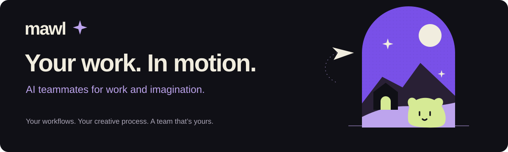

<p align="center">
  
</p>

# Mawl

**AI teammates for work and imagination.**

Automate the routine. Make room for the creative. Mawl is an open-source, self-hosted home for a small team of AI agents, with your models, your keys, and your work on your machine.


[Get started](#get-started) · [What's working](#whats-working) · [Development](#development) · [Documentation](#documentation)

## A little team. A shared direction.

In Mawl, an agent is a **teammate**: a role you shape, with its own persona and choice of model. The desktop app hosts the server and database locally; a headless Docker setup is available too.

The wider vision is a team that can carry work forward together. A researcher gathers the useful details. A writer turns them into a brief. A designer brings the direction to a canvas. You steer the work, review the result, and decide what happens next.

| Direction | What it makes room for |
|---|---|
| **Workflows that keep moving** | Repeatable routines, scheduled work, and focused handoffs between teammates. |
| **A creative process you can see** | Canvases for mockups, sites, and graphics, with dedicated animation and video workflows planned later. |
| **Memory with a purpose** | Decisions, preferences, useful history, and reusable skills you can inspect and edit. |
| **Context that earns its place** | Cache-aware prompt assembly, selective recall, compact handoff notes, and context budgets designed to avoid unnecessary token use. |
| **A computer when the work needs one** | Optional sandboxed terminal or desktop computers, with visible activity and takeover on the roadmap. |
| **You stay in the loop** | Planned policy gates, approvals, and an audit trail keep sensitive actions reviewable. |
| **A space that's yours** | Your model providers, local conversation storage, and optional sandboxed teammate computers. |

These are product directions, not a list of shipped features. Actual token usage depends on your model and workload. The current implementation and next steps are below.

## What's working

Mawl is in active development. The foundations include:

- A TypeScript monorepo with shared contracts, a design system, and test tooling.
- A server with provider connections, ChatGPT sign-in, a durable run engine, and cache-aware prompt assembly.
- A web interface for conversations, teammates, settings, and the workspace, plus screens for tools, schedules, and approvals whose functionality follows the roadmap.
- Windows desktop hosting foundations with Tauri and embedded Postgres.
- A Docker Compose setup for running the server, web interface, and database on one computer.

The full agent workflow, teammate-to-teammate communication, optional computers, long-term memory, schedules, and canvases are being built toward. Telegram, Discord, and mobile access are later work. See [the implementation plan](docs/PLAN.md) for the precise status; [the desktop-first decision record](docs/REDESIGN.md) explains the architecture's direction.

Provider foundations cover Anthropic, OpenAI, OpenRouter, Ollama, and compatible APIs. ChatGPT and Claude Code account-based paths and their limitations are documented in [Running Mawl](docs/RUNNING.md). Online models receive the context needed to answer; choosing a local model is a separate decision from storing conversations locally.

## Get started

The documented headless setup needs **Docker with Compose v2**. Run these commands from the repository root.

For a fresh setup, copy `infra/compose/.env.example` to `infra/compose/.env` and set a random `MAWL_DB_PASSWORD`. If you already have a database and an `.env`, keep its existing password. The [running guide](docs/RUNNING.md#first-start) includes password-generation commands for Bash and PowerShell.

```bash
docker compose -f infra/compose/docker-compose.yml up -d --build
```

Open [localhost:7420](http://localhost:7420). The first start builds the app, waits for Postgres, and applies migrations. The browser asks for the owner token generated by the server; follow [the owner-token instructions](docs/RUNNING.md#the-owner-token) to retrieve it and sign in.

Check the services and follow the logs:

```bash
docker compose -f infra/compose/docker-compose.yml ps
docker compose -f infra/compose/docker-compose.yml logs -f server
```

[Running Mawl](docs/RUNNING.md) covers provider sign-in, ports, configuration, persistent data, troubleshooting, and reset. The Windows desktop host is the main product direction; this Compose guide remains the documented way to explore the headless app from source.

## Find your way around

```text
apps/
  server/      HTTP + WebSocket server, run engine, providers
  web/         React interface
  desktop/     Tauri desktop host
  mobile/      Expo app foundations; mobile delivery is planned
packages/
  contracts/   zod schemas, events, and the oRPC contract
  core/        providers, prompt assembly, and shared agent logic
  db/          Drizzle schema and migrations
  memory/      memory-system package
  sandbox/     teammate-computer package
  ui/          design tokens and accent engine
  ...          client, mascot, channels, native UI, and test utilities
infra/         Docker Compose, desktop packaging, and computer infrastructure
design/        brand assets and visual references
site/           landing page (static, deployed to Cloudflare Pages) and local preview
docs/          product, architecture, design, and implementation guides
```

## Development

Use **Node 24** and **pnpm 10** through Corepack. Install dependencies from the root:

```bash
corepack pnpm i
```

Prefer checks scoped to the package or files you changed. For example:

```bash
corepack pnpm --filter @mawl/web typecheck
corepack pnpm exec biome check site
```

The workspace commands remain available when you need a broader check:

```bash
corepack pnpm lint
corepack pnpm typecheck
corepack pnpm test
```

For the current landing-page design, run `node site/preview.mjs` and open [localhost:4173](http://localhost:4173). It uses local fonts and assets and needs no build step.

[CLAUDE.md](CLAUDE.md) covers repository conventions, scoped testing, and the development workflow. [The plan](docs/PLAN.md) is the source of truth for implementation status.

## Documentation

| Guide | Start here when you want to… |
|---|---|
| [Product specification](docs/SPEC.md) | Understand who Mawl is for and what it aims to do. |
| [Running Mawl](docs/RUNNING.md) | Start the app, connect a provider, inspect logs, or manage data. |
| [Architecture](docs/ARCHITECTURE.md) | Follow the server, clients, event flow, and runtime boundaries. |
| [Desktop-first decisions](docs/REDESIGN.md) | Understand the desktop host and current technical direction. |
| [Memory and context](docs/MEMORY.md) | Explore recall, compaction, prompt caching, and context budgets. |
| [Canvases](docs/CANVAS.md) | Read the proposed design, graphics, site, and motion workspace. |
| [Design system](docs/DESIGN.md) | Work with the interface's tokens, character, and interaction principles. |
| [Implementation plan](docs/PLAN.md) | See what is built, in progress, and still ahead. |

## License

Mawl is licensed under [Apache 2.0](LICENSE). Third-party notices are in [NOTICE](NOTICE).

Good work, made together.
