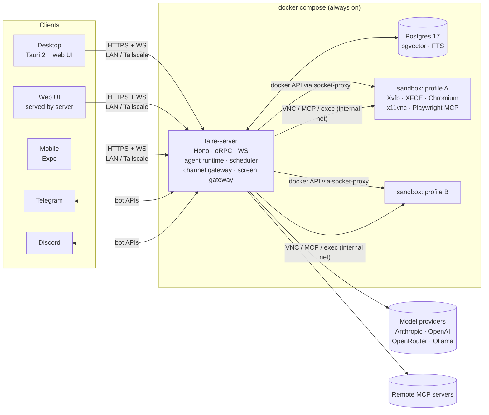
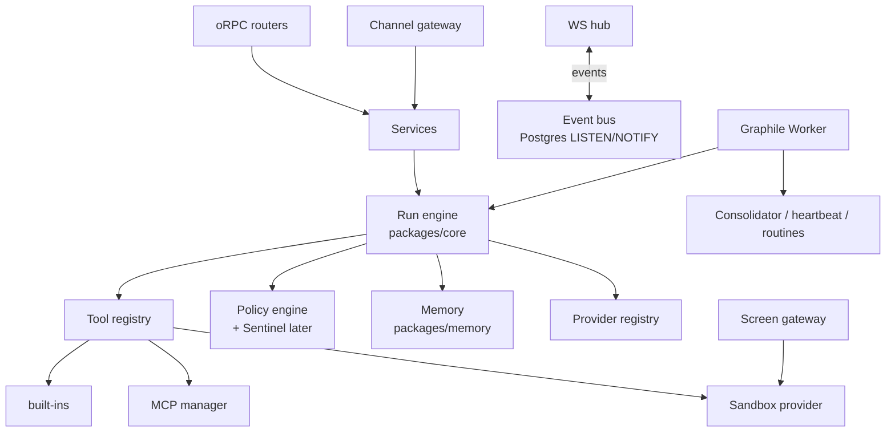
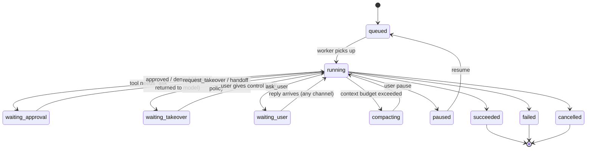

# Faire — Architecture

Read alongside [SPEC.md](SPEC.md), [MEMORY.md](MEMORY.md) and [PLAN.md](PLAN.md). Library versions are targets; pin exact versions when scaffolding and check that each is current.

## 1. System overview



**Principle: one brain, many faces.** All state and all agent execution live in `faire-server` plus Postgres. Every client is a thin view over the same typed API and event stream, so agents keep running when every client is closed.

## 2. Monorepo layout

pnpm workspaces + Turborepo. TypeScript (strict) everywhere except the sandbox image's shell scripts.

```
faire/
├─ apps/
│  ├─ server/        Hono HTTP + oRPC + WebSocket; boots runtime, worker, gateways
│  ├─ web/           React 19 + Vite + Tailwind v4 + Motion; the main UI
│  ├─ desktop/       Tauri 2 shell (Rust minimal): window, tray, notifications, deep links, "manage stack"
│  └─ mobile/        Expo (React Native, New Arch) + Reanimated + expo-router
├─ packages/
│  ├─ contracts/     zod schemas + oRPC router contract + event types (shared by all)
│  ├─ core/          agent runtime: run loop, tool registry, policy engine, providers, MCP manager
│  ├─ memory/        tiers, recall, compaction, consolidator (see MEMORY.md)
│  ├─ db/            Drizzle schema + migrations (Postgres + pgvector)
│  ├─ sandbox/       SandboxProvider interface + DockerProvider + screen gateway
│  ├─ channels/      ChannelAdapter interface + telegram (grammY) + discord (discord.js)
│  ├─ ui/            design tokens (CSS vars + TS), shared React components (web/desktop)
│  ├─ ui-native/     RN components using the same tokens (mobile)
│  ├─ mascot/        beaver assets: Rive file + SVG fallbacks + state hook
│  ├─ client/        typed API client + WS event store (TanStack Query), used by web & mobile
│  └─ testkit/       fake LLM provider (scripted), fixtures, test containers helpers
├─ infra/
│  ├─ compose/       docker-compose.yml, .env.example
│  ├─ sandbox/       Dockerfile + supervisord for the computer image
│  └─ install/       install.sh / install.ps1
├─ design/           mockup + assets
└─ docs/
```

## 3. Technology choices

| Concern | Choice | Why |
|---|---|---|
| Monorepo | pnpm + Turborepo | Fast and cached |
| Lint/format | Biome | One fast tool |
| Tests | Vitest (unit/integration), Testcontainers (Postgres), Playwright (web e2e + visual), Maestro (mobile e2e, later) | TDD everywhere |
| HTTP/API | Hono + oRPC (end-to-end types, OpenAPI out) + native WS | Small and fast; typed clients for web and mobile |
| Auth | Single owner + paired devices. Device tokens (Ed25519 keypair per device, JWT session) | No accounts to create; per-device revocation |
| DB | Postgres 17 + pgvector + built-in FTS (`tsvector`) via Drizzle | One service for relational, vector and BM25 |
| Jobs | Graphile Worker (Postgres-backed queue + cron) | No Redis; durable, transactional |
| Agent loop | Vercel AI SDK v6 (`ToolLoopAgent` / `streamText` with `stopWhen`) wrapped by our `Run` engine | Multi-provider, tool approval hooks, stable MCP client |
| Providers | `@ai-sdk/anthropic`, `@ai-sdk/openai`, `@openrouter/ai-sdk-provider`, `ollama-ai-provider-v2`, `@ai-sdk/openai-compatible` | Bring your own key or a local model |
| MCP | `@ai-sdk/mcp` `createMCPClient` (HTTP/SSE + stdio) | Stdio servers run *inside* the sandbox via exec |
| Sandbox | Docker containers via `dockerode`, through `tecnativa/docker-socket-proxy` | The server never mounts the raw socket |
| Desktop stream | x11vnc → websockify → **screen gateway** in server → `@novnc/novnc` RFB client | Simple and proven; upgrade path to neko/Selkies WebRTC |
| Browser automation | `@playwright/mcp` running headed on the sandbox `DISPLAY` | You see what the agent does |
| Channels | grammY (Telegram), discord.js (Discord) | Mature and typed |
| Desktop shell | Tauri 2 (+ plugins: notification, deep-link, single-instance, autostart, updater, shell) | Small and fast |
| Mobile | Expo SDK (latest), expo-router, Reanimated, expo-notifications, expo-camera (QR), react-native-webview (noVNC) | Proven mobile path |
| UI | React 19, Tailwind v4, Radix primitives (via shadcn-style local components), Motion, Lucide icons, Sonner (toasts), cmdk (command palette) | Use existing libraries; don't reinvent |
| Mascot animation | Rive (`@rive-app/react-canvas`, `rive-react-native`) with an SVG + Motion fallback | One state machine for both platforms |
| Data fetching | TanStack Query + a WS event bus that updates the cache | Live UI without polling |
| Crypto | libsodium-wrappers (secret encryption at rest) | Audited |
| Observability | pino logs + OpenTelemetry traces (optional exporter) | |

## 4. Server internals (`apps/server`)



- A single Node process runs everything for v1: API, WS, worker, gateways. Its entrypoint can start them as separate roles later (`--role=api|worker|gateway`) for scaling or crash isolation. In compose, `restart: unless-stopped` plus a healthcheck supervises it.
- **Event bus.** Every state change becomes an `Event` row and a `NOTIFY`, which the WS hub fans out to subscribed clients. Clients resume from `lastEventId`.

## 5. Agent run engine (`packages/core`)

### Run lifecycle



- **Durable steps.** Each model step and tool result is persisted before the next step starts. A crash resumes from the last persisted step. Runs execute as Graphile jobs, and **waiting states release the worker**: the job ends, and a new job continues the run when the condition resolves.
- **Context assembly per step:**
  `system(persona + rules + tool docs)` → `core blocks (frozen per segment)` → `segment summary/handoff` → `recalled memories (as data)` → `recent turns` → `current input`.
  The stable prefix comes first so prompt caching works (Anthropic `cache_control` breakpoints are set automatically).
- **Budget.** Each run has a token budget, a step cap (`stopWhen: stepCountIs(N)`), a wall-clock cap and a cost cap. These are configurable per profile and routine.
- **Provider adapters** expose capabilities (`supportsContextEditing`, `supportsCompaction`, `supportsCaching`, `contextWindow`). The memory layer uses native Anthropic context editing and compaction when they are available and falls back to its own ladder otherwise.

### Tools

| Group | Tools |
|---|---|
| Computer | `shell`, `read_file`, `write_file`, `list_files`, `computer_screenshot`, `computer_act` (batched xdotool actions), `open_url`, browser via Playwright MCP |
| Web | `web_search` (provider-native or SearXNG/Brave key), `web_fetch` (to markdown) |
| Memory | `memory_block_edit`, `remember`, `recall`, `session_search`, `skill_load`, `skill_propose` |
| Human | `ask_user`, `request_takeover`, `notify` |
| Agency | `schedule_create/list/cancel`, `message_teammate` (S1) |
| MCP | Any connected server's tools, namespaced `mcp__<server>__<tool>` |

Large tool outputs (over ~4k tokens) are stored as **artifacts**. The model gets a preview plus `artifact_id` and can page through the rest with `read_artifact`.

### Policy engine

```ts
type Level = 'auto' | 'ask' | 'handoff' | 'block'
interface PolicyRule { match: { tool?: string; mcpServer?: string; actionClass?: ActionClass; argPattern?: string }; level: Level }
type ActionClass = 'read' | 'write_local' | 'send_message' | 'purchase' | 'delete' | 'credential' | 'external_post' | 'shell_exec'
```

- Tools declare an action class. MCP tools default to `ask` until the user classifies them; read-only hints from MCP annotations lower this to `auto`.
- The user's rules come first, then profile defaults, then global defaults. `credential` and payments are always `handoff`, and the user cannot lower them.
- **Sentinel (S2).** An optional second model reviews `send_message`/`external_post`/`purchase` calls against the user's intent and can escalate them to `ask`.

## 6. Sandbox and screen gateway (`packages/sandbox`, `infra/sandbox`)

```ts
interface SandboxProvider {
  ensure(profileId: string, spec: SandboxSpec): Promise<SandboxHandle>   // create or start
  suspend(profileId: string): Promise<void>                               // stop when idle (home volume persists)
  exec(h: SandboxHandle, cmd: string[], opts?: ExecOpts): AsyncIterable<ExecChunk>
  vncEndpoint(h: SandboxHandle): Promise<{ host: string; port: number }>
  status(h: SandboxHandle): Promise<SandboxStatus>
}
```

- **Image `faire/computer`.** Ubuntu 24.04 with:
  - Xvfb `:1` (1280×800), XFCE (minimal), Chromium, xdotool, scrot
  - x11vnc + websockify, Node 22 with `@playwright/mcp` running headed on `:1`
  - a small `computer-agent` HTTP helper (screenshot/act/exec)
  - supervisord to run everything, and a non-root user `faire` with home on a named volume `faire-home-<profile>`
- **Network.** Sandboxes join an internal network `faire-sbx`. Only the server can reach their VNC and helper ports, and nothing is published to the host. Egress is allowed, with an optional per-profile allowlist later.
- **One sandbox per profile.** It starts on demand, auto-suspends after N idle minutes (default 20), and its home is checkpointed through the volume.
- **Screen gateway.** `GET /screen/:profileId?ticket=` upgrades to WS and proxies the VNC bytes.
  - Tickets are short-lived (60 s, single use), issued over oRPC to an authenticated device, and arrive in the WS subprotocol header, never in a logged URL.
  - A ticket carries a capability: `view` or `control`. Only the holder of the **control lease** gets input forwarded. Everyone else is view-only, with input dropped server-side.
- **Takeover protocol.**
  - `takeover.request` → if a run is active and not in `waiting_takeover`, the user gets a "pause the agent?" prompt, and confirming pauses the run.
  - The lease is granted with an expiry, renewed by heartbeats.
  - `takeover.release` → the run resumes, and the agent gets a note: "User had control for 2m14s; re-observe the screen."
- **Credential form.** The user types into a Faire form. The server sends the text to the sandbox with `xdotool type`, without adding it to the transcript or the model context, and logs `credential_entered (redacted)` in the audit log.

## 7. Channels (`packages/channels`)

```ts
interface ChannelAdapter {
  kind: 'telegram' | 'discord'
  start(ctx: ChannelContext): Promise<void>; stop(): Promise<void>
  send(to: ChannelPeer, msg: OutboundMessage): Promise<void>        // text, markdown, buttons, images
}
// Inbound is normalised to { profileId, channel, peer, text, attachments, replyTo, actionId? }
```

- **Ownership and isolation.** Each profile has its own bot tokens, with a DB lock so one token belongs to one profile. Only allowlisted user IDs can talk to a bot; the owner is claimed with a pairing code during setup.
- **Sessions.** Each channel+peer gets a conversation thread. Memory is shared across a profile's threads.
- **Interactive elements.** Approvals render as inline buttons (Approve / Deny / Open in app), and takeover requests include a deep link to the app.
- **Commands.** `/status`, `/runs`, `/pause`, `/resume`, `/routines`, `/new`, `/memory <query>`.

## 8. Clients

- **Web UI (`apps/web`).** The UI itself; desktop and mobile get layouts suited to them.
  - Routes: `/onboarding`, `/t/:profile` (chat), `/t/:profile/computer`, `/activity`, `/approvals`, `/memory`, `/routines`, `/connections`, `/settings`.
  - Command palette (⌘K).
  - Layout: three panes. A teammate list, the conversation, and a context panel (computer / memory / run details) that you can collapse.
- **Desktop (`apps/desktop`).** Tauri loads the web build bundled with it and points it at the configured server URL (default `http://localhost:7420`).
  - Native features: tray icon with the mascot state, native notifications, a global shortcut to a quick-ask popover, autostart, and deep links `faire://`.
  - A "Start my stack" helper runs `docker compose up -d` when Docker exists locally.
- **Mobile (`apps/mobile`).**
  - Tabs: Teammates · Activity · Approvals · Settings.
  - Chat screen, and a Computer screen (noVNC in a WebView with touch→mouse mapping and a keyboard bar).
  - Push notifications go through Expo Push, which is the only external call and can be turned off. Without it, foreground WS events still work.

### Pairing (v1: LAN/Tailscale)
1. Desktop or web Settings → "Pair phone" shows a QR code containing `{ serverUrls: [lan, tailscale?], pairingCode (one-time, 5 min), serverPubKey }`.
2. The phone scans it, generates an Ed25519 device key and calls `devices.pair(code, devicePubKey, name)` on the first URL it can reach.
3. The server stores the device and returns a session. Each later request is a signed challenge followed by a short-lived JWT.
4. Settings lists the devices, and you can revoke any of them. Docs recommend Tailscale for access from outside the home network. An E2E relay (S6) can later replace the transport without changing the auth.

## 9. Data model (core tables, Drizzle)

```
profiles(id, name, slug, color, persona_md, model_main, model_helper, policy_json, heartbeat_cron, created_at, archived_at)
provider_credentials(id, provider, label, secret_enc, base_url, created_at)
threads(id, profile_id, channel, peer, title, created_at, last_event_at)
messages(id, thread_id, run_id, role, parts_json, token_count, created_at)
runs(id, profile_id, thread_id, trigger{user|routine|heartbeat|teammate}, status, budget_json, usage_json, segment_no, started_at, ended_at, error)
run_steps(id, run_id, idx, kind{model|tool}, input_json, output_ref, usage_json, created_at)
artifacts(id, profile_id, run_id, mime, bytes|path, preview, token_count)
approvals(id, run_id, tool, args_redacted_json, action_class, status, decided_by_device, decided_via_channel, created_at, decided_at)
routines(id, profile_id, name, schedule{cron|rrule|nl_source}, prompt, delivery_channel, enabled, last_run_id)
mcp_servers(id, profile_id|null, name, transport, config_enc, enabled, tool_policy_json)
channels(id, profile_id, kind, token_enc, allowlist_json, status)
devices(id, name, pubkey, platform, last_seen_at, revoked_at)
events(id bigserial, profile_id, type, payload_json, created_at)    -- feed + WS resume + audit
-- memory tables: see MEMORY.md
```

## 10. Event protocol (WS)

`client → server`: `{ type: 'subscribe', topics: ['profile:*'|'run:<id>'|...], since?: eventId }`
`server → client`: `{ id, type, profileId, runId?, payload, ts }`

Event types:
- `run.status`
- `run.delta` (text tokens)
- `run.tool_call` / `run.tool_result`
- `run.step`
- `approval.created` / `approval.resolved`
- `takeover.requested` / `takeover.lease`
- `memory.updated`
- `routine.fired`
- `sandbox.status`
- `notify`

All event types are defined as zod schemas in `packages/contracts`.

## 11. Security model

- **Trust boundaries:**
  - client ↔ server: device auth
  - server ↔ sandbox: internal network; the sandbox is treated as untrusted
  - server ↔ providers/MCP: TLS
- The sandbox can never reach Postgres or the Docker proxy. These networks are kept separate.
- Secrets are encrypted at rest with a key from the `faire-secrets` volume, generated on first boot. Secrets are never logged and never sent to the model.
- Tool output and web content are treated as **data**. They are wrapped in `<untrusted>` tags in context, scanned for injection before a memory write, and their instructions are never followed blindly (mirrored in the system prompt).
- Rate limits and caps per run; global kill switch "Pause all teammates".
- Supply chain: pinned image digests, lockfile, Renovate.

## 12. Deployment

`infra/compose/docker-compose.yml` (sketch):

```yaml
services:
  server:
    image: ghcr.io/<owner>/faire-server:latest
    ports: ["7420:7420"]
    environment: [DATABASE_URL=postgres://faire@db/faire, DOCKER_HOST=tcp://dockerproxy:2375]
    volumes: [faire-secrets:/secrets, faire-artifacts:/data/artifacts]
    networks: [core, sbx]
    depends_on: { db: { condition: service_healthy } }
    restart: unless-stopped
  db:
    image: pgvector/pgvector:pg17
    volumes: [faire-db:/var/lib/postgresql/data]
    networks: [core]
  dockerproxy:
    image: tecnativa/docker-socket-proxy
    environment: [CONTAINERS=1, POST=1, EXEC=1, IMAGES=1, NETWORKS=1, VOLUMES=1]
    volumes: [/var/run/docker.sock:/var/run/docker.sock:ro]
    networks: [core]
  computer-image:          # build/pull only; containers are created per profile by the server
    image: ghcr.io/<owner>/faire-computer:latest
    profiles: [build]
networks: { core: {}, sbx: { internal: false } }
volumes: { faire-db: {}, faire-secrets: {}, faire-artifacts: {} }
```

`install.sh` / `install.ps1`:
1. Check Docker.
2. Download the compose file.
3. Run `docker compose pull && up -d`.
4. Open `http://localhost:7420`.

The desktop app can run the same flow from its "Start my stack" button.

## 13. Key decisions (ADR summary)

| # | Decision | Alternatives considered |
|---|---|---|
| 1 | Server-side brain in Docker; clients are thin | Embedded runtime in the desktop app (agents would stop when it quits) |
| 2 | Tauri 2 desktop + Expo mobile, sharing `contracts`/`client`/tokens | Electron (heavier); Tauri mobile (less mature) |
| 3 | Postgres + pgvector + FTS, with Graphile Worker | SQLite + sqlite-vec (simpler but weaker under concurrency); Redis queues |
| 4 | Vercel AI SDK v6 core loop, our own Run engine | Claude Agent SDK (Anthropic-only); Mastra (heavier, opinionated memory) |
| 5 | noVNC through an authenticated gateway first | neko/Selkies WebRTC (later), Guacamole (heavy) |
| 6 | One sandbox per profile | One shared computer (anti-pattern) |
| 7 | Our own memory layer inspired by Letta/mem0/Graphiti | Embedding mem0/Letta as a service (an extra stack, less control) |
