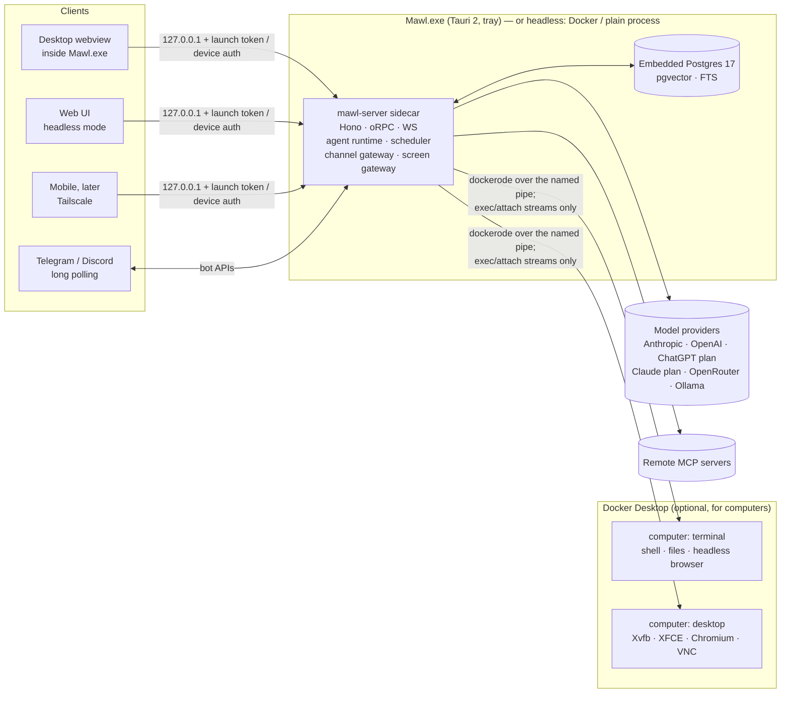
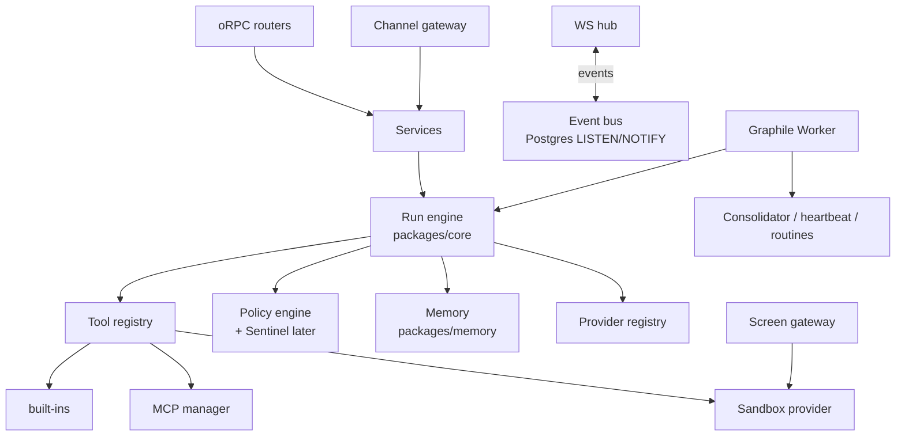
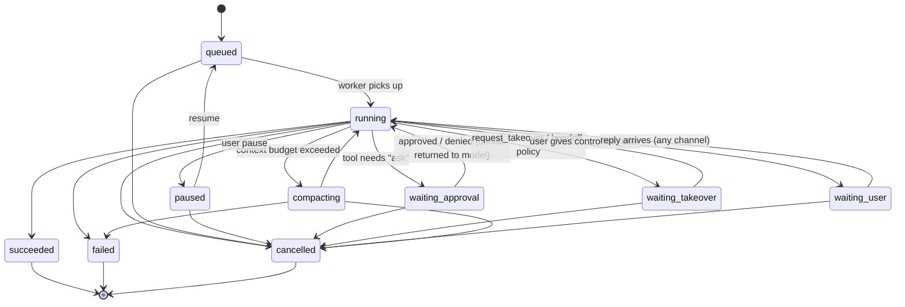

# Mawl — Architecture

Read alongside [SPEC.md](SPEC.md), [MEMORY.md](MEMORY.md), [PLAN.md](PLAN.md) and [REDESIGN.md](REDESIGN.md) (the desktop-first decision record, ADR R1–R14). Library versions are targets; pin exact versions when scaffolding and check that each is current. Sections marked *(planned)* describe the redesign target; *(as built)* describes code that exists.

## 1. System overview



**Principle: one brain, many faces.** All state and all agent execution live in `mawl-server` plus Postgres. Every client is a thin view over the same typed API and event stream. On the desktop, the brain runs inside the tray app, so closing the window never stops a teammate; only "Quit Mawl" does. Docker is needed only for computers.

## 2. Monorepo layout

pnpm workspaces + Turborepo. TypeScript (strict) everywhere except the sandbox image's shell scripts.

```
mawl/
├─ apps/
│  ├─ server/        Hono HTTP + oRPC + WebSocket; boots runtime, worker, gateways
│  ├─ web/           React 19 + Vite + Tailwind v4 + Motion; the main UI
│  ├─ desktop/       Tauri 2 host (Rust): sidecar supervisor (server + embedded Postgres), tray, autostart, notifications, deep links
│  └─ mobile/        Expo (React Native, New Arch) + Reanimated + expo-router
├─ packages/
│  ├─ contracts/     zod schemas + oRPC router contract + event types (shared by all)
│  ├─ core/          agent runtime: run loop, tool registry, policy engine, providers, MCP manager
│  ├─ memory/        tiers, recall, compaction, consolidator (see MEMORY.md)
│  ├─ db/            Drizzle schema + migrations (Postgres + pgvector)
│  ├─ canvas/        *(planned, DC2)* canvas build pipeline: validation, packs, single-file HTML, review script (see CANVAS.md)
│  ├─ sandbox/       Computer manager: ComputerProvider interface + DockerProvider (exec transport) + screen gateway
│  ├─ channels/      ChannelAdapter interface + telegram (grammY) + discord (discord.js)
│  ├─ ui/            design tokens (CSS vars + TS), shared React components (web/desktop)
│  ├─ ui-native/     RN components using the same tokens (mobile)
│  ├─ mascot/        Mawl assets shared with mobile (a stub today; the web Mawl lives in apps/web/src/mascot)
│  ├─ client/        typed API client + WS event store (TanStack Query), used by web & mobile
│  └─ testkit/       fake LLM provider (scripted), fixtures, test containers helpers
├─ infra/
│  ├─ compose/       docker-compose.yml, .env.example (headless mode)
│  ├─ docker/        server.Dockerfile (headless image)
│  ├─ desktop/       embedded Postgres bundle recipe, pgvector build (pgvector/)
│  └─ computer/      Dockerfiles for mawl-computer-terminal and mawl-computer-desktop
├─ design/           mockup + assets
└─ docs/
```

## 3. Technology choices

| Concern | Choice | Why |
|---|---|---|
| Monorepo | pnpm + Turborepo | Fast and cached |
| Lint/format | Biome | One fast tool |
| Tests | Vitest (unit/integration), Testcontainers (Postgres), Playwright (web e2e + visual), Maestro (mobile e2e, later) | TDD everywhere |
| HTTP/API | Hono + oRPC (end-to-end types, OpenAPI out) + native WS | Small and fast; typed clients for web and mobile |
| Auth | Single owner + paired devices. Device tokens (Ed25519 keypair per device, JWT session) | No accounts to create; per-device revocation |
| DB | Postgres 17 + pgvector + built-in FTS (`tsvector`) via Drizzle. Desktop: embedded EDB 17.10 binaries run as a child of the server (REDESIGN §10.1); headless: the `pgvector/pgvector` image | One engine for relational, vector and BM25, the same in both modes |
| Jobs | Graphile Worker (Postgres-backed queue + cron) | No Redis; durable, transactional |
| Agent loop | Vercel AI SDK v7 (`ai@7`, spec LanguageModelV4; `ToolLoopAgent` / `streamText` with `stopWhen`, `tool({ needsApproval })`) wrapped by our `Run` engine; MCP via `@ai-sdk/mcp@2` | Multi-provider, tool approval hooks, stable MCP client. Tests use `@mawl/testkit` `fakeModel` (wraps `MockLanguageModelV4`) |
| Providers | `@ai-sdk/anthropic`, `@ai-sdk/openai`, `@openrouter/ai-sdk-provider`, `ollama-ai-provider-v2`, `@ai-sdk/openai-compatible` | Bring your own key, a local model, a ChatGPT plan (Sign in with ChatGPT), or a Claude plan through the unmodified Claude Code binary (own adapter over `@anthropic-ai/claude-agent-sdk`, see Provider registry) |
| MCP | `@ai-sdk/mcp` `createMCPClient` (HTTP/SSE + stdio) | Stdio servers run *inside* the computer over `docker exec -i` |
| Computers | Docker containers via `dockerode`: the Windows named pipe on desktop; `tecnativa/docker-socket-proxy` in headless mode | All traffic over exec/attach streams, no published ports (R6) |
| Desktop stream | x11vnc in the container → exec-stream tunnel → **screen gateway** in server → `@novnc/novnc` RFB client | Simple and proven; upgrade path to neko/Selkies WebRTC |
| Browser automation | `@playwright/mcp` inside the computer: headless on the terminal kind, headed on the desktop kind's `DISPLAY` | You see what the agent does; its reported locator code feeds the trace compiler |
| Channels | grammY (Telegram), discord.js (Discord) | Mature and typed |
| Desktop host | Tauri 2.12 (+ plugins: notification, deep-link, single-instance, autostart, updater), NSIS per-user installer; `node.exe` sidecar spawned by a Rust supervisor (REDESIGN §10.2) | Small and fast; one installer of about 46 MiB, no admin |
| Mobile | Expo SDK (latest), expo-router, Reanimated, expo-notifications, expo-camera (QR), react-native-webview (noVNC) | Proven mobile path |
| UI | React 19, Tailwind v4, Radix primitives (via shadcn-style local components), Motion, Lucide icons, Sonner (toasts), cmdk (command palette) | Use existing libraries; don't reinvent |
| Mascot animation | Mawl is an inline SVG with CSS keyframes, and CSS transitions between states (UI-REDESIGN.md §4). Rive is dropped for now | Ships today, freezes cleanly under reduced motion, no runtime to load |
| Data fetching | TanStack Query + a WS event bus that updates the cache | Live UI without polling |
| Crypto | libsodium-wrappers (secret encryption at rest) | Audited |
| Observability | pino logs + OpenTelemetry traces (optional exporter) | |

## 4. Server internals (`apps/server`)



- A single Node process runs everything for v1: API, WS, worker, gateways. Its entrypoint can start them as separate roles later (`--role=api|worker|gateway`) for scaling or crash isolation. In compose, `restart: unless-stopped` plus a healthcheck supervises it.
- **Desktop mode** *(D1; REDESIGN §4; server side built in D1.3, the Tauri host is D1.5)*. The Tauri supervisor spawns the server with `MAWL_MODE=desktop`, a free loopback port in `MAWL_PORT` and a per-launch token as stdin's first line, never argv or env. The server owns the embedded Postgres: `initdb` on first run (`--no-sync` into a staging dir, then renamed), spawn `postgres` on a free 127.0.0.1 port with a generated password stored under the data root, and `pg_ctl stop -m fast -w` on shutdown (a kill only as the fallback). Built in D1.1 as `apps/server/src/embedded-pg` (`startEmbeddedPostgres({ pgRoot, dataRoot })`, data root layout `cluster\` + `password`, typed `EmbeddedPgError` boot codes); D1.3 wires it into boot: with no `DATABASE_URL` it starts from `MAWL_PG_ROOT` into `<MAWL_DATA_DIR>\pg-data` right after the secrets load, and is stopped last on shutdown and on any boot failure after it started. pgvector's `vector.dll`, control and SQL must sit in that `pg\` (installer, D1.7), since migration 0000 creates the extension. Never spawn it `detached`: libuv's job object then takes Postgres down with a killed server, and WAL recovers. Launch token (as built, `launch-token.ts`): base64url, 32-512 characters, on a line that must end with a newline (a token followed by EOF without one counts as `missing`), the newline within 1 KiB and within 15 s, or boot fails closed with `LaunchTokenError` (`missing`, `invalid`, `timeout`) and exit 1; messages never echo what was read. It is kept in memory only (`config.launchToken`, enforced on `/rpc` and `/ws` since D1.4, see §11) and registered with the redactor, which censors the value in every log line, messages and keys included. The stdin protocol is two lines: the token, then the master key (D1.6, as built in `secrets/host-key.ts`): 32 bytes as base64url without padding, exactly 43 characters in canonical form, then a newline, within 15 s of the token line, or boot fails closed with `HostKeyError` (`missing`, `invalid`, `timeout`; messages never echo what was read). `readLaunchToken()` keeps only that line (at most 1 KiB, in a fixed buffer) and hands it over once through `takeRemainder()`, which zero-fills its copy and stops buffering; every stdin chunk is zero-filled once copied. The key's base64url form is registered with the redactor before boot, and the bytes reach `startServer` only as `BootOverrides.hostMasterKey` (a class with a private field, a one-shot `take()` and redacting `toJSON`/`inspect`), never in the config. Parent watchdog: stdin end, close or error after the token runs the same graceful stop as SIGTERM (embedded Postgres included) and exits 0. Shutdown steps all run even when one fails, with Postgres last. The hard exit-1 paths that skip the graceful stop (a fatal error, the 10 s deadline, a second SIGINT/SIGTERM during a shutdown) first run an emergency stop of the embedded Postgres for at most 3 s. Stdin EOF counts as the first signal but never escalates: EOF during a shutdown that a signal started only logs, so a host that signals and then closes stdin still gets the graceful exit 0. Headless mode never opens stdin. Data lives in `%LOCALAPPDATA%\app.mawl.desktop\{pg-data,secrets,claude,logs,artifacts}` (Tauri's `app_local_data_dir`), separate from the install dir with its `pg\` binaries. The supervisor spawns the server with `env_clear()` plus an allowlist, `CREATE_NO_WINDOW` and a kill-on-close job object (REDESIGN §10.2).
- **Desktop host** *(as built in D1.5a through D1.5b2b; `apps/desktop/src-tauri`)*. The logic lives in the Tauri-free crate `host/` (`mawl-host`), so it all runs under `cargo test`; a unit-test binary that links Tauri dies on Windows without the app's Common Controls v6 manifest. `src/shell.rs` only wires it to Tauri.
  - *Supervisor.* A pure state machine (`machine.rs`: events in, effects out, a generation number per process so late events of a replaced server are ignored) driven by one thread (`driver.rs`). Restarts back off 1, 2, 4, 8, 16 s; the sixth failure inside 5 min is final (the failed screen). Missing install files fail at once, without restarts. Boot must reach `/healthz` 200 with the identity proof within 120 s or the tree is killed and restarted. Every probe sends a fresh nonce and the origin it uses (`http://127.0.0.1:<port>`) and checks `id`, the identity proof v2 (`health.rs`; see the HTTP surface bullet under the server); a 200 without the right proof is `Foreign` (another program holds the port), is never ready and counts as a bad answer, so the token is never handed to a page from that port. Once ready, `/healthz` is polled every 5 s; three bad answers in a row (a 503 because Postgres died, refused, a 3 s timeout, or no proof) close stdin and restart the server. The boot stage shown on the splash comes from the server's own log lines (`embedded postgres ready`, `migrations applied`).
  - *Process.* `std::process::Command` with no shell, `env_clear()` plus an allowlist (system variables and `PATH`; never `NODE_OPTIONS` or provider keys; a development build also passes `DATABASE_URL`, `MAWL_PG_ROOT`, `LOG_LEVEL`), `CREATE_NO_WINDOW`, cwd = the data dir. Each server gets its own job object with `KILL_ON_JOB_CLOSE`, created before the spawn; the child joins it before it gets the token, and the server reads the token and the key before it starts Postgres, so the whole tree is in the job. The job is terminated when the server exits (an orphaned Postgres goes with it) and closes with the host. Stdin stays open for the server's life. Stdout and stderr go into a 400-line ring (lines cut at 2 KiB, the token and the master key redacted before cutting) for "Copy diagnostics". Output is read in pieces of at most 64 KiB; a cut piece hands its last 128 bytes to the next one, so neither the token nor the key is ever split across pieces (redaction only matches a whole secret). The child joins its job right after the spawn (std cannot start it suspended); that is safe because the server does nothing but wait on stdin until the token line arrives.
  - *Launch.* Installed: `mawl-server.exe` (Node, an `externalBin`) beside `Mawl.exe`, `server\server.mjs` (+ `drizzle\`, `web\`) and `pg\` in the resource dir (D1.7 bundles them). Debug builds without that layout use `node` from `PATH` on `apps/server/dist/server.mjs`. The token is 32 bytes from the OS CSPRNG, base64url (43 characters), one per host launch and kept across server restarts.
  - *Master key (D1.6; `master_key.rs`).* Before every spawn the supervisor resolves the master key and writes it as stdin's second line, in one write with the token from a buffer that is wiped afterwards. It lives in Windows Credential Manager as a generic credential of the signed-in user (target `Mawl/master-key`, `CRED_PERSIST_LOCAL_MACHINE`: it stays on this PC like `%LOCALAPPDATA%`; Windows protects the blob with DPAPI). Order: a stored entry is used (it must be 32 bytes, else the spawn fails and the entry is never replaced); an empty store imports `<data>\secrets\master.key` (a server from before D1.6 created it; it must be 32 bytes and the host never edits or deletes it); otherwise 32 bytes come from the OS CSPRNG. An imported or new key is written, read back and compared, and only an equal read-back is sent, so a key on stdin is always one the store returned. Any failure (Credential Manager, sizes, read-back) is a spawn failure with a diagnostics note and the usual backoff, so it is retried. The ring redacts the key like the token (`LogRing::redact_key`, called before the key is written). The store is a trait (`KeyStore`): the tests use `MemoryStore` and never touch the real Credential Manager, which is checked by hand on a Windows desktop only.
  - *Port and origin.* The app runs at `http://127.0.0.1:<port>/`, served by the server (`MAWL_WEB_DIR`), so `/rpc` and `/ws` are same-origin and need no CORS. The port is remembered in `<data>\desktop-port` (first choice 47420) because localStorage is per origin; it moves only when taken. Development uses Vite at `localhost:5173`, which proxies to a server fixed on 7420.
  - *Window.* The main window is built by the host (`create: false`), hidden until the splash paints, on `splash.html` from the web build over Tauri's asset protocol. An initialization script (main frame only, before page scripts) defines a read-only `window.__MAWL_LAUNCH_TOKEN__` when the page's scheme and host are the app's (any port for this PC's server, whose port may move within a run; the whole origin, port included, for a remote Mawl); the navigation handler keeps the main frame on the splash's exact page (`/splash.html`, a query is fine; the rest of the web build shares Tauri's origin and its IPC, so `index.html` is refused) or, only while the supervisor is `Ready`, the app's exact origin (during a restart another local process could hold the freed port and would otherwise get the token on a reload), frames get no initialization script (and the server's CSP forbids them), and `on_new_window` refuses every pop-up (`window.open`, `target=_blank`); an external web link is sent to the browser instead (see *External links*). The app page has no Tauri IPC: `build.rs` declares an app manifest, so Tauri checks the ACL on every app command, `capabilities/host.json` allows them with no `remote` entry, and Tauri treats `http://127.0.0.1:<port>` as a remote origin (Tauri 2.12 `Webview::on_message`). The splash, on Tauri's own origin, can call them. In development the app runs on Vite's origin, which Tauri counts as local, so there it can. On ready the splash fades out and asks the host to navigate (a 3 s fallback does it anyway); a restart, a crash or a quit navigates back to the splash, and the next ready loads the app again. No app page is kept through an outage: it would reconnect to the old origin with the token before anything proved who answers there (an app-wide reconnecting banner with a client-side proof check is a later slice, see PLAN). A refused navigation to the app's own origin (while the server is not ready) is dropped, never handed to the browser. Whether the server is ready and whether the window is in the app are decided together (`presence.rs`: one lock, the navigation runs under it), so an enter that arrives after a crash finds the server not ready and does nothing.
  - *Quit.* "Quit Mawl" and every exit request close the server's stdin and wait up to 30 s before the job kills the tree; the app exits once the server is gone (a 45 s backstop exits regardless, and the job handles close with the process). A second launch focuses the window, also when it is hidden in the tray or still on the splash.
  - *Tray and login (D1.5b1).* The tray icon, tooltip and a disabled first menu line follow the supervisor's status (`tray.rs` in `mawl-host`: an exhaustive match, so a new status needs a decision). Until the mascot art exists (DESIGN.md section 8) `Ready` shows the app icon and the other states put a small status dot on it; the variant names are stable so art can replace the dots. The menu also holds "Open Mawl", "Start Mawl at login" and "Quit Mawl"; a left click opens the window. Autostart uses `tauri-plugin-autostart` with the argument `--autostart`: it is switched on at the first run only (the marker `autostart_initialised` in the data dir; a marker that cannot be written means no), afterwards the OS state and the owner's choice rule, and a development build never registers it. A launch with `--autostart` keeps the window hidden (the server still starts; the tray, a second launch without the flag or a deep link open it). The first close to the tray shows one notification, "Mawl is still running" (marker `close-hint-shown`; a failed write never blocks the close). Native notifications, only while the window is not visible (hidden or minimized): one when the server fails for good, and "Mawl is back" when it is ready again after an outage over 30 s (`notice.rs`; a restart that is quick or happens with the window open says nothing).
  - *External links (D1.5b2a).* When the app page navigates, or opens a new window, to a URL the navigation rule refuses, the host cancels it and may open it in the default browser (`tauri-plugin-opener`, `external_link.rs` in `mawl-host`). Only `http` and `https` URLs with a host, no `user:pass@`, at most 2048 bytes. Everything else is dropped: `file:`, `javascript:`, `data:`, `blob:`, `mailto:`, `tauri:`, `mawl:` and any custom scheme, because the OS runs whatever handles a scheme. A link to this machine is dropped on every port (`localhost`, `*.localhost`, `127.0.0.0/8`, `::1`, `0.0.0.0`, in any notation the URL parser normalizes, including `[::127.0.0.1]`). Private and link-local addresses (`192.168.x.x`, `10.x.x.x`, `fe80::`) stay allowed on purpose, because owners share LAN links such as an Ollama box. `http://127.0.0.1:<other port>` may be another local service (a database admin page, a dev server) that the page was tricked into poking, and the app's own origin must stay in the webview because the launch token only exists there. At most one open per 500 ms, so a page cannot spam browser windows. Known limit: the host cannot tell a click from a script and there is no user-gesture requirement, so the scheme rules and the limiter are the only guard against a page opening links by itself. The URL is opened as the link gave it; the launch token is never added to it.
  - *Deep links (D1.5b2a).* The host navigates the main window itself to the allowlisted path of a `mawl://` link (`deep_link.rs`: `parse_deep_link`, then `link_target` joins it to the app origin). When the server is ready the window goes there at once (under the presence lock, so it cannot race a crash); otherwise the path waits in `PendingLink` (last link wins) and the first entry into the app uses it. A launch link, an OS link and a second launch's argument (single-instance forwards it to `on_open_url`) take the same route, and the window is raised for all but the launch link (the splash shows it). Every path the allowlist yields is a route of the web app and the server serves the SPA shell for it (`/activity` and `/connections` redirect to a tab of `/approvals` and `/tools`). The navigation reloads the page: there is no IPC to route inside it.
  - *Remote Mawl (D1.5b2b; `remote.rs` in `mawl-host`).* "Connect to a remote Mawl" (the tray, or the failed screen) opens the splash's form: an address and the remote's owner token. The address must be an origin (`scheme://host[:port]`, no `user:pass@`, path, query or fragment; a bare host means `https`), and `https` unless the host is this machine (`127.0.0.0/8`, `::1`, `localhost`, `*.localhost`): plain http to another machine is refused (`insecure`), so the token never crosses a network unencrypted. TLS is the OS's (native-tls on SChannel with the platform verifier). The token must match the server's pattern (32-512 of `A-Z a-z 0-9 - _`). The host then probes `<origin>/healthz` with a fresh nonce and that origin (proof v2, no redirects, 4 KiB body, 5 s) and saves nothing unless the answer is a 200 with the right proof; a 503 counts as "lost its database" only with the proof too, and a proof for another token or another origin is `token_refused`. Only then is the token written to Windows Credential Manager (target `Mawl/remote-token`, read back and compared) and the origin, never the token, to `<data>\window-target.json` (written to a temporary file, then renamed). The check, both writes and a switch back to this PC run under one lock, so parallel calls cannot leave one address with another token. Mawl then starts again on the remote: no local server runs, the splash checks the remote once more and enters on a proven answer, and the token script and the navigation rule are pinned to that origin. While the window shows the remote app the host checks it again every 15 s (`Recheck`): an answer that is not the proven Mawl leaves to the splash at once, silence after two misses in a row, and a proven Mawl without its database stays. A missing, unreadable or invalid target file, or a missing token, means this PC's server. "Use this PC's Mawl" saves the local target and deletes the token. Known limits: the proof shows that a server holding the token answers for that origin at the moment of a check (at the connect, at each start and on each re-check), not for every request the page makes in between, where the app relies on TLS (or loopback); a DNS or address change between two checks is caught by the next one. The proof effectively binds the scheme and host, not the port: the MAC covers the whole origin the client names, but the server proves any origin whose host its HostPolicy allows, on any port and with the scheme the client sent, so another service on the same allowed host could relay a proof for its own port (the client's https rule keeps the scheme honest for non-loopback hosts). The tray has its own copy for a remote ("Connected to your remote Mawl", "Can't reach your remote Mawl", "Your remote Mawl is up but its database is down", "Your remote Mawl refused the token"). The diagnostics show the origin and the last check, never the token.
  - *Splash appearance (D1.5b2b; `appearance.rs`).* The owner's theme and accent live in the app origin's localStorage, out of the splash's reach, and the app page has no IPC. So the host reads `mawl.appearance` from the app page (`eval_with_callback`) when the window leaves the app, hides to the tray or quits, keeps only a known theme, a `#RRGGBB` accent and a boolean in `<data>\appearance.json`, and the splash reads it through a host command. The page's answer is untrusted (a remote page could write anything there).
  - *Logoff, shutdown and sleep (D1.5b2a; `session.rs` in `mawl-host`, `src/session_end.rs`, Windows only).* tao answers `WM_ENDSESSION` by exiting the process at once, which would leave the server to the job object (a hard Postgres kill and WAL recovery at the next start). A window subclass on every top-level window of the UI thread sees the messages first. `WM_QUERYENDSESSION`: never veto, set a shutdown block reason ("Mawl is saving your work") and start the normal clean stop. `WM_ENDSESSION` (true): the first window to see it waits for the server process to be gone for at most 4.5 s (Windows gives a GUI app about 5 s), then clears the reason and passes the message on; later windows do not wait again. The wait watches a flag the supervisor sets (`HostUi::server_gone`) before any window, tray or event call, and once quitting the shell skips those calls: they dispatch to the UI thread and block until it answers, and that thread is the one waiting. A session end that is called off (`WM_ENDSESSION` false) still leaves Mawl stopping, so it quits: an accepted trade-off, since the clean stop began at the query and data safety wins over keeping the window. `WM_POWERBROADCAST` with `PBT_APMRESUMEAUTOMATIC` makes the supervisor probe `/healthz` now (`Event::ProbeNow`: only while booting or ready; the answer follows the normal rules, so a dead server is restarted after three bad answers) instead of waiting for the 5 s cadence. Suspend needs no action and nothing goes to the server. Not verified without a real logoff, shutdown and sleep on Windows: that the messages reach the subclass in this order, that the block reason shows, and that Postgres stops clean inside the window.
  - *Host to app channel (deferred).* The app page never gets Tauri IPC and nothing flows from the host through the server to `/ws`: the host sees what it needs itself (link, power and session events above). A server to host stream is built only when the server has something native to say, such as approval and finished-run notifications (PLAN D1.5b2c).
  - *CSP.* Tauri's (the splash): `script-src 'self'`, `connect-src ipc: http://ipc.localhost` only, `object-src 'none'`, no framing. The server's (the app, `webCsp()` in `web-static.ts`): `script-src 'self'`, `connect-src 'self'` plus `ws://` and `wss://` of the request's host, `object-src 'none'`, `base-uri 'self'`, `frame-src 'none'`, `frame-ancestors 'none'`; inline styles stay allowed (Radix, Motion), and images are same-origin, `data:` and `blob:` only.
- **Runtime and config.**
  - Dev runs `tsx watch src/main.ts`. Production is one esbuild bundle, `apps/server/dist/server.mjs` (`pnpm --filter @mawl/server build`), with `@mawl/*` sources and npm deps inlined (only `pg-native` is external; the Claude Agent SDK's JS is inlined and the pinned Claude binary manifest from `pnpm-lock.yaml` is embedded via `define`) and the SQL migrations copied to `dist/drizzle`. Native Node type stripping is not used because workspace packages use extensionless imports. Start with `pnpm --filter @mawl/server start`.
  - Boot order: parse env, open logger, in desktop mode read the launch token and the master key from stdin, load the master key (desktop: the host's, compared with an old `master.key`; headless: load or create the file) and the ChatGPT host id, start the embedded Postgres (desktop without `DATABASE_URL`), open Postgres, run migrations (advisory-locked), in desktop mode check that the key decrypts a stored secret and then delete an old `master.key`, run Graphile Worker's own migrations and start its worker, re-enqueue runs left `queued` or `running`, listen, log `listening`. SIGINT and SIGTERM stop the listener, abort running jobs (their runs stay `running` and resume on the next boot), stop the worker, close the database and exit 0. Any boot failure logs one `boot failed` line (error name, code, message; never the connection string) and exits 1.
  - Env is validated with zod at boot; errors list variable names only, never values.

    | Variable | Default | Meaning |
    |---|---|---|
    | `MAWL_MODE` | `headless` | `headless` (Docker or a plain process) or `desktop` (spawned by the Tauri host; the server then reads the launch token and the master key from stdin) |
    | `DATABASE_URL` | required in headless | `postgres://` or `postgresql://` URL. Optional in desktop mode: when set, it is used and no embedded Postgres starts |
    | `MAWL_DATA_DIR` | unset | desktop only, required, absolute: Tauri's `app_local_data_dir`, never the install dir. Holds `pg-data\` and, by default, `secrets\`. Ignored in headless mode |
    | `MAWL_PG_ROOT` | unset | desktop only, absolute, required when `DATABASE_URL` is unset: the install's `pg\` with `bin\initdb`, `postgres`, `pg_ctl`. Ignored in headless mode |
    | `MAWL_HOST` | `127.0.0.1` | bind address (compose sets `0.0.0.0`). Desktop mode accepts only `127.0.0.1`, `::1` or `localhost` |
    | `MAWL_PORT` | `7420` | HTTP port |
    | `MAWL_SECRETS_DIR` | `.mawl/secrets` (desktop: `<MAWL_DATA_DIR>/secrets`) | holds `master.key` (headless; desktop keeps the key in Credential Manager and deletes an old file after migrating it) and `siwc-host-id` (compose: `/secrets`) |
    | `MAWL_SIWC_PORT` | `1455` | loopback port of the Sign in with ChatGPT callback |
    | `MAWL_SIWC_BIND_HOST` | `127.0.0.1` | bind address of that callback listener |
    | `MAWL_CLAUDE_CONFIG_DIR` | unset | optional, must be an absolute path; passed to the Claude Code binary as `CLAUDE_CONFIG_DIR`, where the owner's own `claude auth login` keeps its login (compose: a named volume) |
    | `MAWL_CLAUDE_CODE_PATH` | unset | optional, must be an absolute path; path of a Claude Code binary to use instead of the one the SDK bundles |
    | `MAWL_WEB_DIR` | unset | optional, must be an absolute path; the built web app (`apps/web/dist`) to serve at `/`. Unset: a `web` directory beside the bundle (`dist/web`, which the image ships) when it holds `index.html`, otherwise none, and dev uses the Vite server |
    | `MAWL_OWNER_TOKEN` | unset | headless only (ignored in desktop mode): the owner token `/rpc` and `/ws` require, 32-512 base64url characters. Unset: generated on first boot into `<MAWL_SECRETS_DIR>/owner-token` and shown once on stderr (§11) |
    | `MAWL_ALLOWED_ORIGINS` | none | comma-separated extra origins that may open the WebSocket and pass the Host check (compose passes it through from `infra/compose/.env`) |
    | `LOG_LEVEL` | `info` | pino level |

  - HTTP surface: `GET /healthz` returns 200 `{ok:true}`, or 503 `{ok:false}` (no detail) if `select 1` fails or takes over 2 s; it is the compose healthcheck target. Identity proof v2 (`health-identity.ts`, mirrored in the host's `health.rs`; shared test vectors pin both): with a nonce `?n=` (base64url, 16-128 characters) and the origin the client used `?o=` (canonical `scheme://host[:port]`, as `new URL(o).origin` gives it), the body also carries `id` = HMAC-SHA256(auth token, `mawl/healthz-identity/v2:` + nonce + origin), base64url, on a 200 and a 503 alike. It is the desktop host's proof that it talks to its own server, or to the remote Mawl it means: it does not reveal the token, a fresh nonce per probe stops replays, and because the origin is in the MAC a look-alike origin that relays the probe to the real server only ever obtains a proof for the real origin, which the client refuses. The server proves only its own origins: a request with `n` whose `Host` fails the HostPolicy, or whose `o` names a host the HostPolicy does not allow (loopback names, the bind address, the hosts of `MAWL_ALLOWED_ORIGINS`; port and scheme are not compared, as in the Host check), gets 403 `{ok:false}` and no proof. The `Host` need not equal `o`, so a reverse proxy that rewrites `Host` to its loopback upstream keeps working, as long as the public origin is in `MAWL_ALLOWED_ORIGINS`. A missing or malformed `n` or `o` gets the plain answer (a v1 probe, without `o`, gets no proof). `/healthz` stays unauthenticated. oRPC (`RPCHandler`, fetch adapter) is mounted at `/rpc`, behind the Host check, the auth token and a 1 MiB body limit (§11); `/healthz` needs no token. Procedures not built yet answer 501 `NOT_IMPLEMENTED` (still stubs: approvals, devices, settings; theme and accent stay per browser). `events.subscribe` is served only on `/ws`; HTTP `/rpc` answers it with 501.
  - Profiles (as built): `profiles.list/get/create/update/archive` run through `profiles/service.ts`. `create` needs only `name` (trimmed, 1-80 chars) and `modelMain` (`<credentialId>:<modelId>`, checked by the contract). Persona is capped at 8000 characters and an explicit slug at 40. The slug is derived from the name (lowercase ascii, dashes, 40 chars, fallback `teammate`) and deduped `-2`, `-3`; an explicit slug that is taken answers typed `SLUG_TAKEN` (409), and a model naming a missing credential answers `UNKNOWN_CREDENTIAL` (422). The color defaults to the DESIGN.md accent presets in rotation by profile count, Lime (Mawl's own color) first; a stored color is never rewritten. `list` hides archived profiles unless `includeArchived`; `archive` is idempotent and keeps the slug reserved. An archived profile is not found for `update` and `runs.start`. No profile events on the bus yet.
  - The owner's profile (as built, U6): `user.get` returns `{ name, personalContext }` (empty strings until the first save; reading never writes) and `user.update` replaces both in one upsert on the single-row `user_profile` table. Input is a `z.strictObject`: the name is trimmed and at most 80 characters, the personal context at most 2000; both may be empty. Output is strict too, so nothing but those two fields leaves the server. Both texts are the owner's words: they seed the `user` core memory block in D4.1 and must enter any prompt as untrusted data, never as instructions. The web app caches the profile in `localStorage` (`mawl.profile`) for first paint only, and once moves a browser-only profile from before U6 up to an empty server (`mawl.profile.migrated` marks it done).
  - Web app: when a web directory exists (`MAWL_WEB_DIR`, else `dist/web`), `apps/server/src/web-static.ts` serves it after the API routes, so `/rpc`, `/ws` and `/healthz` are never shadowed. GET and HEAD only, behind the same Host check as `/rpc`. A file that exists is sent as it is; `/assets/*` (hashed by Vite) gets `Cache-Control: public, max-age=31536000, immutable` and everything else `no-cache`. A path with no file falls back to `index.html` only when the request accepts `text/html`, is not under `/assets/` and has no file extension (client-side routes such as `/t` or `/settings`); anything else is a 404. Paths with percent escapes, backslashes, empty segments or a segment starting with `.` are never mapped to a file (no traversal, no dotfiles). Every static response carries `X-Content-Type-Options: nosniff`, `Referrer-Policy: no-referrer`; the page's `Content-Security-Policy` is `webCsp()` (see the CSP bullet under "Desktop host" above).
  - Logging: pino JSON with redaction of secret-like fields and auth headers. Each request logs method, path without query, status, duration and a request id (also returned as `x-request-id`). The RPC error hook logs procedure path and error code only, never inputs or outputs.
- **Event bus.** Every state change becomes an `Event` row and a `NOTIFY`, which the WS hub fans out to subscribed clients. Clients resume from `lastEventId`.

## 5. Agent run engine (`packages/core`)

### Run lifecycle



A user can cancel a run from any non-terminal state (SPEC F6). Waiting states don't time out into `failed`. An expired approval is returned to the model as a denial, and the run continues.

- **Durable steps.** Each model step and tool result is persisted before the next step starts. A crash resumes from the last persisted step. Runs execute as Graphile jobs, and **waiting states release the worker**: the job ends, and a new job continues the run when the condition resolves.
- **Context assembly per step:**
  `system(persona + rules + tool docs)` → `core blocks (frozen per segment)` → `segment summary/handoff` → `recalled memories (as data)` → `recent turns` → `current input`.
  The stable prefix comes first so prompt caching works (Anthropic `cache_control` breakpoints are set automatically).
- **Budget.** Each run has a token budget, a step cap (`stopWhen: stepCountIs(N)`), a wall-clock cap and a cost cap. These are configurable per profile and routine.
- **Provider adapters** expose capabilities (`supportsTools`, `supportsContextEditing`, `supportsCompaction`, `supportsCaching`). The memory layer uses native Anthropic context editing and compaction when they are available and falls back to its own ladder otherwise. `contextWindow` is a property of the model, not the provider, so it is not part of the descriptor; the run engine (P1.4) resolves it per model id.

  **Run engine (as built, P1.4).** Pure engine in `packages/core/src/runs/` behind a `RunStore` port; persistence, Graphile Worker and RPC in `apps/server/src/runs/`.
  - *Model ref.* `profiles.model_main` is `<credentialId>:<modelId>`, split at the first colon (`parseModelRef` in contracts), so model ids may hold `:` and `/`. An unparseable ref or an unknown credential fails the run as `model_not_configured`; a credential that cannot be decrypted fails it as `config_error`. A provider failure while building the model (ChatGPT plan needing re-auth) passes through with its own reason. Any other error while building the model is infrastructure: it is rethrown so the job retries, and the run is not failed. `runs.start` trims the prompt and rejects one that is empty after trimming. The provider's `supportsTools` capability decides whether tools reach the model.
  - *Error codes.* `Run.error` and the `run.status` event's `error` are a closed `RunErrorCode`: every `ProviderFailureReason` plus `model_not_configured`, `budget_steps`, `budget_tokens`, `budget_wall_clock`, `internal_error`. The engine never stores provider or exception text. `ProviderFailureError.reason` maps 1:1, anything else is `internal_error`, and the host logs the exception name with the run id only.
  - *Execution.* `executeRun(deps)` does one `streamText` call per model step (`stopWhen: stepCountIs(1)`, `maxRetries: 2`, `streamText` only, never `generateText`). Messages for step N are the thread history (text of user and assistant messages, last 200) plus the replayed response messages of every persisted step. Stream and call errors arrive through `onError`, not as throws. The step loop continues while the persisted model step holds client tool calls (the engine runs them, D2.2); a model step without tool calls finishes the run. Text deltas go to `onDelta` only (ephemeral, P1.5 fans them out); there is never a row per token.
  - *Step persistence.* A model step writes one `model` row (`input_json = {messages: [assistant message]}`, usage) with its `run.step` event and the run's running usage total, before any of its tool calls runs; the `tool` row (`{messages: [tool message]}`) follows in its own transaction (`appendToolStep`) once every call has a result (D2.2; until then both rows were one transaction). `idx` counts rows (model then tool), so it is contiguous and `UNIQUE(run_id, idx)` dedupes: a duplicate execution finds its row taken and ends quietly without touching the run. The write also locks the run row (`SELECT ... FOR UPDATE`) and only happens while the status is `running`: if cancel or pause committed first, nothing is written (no rows, no events) and the engine stops quietly. Each step also adds its elapsed time to `runs.active_ms` in the same transaction. All `run_steps` and `events` writes go through `apps/server/src/runs/repo.ts`, which always applies `jsonValue()` (a raw JS `null` is stored as JSON null, tested on PGlite and Postgres).
  - *State machine.* Every status change is `UPDATE runs SET status=$to WHERE id=$id AND status=$from`, checked with `canTransition`, plus a `run.status` event in the same transaction. A lost CAS means cancel or pause won: the engine stops and writes nothing. Job start moves `queued` to `running` and stamps `started_at`; a run already `running` is a crash resume and continues from its persisted steps (a last persisted model step without tool calls means only the finish was missed, so it finishes without calling the model; one with tool calls but no tool row runs only its unrecorded calls). Terminal, paused and waiting runs are a no-op; a parked run moves `running` to `waiting_user` and the job ends (D2.2, see *Tool registry and built-ins*). A failure before the first step still goes `queued` to `running` to `failed`. On success, one transaction inserts the assistant message (text of every model step, joined by a blank line), moves `running` to `succeeded` with the summed usage and bumps `threads.last_event_at`.
  - *Budget.* Defaults: 20 model steps, 200 000 tokens (input plus output over all steps), 15 minutes of active time; `runs.budget_json` overrides each. Active time (`runs.active_ms`, exposed as `Run.activeMs`, migration 0005) is what earlier executions persisted plus this execution so far, so time spent paused, queued again after a resume, or down after a crash is not counted. `started_at` is stamped once and a resume keeps it. Steps, tokens and wall clock are checked before every step, so the step that crosses the token cap is persisted and the run then fails `budget_tokens`; a final answer that crosses the cap still succeeds. The wall clock also aborts an in-flight step through a timer-linked signal and fails `budget_wall_clock`. The cost cap (`maxCostUsd`) is accepted but not enforced: there is no pricing table yet.
  - *Cancel, pause, resume, shutdown.* The server keeps a `RunRegistry` (`Map<RunId, AbortController>`) of executing runs; it is also the "already executing in this process" guard. `runs.cancel` is a CAS from any non-terminal state to `cancelled` (CONFLICT `{from, to}` if terminal) and then aborts the controller; `runs.pause` is `running` to `paused` plus abort; `runs.resume` is `paused` to `queued` plus a new job. The engine re-reads the status before each step. An abort with reason `shutdown` leaves the run `running` with its steps intact; any other reason means the state is already set. A partial in-flight step is discarded and redone on resume. A job whose run is still registered (pause, then a quick resume, while the old execution unwinds) is not dropped: it re-queues itself about 1 s later, at most 30 times (counter in the job payload), then leaves the run to boot recovery. A shutdown abort that fired before the listener attached is applied right after attaching.
  - *Graphile Worker.* graphile-worker 0.18.0 shares `DbHandle.pool`, `noHandleSignals: true`, concurrency 4, logs routed into pino (`graphile` scope). One task, `run.execute`, payload `{ runId }` (zod-parsed; a malformed payload is logged and dropped). The handler throws only on infrastructure errors (database down), so Graphile retries (`maxAttempts` 5); model and provider errors fail the run, not the job. `runs.start` writes the thread (new `app` thread titled with the first 60 characters of the prompt, or an existing one of the same profile), the user message and the queued run with its `run.status` event in one transaction, then enqueues; if enqueueing fails the run stays `queued` and is logged. The bundle includes graphile-worker (its migrations are embedded in JS), proved by `build.pg.test.ts`.
  - *Boot recovery.* After Graphile's own migrations and `run()`, the server enqueues a job for every run in `queued` or `running`, because a crashed process leaves its job locked for hours. This is idempotent: the CAS, `UNIQUE(run_id, idx)` and the registry guard make a second job a no-op.
  - *RPC.* `runs.start/get/cancel/pause/resume`, `threads.list` (by last activity, newest first) and `threads.messages` (latest `limit` messages, default 50, in chronological order; `before` is an opaque cursor, the id of the oldest message the client already has, and the server pages by `(created_at, id)` so microsecond timestamps and ties never drop rows; a cursor that is not a message of that thread is NOT_FOUND) are implemented; unknown profile, thread or run is typed NOT_FOUND, and a thread must belong to the profile. Every call needs the owner or launch token (§11, D1.4); per-device auth is D8.1, and `events.subscribe` stays a stub until P1.5.
  - *Not yet.* The policy engine behind the tool gate (D2.3; the gate allows everything until then), the Claude Code tool bridge, context assembly beyond persona and history and `contextWindow` (P3.5; the prompt assembler is not wired into the engine yet), approvals (D2.4), the run inbox (D2.5) and the cost cap. Tool idempotency on resume is built (D2.2, per (run, step idx, tool call id)).

  **Provider registry (as built, `packages/core/src/providers/`).**
  - `PROVIDER_DESCRIPTORS[kind]` holds label, `keyRequired`, `baseUrlRequired`, `defaultBaseUrl` and the capability flags. The app reads it through `providers.catalog` to render the add form.
  - `createLanguageModel({ kind, baseUrl, secret }, modelId, { fetch? })` returns a `LanguageModelV4`. OpenAI uses the Responses API; `openai_compatible` and OpenRouter use chat completions; Ollama uses `<base>/api`. A kind that needs a key refuses to build without one, so the SDKs never fall back to an environment variable. Every SDK gets a fetch wrapper that forces `redirect: 'error'`, so a run-time request never forwards a key to another host.
  - `testCredential(conn, { fetch?, timeoutMs = 10 000 })` makes one free GET and returns `{ ok, latencyMs }` or `{ ok: false, reason }`. The reason is one of `invalid_key`, `unreachable`, `rate_limited`, `unexpected_response`, `blocked_address` (set by the server's SSRF guard, below), or, for the Claude plan only, `not_signed_in` and `wrong_auth_method`. No provider text is ever returned and the response body is not read, because either can echo the key. Redirects are refused (`redirect: 'error'`) so a key is never sent to another host. A hard deadline races the fetch, so a fetch that ignores the abort signal still ends as `unreachable`.
  - A base url is http(s) only, with no credentials, query or fragment; trailing slashes are stripped on input, as `resolveBaseUrl` does. `providers.test` on a stored row whose secret no longer decrypts (master key changed) fails with the typed `CREDENTIAL_UNREADABLE` (409) error.
  - *SSRF guard on `providers.test` (D1.4, `apps/server/src/providers/egress/`).* A check against the provider's own default url (Ollama on `localhost:11434`, the public APIs) goes out as before. Any other url goes through `createGuardedFetch`: the name is resolved once, every answer is classified (`classifyAddress`, in `packages/core/src/net/` since D2.3 so the policy engine shares it; IPv4-mapped, IPv4-compatible and NAT64 forms read as their IPv4), and the request connects through node:http(s) with a `lookup` pinned to the first answer, so a rebinding resolver gets no second chance; TLS still checks the name and redirects are never followed. `blocked` (0.0.0.0/8, 169.254.0.0/16, 100.100.100.200, 168.63.129.16, the documentation ranges 192.0.2.0/24, 198.51.100.0/24 and 203.0.113.0/24, multicast and reserved, `::`, fe80::/10, fd00:ec2::/32, ff00::/8, and the tunnels 2002::/16, 2001::/32 and 64:ff9b:1::/48) is always refused; `private` (127/8, 10/8, 172.16/12, 192.168/16, 100.64/10, 192.0.0.0/24, 198.18.0.0/15, ::1, fc00::/7) is allowed for a stored credential (the owner saved it) and for an unsaved one only with `allowPrivateNetwork: true` in the input (the Add dialog asks first: "Allow and check again"). A refusal answers `blocked_address`. A per-process token bucket (10 at once, one more every 3 s) answers further calls with the typed `RATE_LIMITED` (429) before any lookup. Not yet guarded: run-time model calls to a stored base url (follow-up).

  | Kind | Default base url | Caching | Context editing / compaction | Key test request |
  |---|---|---|---|---|
  | `anthropic` | `https://api.anthropic.com/v1` | yes | yes / yes | `GET {base}/models` with `x-api-key` and `anthropic-version: 2023-06-01` |
  | `openai` | `https://api.openai.com/v1` | yes | no / no | `GET {base}/models` with `Authorization: Bearer` |
  | `openrouter` | `https://openrouter.ai/api/v1` | yes | no / no | `GET {base}/key` with `Authorization: Bearer` |
  | `ollama` | `http://localhost:11434` (in Docker use `host.docker.internal`) | no | no / no | `GET {base}/api/tags` (Bearer only if a key is set) |
  | `openai_compatible` | none, required | no | no / no | `GET {base}/models` (Bearer only if a key is set) |
  | `openai_chatgpt` | `https://api.openai.com/v1` (fixed) | no | no / no | `GET {base}/models` with the OAuth access token |
  | `anthropic_claude_code` | none (no HTTP from Mawl) | no | no / no | `claude auth status` run through the binary |

  Status mapping: 2xx ok; 401/403 `invalid_key`; 429 `rate_limited`; network error, timeout or refused redirect `unreachable`; anything else `unexpected_response`.

  **Sign in with ChatGPT (`openai_chatgpt`, as built).** The owner signs in with a ChatGPT plan instead of an API key. Facts come from developers.openai.com/siwc/token-sharing-open-source (checked 2026-10-18).
  - *Where the code lives.* Pure OAuth logic is in `packages/core/src/providers/chatgpt/`: PKCE, authorize url, code exchange, refresh, revoke, ID token checks, error mapper, fetch wrapper, token manager. Persistence and the listener are in `apps/server/src/providers/` (`chatgpt/auth.ts`, `chatgpt/listener.ts`).
  - *Sign-in flow.* `providers.chatgpt.start` returns `{ attemptId, authorizeUrl }`; the app opens the url in a browser on the server host. The server opens a one-shot `node:http` listener on `MAWL_SIWC_BIND_HOST:MAWL_SIWC_PORT` for `GET /auth/callback`. The redirect uri is always `http://127.0.0.1:<port>/auth/callback` (never `localhost`; only the port may vary). One attempt is in flight at a time: a second `start` cancels the first. An attempt expires after 10 minutes. `providers.chatgpt.status({ attemptId })` answers `pending`, `succeeded {credentialId}` or `failed {reason}`, with a closed `ChatGptSignInFailure` reason; an unknown id is NOT_FOUND. If the port cannot be bound, `start` answers 503 `SIGN_IN_UNAVAILABLE`. The listener refuses a foreign `Host` header, other paths, other methods and any callback whose `state` is missing or wrong (constant-time check, answered 400) without using up the attempt, so a web page that probes the port cannot cancel a sign-in. A valid state with `error=access_denied` does end it. It keeps an error handler after it starts. Starting a new attempt waits for one whose code exchange is already running instead of cancelling it, and answers a static "You can close this window" page that echoes no code, state or error. In Docker, bind `0.0.0.0` inside the container and publish `127.0.0.1:1455:1455` on the host only.
  - *OAuth details.* Authorize `https://auth.openai.com/api/accounts/authorize`, token `.../api/accounts/oauth/token`, revoke `.../api/accounts/oauth/revoke` (the `revocation_endpoint` of the issuer's openid-configuration, hard-coded). First sign-in sends `client_id=dynamic_agent_client` and `agent_name_hint=Mawl`; OpenAI returns the issued `oaiapp_...` id as `client_id` in the callback. The server saves it in `oauth_clients` before the code exchange and reuses it on every later sign-in; the placeholder is never stored. A new registration whose callback lacks an `oaiapp_` id is rejected as incomplete, and a callback that supplies a different id than the saved one is rejected. Scopes are `openid profile email offline_access resource.invoke chatgpt.tokens.use.direct`, the resource is `https://api.openai.com/v1`, PKCE is S256, and `state` and `nonce` are fresh per attempt. The ID token is verified with `jose` (6.2.12, MIT): RS256 only (the one algorithm the issuer advertises), signature against the JWKS at `https://auth.openai.com/.well-known/jwks.json` (the issuer's `jwks_uri`, fetched lazily with a 5 s timeout and cached), then issuer, audience (the client id), expiry and nonce. Anything wrong, including an unreachable JWKS, fails the attempt as `invalid_id_token`.
  - *Host id.* `ext_agent_host_id` is a random `urn:uuid:<v4>` created on first boot as `siwc-host-id` in `MAWL_SECRETS_DIR` (same race-safe create as `master.key`) and sent on every sign-in. It is never derived from the owner or the machine.
  - *Storage.* The credential row holds the secret `{clientId, accessToken, refreshToken, idToken, expiresAt, scope}` encrypted with AAD `provider_credentials:<id>`. Public columns: `account_email` (the owner's own), `plan_usage` (false when the grant lacks `chatgpt.tokens.use.direct`: signed in, but no inference) and `reauth_required`. `account_email` is stored in plaintext on purpose: it is the owner's own address, shown in the app, and it is never logged. Signing in again with the same client updates the same row. `oauth_clients` outlives the credential, so logout keeps the registration.
  - *Refresh.* Refresh when under 5 minutes remain. Refreshes are serialised per credential id in process, and a caller rejected with a stale token reuses a token another caller already rotated. The rotated refresh token is persisted before the new access token is handed out. If the save fails it is retried 3 times at once; if it still fails, the rotated credential is kept in memory and is saved (and used) before anything else on the next call. A hard crash in that window loses the rotation and the owner signs in again. Sign-in writes use the same per-credential queue, and clearing tokens after a terminal error only happens if the stored refresh token is still the one that failed, so a late failure cannot wipe a newer sign-in. Terminal errors (`invalid_grant`, `invalid_refresh_token`, `token_expired`, `refresh_token_expired`, `refresh_token_invalidated`, `refresh_token_reused`) clear the tokens, keep the client id, set `reauth_required` and fail with `reauth_required`. `invalid_client` is `config_error`. Network and 5xx failures are `temporarily_unavailable` and never erase credentials.
  - *Inference.* `ProviderService.createModel(id, modelId)` builds the OpenAI SDK's `.responses(modelId)` over `createChatGptFetch`. That wrapper injects a fresh bearer on every call (the SDK key is a placeholder), forces `redirect: 'error'`, and rewrites Responses bodies: `store: false`, system items become developer items, and `previous_response_id` plus the fields the endpoint rejects (`background`, `conversation`, `max_output_tokens`, `max_tool_calls`, `metadata`, `moderation`, `multi_agent`, `prompt`, `prompt_cache_retention`, `safety_identifier`, `temperature`, `top_logprobs`, `top_p`, `truncation`, `user`) are dropped. Non-streaming calls are refused with `unsupported_capability` before any request, so use `streamText`, not `generateText`. A 401 refreshes once and retries once; a second 401 is `config_error`. The base url is fixed: a stored one is ignored, and the wrapper itself refuses (`config_error`, no request, no bearer) any url that is not `https://api.openai.com`. Error bodies are read up to 64 KiB.
  - *Errors.* `ProviderFailureReason` (in `@mawl/contracts`; P1.4 stores it on a failed run) is `plan_limit_reached`, `not_eligible`, `temporarily_unavailable`, `unsupported_capability`, `reauth_required`, `config_error`, `plan_usage_disabled` or `provider_error`. `ProviderFailureError` (core) carries the reason and an optional `retryAfter` in seconds, never provider text. The mapping from `error.code` also applies to streamed `response.failed` and `error` events, which end the stream with the typed error: `subscription_sharing_usage_limit_exceeded` to `plan_limit_reached`; `subscription_sharing_user_not_eligible` to `not_eligible`; `subscription_sharing_usage_unavailable` and `subscription_sharing_user_unavailable` to `temporarily_unavailable`; `subscription_sharing_unsupported_capability` to `unsupported_capability`; `subscription_sharing_route_not_supported`, `chatpass_v2_scope_not_authorized` and `chatpass_v2_invalid_authorization_context` to `config_error`. With no known code the http status decides.
  - *Key test and logout.* `providers.test` on a ChatGPT credential refreshes if needed, then does `GET https://api.openai.com/v1/models` with the bearer; token problems map to `invalid_key` or `unreachable`. `providers.delete` is logout: a form POST to the revoke endpoint (`token`, `token_type_hint=refresh_token`, `client_id`; an empty 200 is success) with up to 3 attempts and doubling backoff on 5xx or network errors, then the row is deleted regardless (a failed revoke is logged as not confirmed). `providers.delete` returns the removed credential plus `revoked`: false means revocation was not confirmed, and the app should tell the owner to revoke access in ChatGPT settings. Other kinds always answer true. `ProviderCredentialInput` rejects `openai_chatgpt`: credentials come only from this flow.
  - *Logging.* Tokens, codes, state, nonce, verifier and the email are never logged; the log carries the attempt id and the outcome only.
  - *Not yet.* Desktop handoff (P1.8), the sign-in button and plan and model pickers (P1.6, P8.1), `id_token_hint` and `login_hint` for returning sign-ins, and model listing in the app.

  **Claude plan via Claude Code (`anthropic_claude_code`, as built).** The owner uses a Claude subscription by signing in to Claude Code itself; Mawl runs the unmodified binary that `@anthropic-ai/claude-agent-sdk` bundles. This is the only subscription path Anthropic's terms allow (code.claude.com/docs/en/legal-and-compliance: sign-in to a Claude account must complete through Anthropic's own flow). Owner decision 2026-10-18: Mawl is a personal, self-hosted project. If Mawl is ever distributed or multi-user, remove this provider (check before P8.5).
  - *Hard rules, tested.* Mawl never reads, copies, parses or logs `.credentials.json` or any keychain entry; implements no claude.ai OAuth flow; accepts no Claude token in any input (no setup-token storage, no OAuth-token handling); and does not remove or disable any of the binary's auth methods. `scripts/claude-terms.test.ts` fails the build if those file names or token variable names appear outside docs and the negative tests. `ProviderCredentialInput` accepts `anthropic_claude_code` with a label only and rejects a `secret` or a `baseUrl`. The row stores the label; its secret column holds an empty encrypted string and the credential has no public account fields (Mawl does not surface the Claude email).
  - *Sign in.* The owner runs `claude auth login` in a terminal on the server host or in the container, with `CLAUDE_CONFIG_DIR` set to the same directory as `MAWL_CLAUDE_CONFIG_DIR` (when set). Mawl only documents the command. Docker: `docker compose -f infra/compose/docker-compose.yml exec server claude auth login` (it needs a terminal, so no `-T`). The image sets both `MAWL_CLAUDE_CONFIG_DIR` and `CLAUDE_CONFIG_DIR` to `/claude`, a named volume, so the login the shell writes is the one the server's spawned binary reads. The server bundle inlines the SDK's JS (`apps/server/src/build.ts`, D1.3b) but not its native binary (about 290 MB per platform, an optional `@anthropic-ai/claude-agent-sdk-<platform>` package), and the server always passes the SDK an explicit `pathToClaudeCodeExecutable` (`apps/server/src/claude-binary/resolver.ts`): `MAWL_CLAUDE_CODE_PATH`, else the pinned binary under `<data>/claude/<ver>/` (desktop; downloaded on first use of the Claude plan, see REDESIGN §10.2), else the platform package beside the bundle. The image (`infra/docker/server.Dockerfile`, Debian glibc) therefore still runs `npm install --omit=dev` of exactly `@anthropic-ai/claude-agent-sdk@0.3.302` in `/app`, which pulls the matching `linux-x64` or `linux-arm64` package, and links its `claude` file to `/usr/local/bin/claude`. Headless login, checked 2026-10-18 in the container: `claude auth login` prints `Opening browser to sign in...`, then a `https://claude.com/cai/oauth/authorize?...` URL whose redirect is `https://platform.claude.com/oauth/code/callback`, then `Paste code here if prompted >`. No local callback port is needed: the owner opens the URL in any browser, signs in, copies the code Anthropic's page shows and pastes it into the terminal. Mawl never sees the code.
  - *Model.* `createClaudeCodeModel` (`packages/core/src/providers/claude-code/`) is an own thin `LanguageModelV4` over the SDK's `query()`, loaded by dynamic import on first use. Text only in v1: system messages become the system prompt, a lone user message is the prompt, and earlier turns become a labelled `User:`/`Assistant:` transcript. Files, images and function tools fail with `UnsupportedFunctionalityError` before anything is spawned (descriptor `supportsTools: false`; P1.4 may bridge tools through an in-process MCP server). `doStream` maps the SDK's partial stream events to text and reasoning parts and the result message to `finish` (usage from the result: input, output, cache read and write; `stop_reason` to the unified finish reason). `doGenerate` collects the stream. Sampling settings are ignored with `unsupported` warnings.
  - *Options, always.* `tools: []`, `settingSources: []`, `strictMcpConfig: true`, `persistSession: false`, `maxTurns: 1`, `includePartialMessages: true`, `permissionMode: 'dontAsk'` (never `bypassPermissions`, never `allowedTools`), `cwd` a dedicated empty directory, one private `mkdtemp` directory (`mawl-claude-code-XXXXXX`, owner-only) under the OS temp dir created per process on first use and made again if a tmp cleaner removes it (a creation failure is `provider_error` without the path), and the AI SDK abort signal wired to the query's `AbortController` (a cancelled stream also aborts). Not `--bare`.
  - *Clean environment.* The SDK's `env` replaces the subprocess environment, so Mawl builds it from an allowlist (`PATH`, `HOME`, `USERPROFILE`, `APPDATA`, `LOCALAPPDATA`, `TMPDIR`/`TEMP`/`TMP`, `LANG`, `LC_ALL`, `SystemRoot` and a few Windows basics, `NODE_EXTRA_CA_CERTS`, the proxy variables, `CLAUDE_CONFIG_DIR`; matched case-insensitively) and never passes `ANTHROPIC_*`, `CLAUDE_CODE_OAUTH_TOKEN`, `CLAUDE_CODE_USE_*` or anything else. Otherwise a stray variable would outrank the subscription login in Claude Code's auth order (cloud vars, `ANTHROPIC_AUTH_TOKEN`, `ANTHROPIC_API_KEY`, `apiKeyHelper`, `CLAUDE_CODE_OAUTH_TOKEN`, then the `/login` subscription) and bill someone else's key. `MAWL_CLAUDE_CONFIG_DIR` overrides an inherited `CLAUDE_CONFIG_DIR`.
  - *Errors.* Mapped to `ProviderFailureReason`, never passing SDK text: a `rate_limit_event` with status `rejected` or assistant error `rate_limit` is `plan_limit_reached` (a rejected event carries `retryAfter` from `resetsAt`, read as epoch seconds, or milliseconds when over 1e11); `authentication_failed`, `oauth_org_not_allowed`, `verification_required` is `reauth_required`; `account_on_hold`, `billing_error` is `not_eligible`; `overloaded`, `server_error` is `temporarily_unavailable`; `model_not_found`, `invalid_request` is `config_error`; everything else (including error results, a crashed or unspawnable binary, a `query()` call that throws synchronously, and codes added later) is `provider_error`. `doGenerate` throws the `ProviderFailureError`; `doStream` emits it as an `error` part followed by `finish` with reason `error`. An abort passes through as the abort.
  - *Key test.* `providers.test` runs `claude auth status` (JSON on stdout, exit 1 when logged out) with the same clean env and a 10 s deadline, resolving the binary from `MAWL_CLAUDE_CODE_PATH` or the SDK's platform package. Only `authMethod` is read: `claude.ai` is `ok` with the measured latency; `none` (or `loggedIn: false`) is `not_signed_in`; any other method (`api_key`, `oauth_token`, `api_key_helper`, `third_party`) is `wrong_auth_method`, because something in the environment or config would bill another key or token and Mawl refuses; a spawn failure or timeout is `unreachable`; output that is not that JSON is `unexpected_response`. Stdout and the owner's email are never returned or logged.
  - *Login check before every run.* The same check runs inside the model, after the input is validated and before any `query()` spawn, so a binary that is signed out or uses another auth method never reaches a billable call. Mapping: `not_signed_in` is `reauth_required`, `wrong_auth_method` is `config_error`, anything else (`unreachable`, `unexpected_response`) is `provider_error`. A check that throws counts as `unreachable`. Only an `ok` result is cached, for 5 minutes (a clock that steps backwards forces a re-check) per (binary path, effective config dir, including an inherited `CLAUDE_CONFIG_DIR`) in a process-wide map shared by every model; failures are never cached and concurrent calls share one in-flight check. A call whose signal is already aborted rejects with the abort before any check or spawn. A caller that aborts while the check is pending stops waiting and rejects with the abort; the check keeps running for the others. `doStream` reports a failed check like any other failure (`stream-start`, `error`, `finish` with reason `error`); `doGenerate` throws it. The check is injectable (`checkLogin`) for tests.
  - *Dependencies.* `@anthropic-ai/claude-agent-sdk` 0.3.302 and its peers `@anthropic-ai/sdk` 0.135.0 and `@modelcontextprotocol/sdk` 1.32.1 are pinned in `@mawl/core`. The SDK's license is Anthropic's Commercial Terms ("SEE LICENSE IN README.md"), not an OSS license; the owner accepted this for a personal project.
  - *Not yet.* Tools (P1.4), the add-provider UI and a "run `claude auth login`" hint on `not_signed_in` (P1.6), model listing (`supportedModels()`), and plan-usage display from `rate_limit_event`.
  The server (`apps/server/src/providers/`) owns persistence. `create` encrypts the secret (or an empty string when none) with AAD `provider_credentials:<id>`; reads select only `providerCredentialPublicColumns`; `resolveCredential(id)` decrypts for the run engine and is not exposed over RPC.

### Loop, prompt, skills and MCP *(planned, D2)*

The loop design is REDESIGN §5. In short:
- A ReAct loop on this durable step engine, plus a steering queue and a follow-up queue (`run_inbox`, injected at step boundaries).
- Truncated tool calls are failed, never executed.
- The system prompt is assembled from versioned blocks (`packages/core/prompts/*.md` compiled into `blocks.generated.ts`) by a pure assembler with two cache breakpoints; layout in MEMORY §7.
- A capped `finishTurn` hook (receipts plug in here) and per-profile fallback models. Tool idempotency keys are built (D2.2).
- Approvals park the call and replay its exact stored arguments.
- `delegate` subagents run inside the parent's turn.
- The system prompt is versioned Markdown blocks in `packages/core/prompts/`, ordered stable to volatile, with snapshot tests.
- Agent Skills `SKILL.md` with progressive disclosure.
- MCP tools are deferred behind `tool_search` above 30 tools.

The Claude plan provider is limited (REDESIGN §5.6).

### Tools

| Group | Tools |
|---|---|
| Computer | `shell` (with background jobs), `read_file`, `write_file`, `list_files`, `computer_screenshot`, `computer_act` (batched xdotool actions, desktop kind only), `open_url`, browser via Playwright MCP |
| Web | `web_search` (pluggable `SearchProvider`; a Tavily, Brave, DDGS chain, D2.2b), `web_fetch` (to markdown, D2.2) |
| Memory | `memory_block_edit`, `remember`, `recall`, `session_search`, `read_artifact` (D2.2) |
| Skills and tools | `skill_load`, `skill_propose`, `tool_search` |
| Human | `ask_user` (D2.2), `request_takeover`, `notify` (D2.2), `request_connection` (D2.9c: a "Connect" card for a missing service; the run continues after sign-in) |
| This PC *(planned, D3.H1)* | `list_files`, `read_file`, `write_file`, `edit_file`, `search_files` inside folder grants; `shell` (PowerShell, background jobs) |
| Projects *(planned, DP3)* | `project_files_list`, `project_files_read`, `project_files_search` |
| Agency | `delegate` (subagent), `ask_teammate` (D2.14, R19), `schedule_create/list/cancel`, `webhook_post` (D5.8) |
| Canvas *(planned, DC3)* | `canvas_create`, `canvas_write`, `canvas_edit`, `canvas_read`, `canvas_list`, `canvas_history`, `canvas_restore`, `canvas_add_asset`, `canvas_review`. Action class `write_local`, `auto`, scoped to the teammate's own canvases; no delete, network, export or publish tool (CANVAS §7, §6.5) |
| MCP | Any connected server's tools, namespaced `mcp__<server>__<tool>` |

Large tool outputs (over ~4k tokens) are stored as **artifacts**. The model gets a preview plus `artifact_id` and can page through the rest with `read_artifact`.

**Tool registry and built-ins (as built, D2.2).** `packages/core/src/tools/`; server wiring in `apps/server/src/tools/registry.ts`.
- *Registry.* `defineTool({ name, description, inputSchema, actionClass, artifacts?, redact?, run })` registers a tool; its input is parsed with its zod schema before `run` sees it. `createToolRegistry({ tools, gate?, artifacts? })` returns a registry; `forRun({ runId, profileId })` binds it to one run and gives the AI SDK `toolSet` (definitions without `execute`, so the SDK runs nothing), the sorted `names` (the prompt assembler's `toolNames` input; the engine still sends persona-only instructions, so the assembled prompt is not wired yet) and `invoke`.
- *The choke point (`invoke`).* In order: a result already recorded for (run, step idx, tool call id) is returned as is; an unknown tool or invalid input becomes a typed error; the `ToolGate` decides; a `run.tool_call` event (`argsRedacted`, `actionClass`) is written; the tool runs; the result is recorded with its `run.tool_result` event. A throwing tool becomes `failed` without its exception text; an abort (cancel, pause, shutdown) records nothing and lets the engine decide. Results are `ToolOutcome`s: `ok` (text, an optional note outside the data wrapper, optional `emit` events), a typed `error`, or `park`.
- *Large outputs.* Tokens are estimated as characters over four (no tokenizer). Above 4000, the text goes to `artifacts` (inline UTF-8, preview, token count) and the model gets the first 2000 characters plus the artifact id and a paging note; `run.tool_result.artifactId` is set. `read_artifact(artifactId, offset?, limit?)` pages by characters, at most 12 000 per call (under the threshold, so reading never creates an artifact), and reads only the run's own profile's artifacts: another profile's id reads as not found. A tool that opts out of artifacts is truncated instead.
- *Engine flow.* The model step's row is written before its tool calls run; the engine then sends each call through `invoke` in call order and writes the tool row (`appendToolStep`) once all have results. The SDK's own tool messages (its error for an invalid call) are dropped. A crash during the tools resumes from the model row and runs only the calls without a recorded result, so a side-effecting tool whose result was recorded never runs again. Events a tool emits (`notify`) are committed in the same transaction as its recorded result. The guarantee covers recorded results only: a recorded call never runs again, and effects committed with the record happen exactly once. An external side effect (a sent message, later) that finished before its result was recorded is at-least-once: a crash in that window runs it again; such tools need a claim-before-run record (D2.3/D2.4 follow-up). A tool call id that repeats within one step is run and answered once. All tool text is made storable before it is written (NUL removed, lone surrogates replaced, cuts never split a surrogate pair), so hostile data cannot fail the write and make the job retry forever; pages nested deeper than 100 or with more than 20 000 elements skip turndown and come back as plain text.
- *`ask_user` and `waiting_user`.* `ask_user({ question, options? })` returns `park`. The step's later calls are left unrun and unrecorded (the answer may change the plan; they run once on resume, and a second `ask_user` in the step is asked after the first is answered); `RunStore.park` writes a `run_waits` row and moves `running` to `waiting_user` with its event in one transaction; the job ends (outcome `waiting`), releasing the worker. `runs.reply({ id, answer })` locks the run row, requires `waiting_user` (CONFLICT `{from, to: 'running'}` otherwise, so a second or concurrent reply loses), resolves the open question, records the answer (wrapped as data) as the `ask_user` call's tool result, moves the run to `running` and enqueues `run.execute`, which resumes from the persisted model step. Cancel from `waiting_user` works as before; a later reply is CONFLICT. The question is visible in the `run.tool_call` event; a run inbox and UI come with D2.5. `run_waits.kind` already allows `approval` for D2.4.
- *`notify({ title, body })`.* Title up to 120 characters, body up to 1000; emits the `notify` event (`level: 'info'`). The desktop host does not yet show it as an OS toast: it has `tauri-plugin-notification` for server health only and does not read the event stream (follow-up). Headless only stores the event.
- *`web_search({ query, count? })`.* `SearchProvider` port in `packages/core/src/tools/builtin/search/`; the server builds a chain per call (`chainedSearch`): Tavily, then Brave, each only when its key is stored and decrypts, then DDGS (DuckDuckGo, keyless, best effort), so search works with nothing configured. No API key is bundled anywhere. The first backend that answers wins (an empty answer counts) and the output starts with `Source: <backend>`. A backend that fails (closed reasons: 401/403 `invalid_key`, 429 and Tavily's 432/433 plan limits `rate_limited`, anything else, a network error, an oversized body or its 6 s per-backend timeout `unavailable`) falls through to the next; the run's abort and unexpected errors propagate and never fall through. When none answers the tool returns `search_unavailable` with Mawl's own message listing each backend and its reason (never response text or keys) and, when DDGS failed, that DuckDuckGo usually asked for a human check and a free Tavily or Brave key fixes it. The whole search gets 20 s (`timeout`; `WEB_SEARCH_TIMEOUT_MS` = 3 backends x 6 s + 2 s). Every request goes through one helper: `redirect: 'error'`, a fixed honest user agent (`Mawl (+https://github.com/dalonga-kohi/mawl)`), a 2 MiB body cap. Tavily: `POST https://api.tavily.com/search` with `Authorization: Bearer <key>`, body `{ query, max_results, search_depth: 'basic' }` (one credit). Brave: `GET https://api.search.brave.com/res/v1/web/search?q=&count=` with the key in `X-Subscription-Token` only. DDGS: `POST https://html.duckduckgo.com/html/` (form `q=`), read by a small tolerant parser in core (no dependency; one forward pass over the tags, linear on hostile input): ads dropped, `//duckduckgo.com/l/?uddg=` links unwrapped, http(s) targets only, results without a usable link dropped. Tavily and Brave results whose url is not http(s) are dropped too. Zero results count only on the page's no-results marker. The bot challenge page needs two signals and no result links: its wording outside the echoed query (input values and the title are ignored) plus challenge markup (the anomaly class names, the `challenge-form` id, an `anomaly.js` action, or a form with a submit button on a page without the results container). The challenge, HTTP 202/401/403/429, or an unrecognized page is `unavailable`, never zero results. A block (the challenge or those statuses) starts a 5 minute in-memory cool-down (one DDGS instance per server) during which no request goes to DuckDuckGo; network errors, refused redirects, 5xx and unrecognized pages start none, since they look like an outage. The challenge is never answered and DDGS is never retried within a search. Keys: `search.setKey({ provider: tavily|brave, apiKey })` stores one encrypted `service_credentials` row per backend (AAD `service_credentials:<service>`), `search.clearKey({ provider })` removes it, and `search.status` returns `{ backends: [{ provider, configured, unreadable, updatedAt }], fallback: 'ddgs' }` (strict, never a key or part of one). A key that no longer decrypts is skipped by the chain with a warning without detail and reports `unreadable: true`; desktop boot's master-key check covers every stored search key (§11). `setKey` accepts printable ASCII without spaces only (the key goes into a header). Queries go to the chosen third party by design; they are not logged.
- *`web_fetch({ url })`.* See the security model (§11): guarded fetch, per-hop checks, caps; HTML becomes markdown with turndown 7.2.4 (MIT), scripts and styles removed. Its policy is per host (D2.3, see Policy engine below).

### Policy engine

```ts
type Level = 'auto' | 'ask' | 'handoff' | 'block'
interface PolicyRule { match: { tool?: string; mcpServer?: string; actionClass?: ActionClass; nodeKind?: NodeKind; argPattern?: string }; level: Level }
type ActionClass = 'read' | 'write_local' | 'send_message' | 'purchase' | 'delete' | 'credential' | 'external_post' | 'shell_exec' | 'owner_contact'
```

- `owner_contact` (added D2.2) is for tools that only talk to the owner inside Mawl (`ask_user`, `notify`); nothing leaves the install.
- Tools declare an action class. MCP tools default to `ask` until the user classifies them; read-only hints from MCP annotations lower this to `auto`.

**As built (D2.3).** `packages/core/src/policy/` is the only place a call is decided (server rule). `decide(input, config)` is pure (no I/O); `policyGate(deps)` adapts it to the registry's `ToolGate`; the server's `createPolicyGate` (`apps/server/src/tools/policy.ts`) is the default gate of `createServerTools` (tests may inject another; core's `allowAllGate` remains for core tests only).
- *Inputs.* The tool name, its action class, the **full parsed arguments** (`ToolGateRequest.args`, never stored; the event keeps `argsRedacted`, whose strings are cut, so a long shell command could otherwise hide a chained one), the node kind (`none` for built-ins; no node tools exist before D3.H1), the run's `trigger` (read from the run row by the gate, never supplied by the caller), the profile's mode, for `this_pc` file tools the folder-grant result (`grant: { inside, writes? }`, the D3.H1 seam; missing means outside), and for `web_fetch` whether this run already fetched the host. The MCP server comes from the namespaced name `mcp__<server>__<tool>`; the read-only hint is not passed yet (MCP slice).
- *Profile policy.* `profiles.policy_json` holds a `ProfilePolicy` (contracts, strict): `mode` (`standard` or `autopilot`), up to 200 `rules` (`{ match, level }`, the credential/purchase refine kept) and up to 200 `allowedHosts`. `{}` is the default. It is parsed on every call; anything invalid, or a failure to load the run and profile, falls back to the default policy (load failure also uses the strictest trigger, `teammate`). Never allow-all, never Autopilot by accident. No migration: the column stays untyped jsonb.
- *Order of decision.*
  1. **Hard floors** end the decision with `block`: a `web_fetch` url that is not http(s), carries credentials, or points at this computer or the local network; a `this_pc` read, write or delete outside the folder grants.
  2. **Tiers:** the owner's rules (`policy_json.rules`), then the `web_fetch` allow list, then profile rules (none ship; a seam for templates), then the built-in defaults. Inside a tier the most specific matching rule wins (exact tool > MCP server > action class; a `nodeKind` or `argPattern` breaks ties); equal specificity goes to the stricter level (`block` > `handoff` > `ask` > `auto`).
  3. **Autopilot** lifts an `ask` from the profile or global tier to `auto` (writes, shell, MCP, the first fetch to a host). It never lifts an `ask` the owner wrote as a rule, a `delete`, anything in a teammate-triggered run, or any `handoff` or `block`.
  4. **Clamps**, applied last so nothing above can lower them: `credential` and `purchase` at least `handoff`; `delete` at least `ask`; in a run with trigger `teammate` (R19) every class except `read` and `owner_contact` at least `ask`. Reading of R19: the owner's rules, grant write levels and Autopilot are the owner's approval, and a teammate's request never inherits them; reads and owner contact stay `auto` so the child can work and report.
- *Built-in defaults.* `read`, `owner_contact` `auto`; `write_local`, `send_message`, `external_post`, `delete`, `shell_exec` `ask`; `credential`, `purchase` `handoff`. Docker computers use the same defaults for now. `this_pc` (R16): reads in a grant `auto`; writes in a grant `ask`, or `auto` when that grant allows writes; deletes in a grant `ask`; `shell_exec` `ask` (the shell is not confined by grants); anything grant-bound outside a grant `block`.
- *`argPattern`.* Never a regular expression (ReDoS): an anchored glob where `*` is the only wildcard, at most 200 characters, matched in at most pattern x subject steps against the tool's primary argument (`command`, else `url` as the WHATWG parser prints it, else `path`; subjects over 4096 characters and tools without one never match). For `shell_exec` it is a literal **command prefix** matched on a token boundary (`git status` matches `git status -s`, not `git statusx`), and only when prefix and command consist of plain characters (letters, digits, space, tab and `_-.,/\:=@+~'"`): any shell operator, substitution, redirection, variable or newline (`;`, `&`, `|`, `` ` ``, `$`, `%`, `!`, `^`, `<`, `>`, brackets, non-ASCII) keeps the call at `ask`. A shell rule lowers below `ask` only with a prefix; prefix `block` rules are best effort, since a command can be spelled many ways.
- *`web_fetch` (owner decision, D2.3).* The url query can carry data out and the event redacts it, so `web_fetch` is `ask` for the first fetch to a host in a run; later fetches to the same host in that run are `auto`; `allowedHosts` (exact names: no wildcard, port or IP literal; case, trailing dot and IDN normalized) are `auto`. Host identity is the normalized host name only: an allowed or seen host matches **any port and both schemes** (`http://a.com:8080` counts as `a.com`). "Seen in this run" is read from the run's own `run.tool_call` events with `level: 'auto'` (`hostsFromToolCalls`), so it survives a resume, and a denied fetch never unlocks its host; if the events cannot be read the fetch asks again. Private, loopback, link-local and metadata IPs in any spelling (`0x7f.1`, `2130706433`, `[::ffff:127.0.0.1]`), single-label names, `localhost`, `.local`, `.lan`, `.internal`, `.home.arpa` and similar, and public DNS names that resolve to loopback (`nip.io`, `localtest.me`, ...) are `block`. This is a first line only: the egress guard still resolves and vets every hop (DNS rebinding). **Known gap: hairpin NAT is not detected.** A request to the host's own public IP (or a public name that resolves to it) looks like any public host to both the policy and the egress guard, and a router can hairpin it back into the LAN (its admin UI, a NAS). No code in Mawl can see this; only network configuration can stop it. The mitigation is the first-host `ask`: the owner sees the host on the approval card (D2.4) before anything is sent, and an allow-listed or Autopilot fetch skips that check. Redirect hops are vetted by the egress guard but not by the policy, so an open redirect on an allowed host can reach another public host (follow-up).
- *Until D2.4.* `ask` and `handoff` are returned as `deny` with Mawl's reason plus a note that approvals are not available yet (fail closed). `ToolGateDecision` already has a `park` variant (`{ decision: 'park', reason, audit }`), which the registry treats as `deny` for now; D2.4 makes it park the run (R9) without a type change.
- *Audit.* Every decision carries `{ level, source, mode? }`; the registry writes `level`, `source` (`floor`, `user_rule`, `profile`, `global`, `autopilot`) and `mode: 'autopilot'` (when the profile runs in Autopilot) into the `run.tool_call` event, for denied calls too. The fields are optional in the contract, so older events stay valid.
- **Sentinel (S2).** An optional second model reviews `send_message`/`external_post`/`purchase` calls against the user's intent and can escalate them to `ask`.

## 6. Computers and screen gateway (`packages/sandbox`, `infra/computer`) *(planned, D3)*

> **Re-scoped 2026-10-24 (REDESIGN R15 to R17).** `Computer` becomes one kind of **Node**. The `this_pc` node (the host itself, no Docker) is built first: file tools limited to owner folder grants with canonical path checks and a fixed deny list, a host shell in a kill-on-close job object with a scrubbed env (`shell_exec` `ask` by default, because a shell is not confined by grants), and stdio MCP servers on the host after the owner approves the exact command and version. The Docker design below is unchanged and follows it. Entity: `nodes(id, name, kind{this_pc|docker_terminal|docker_desktop|…}, image_ref|null, status, home_volume|null, created_at, archived_at)` with `profiles.workbench_node_id` nullable.

```ts
interface ComputerProvider {
  ensure(computerId: ComputerId, spec: ComputerSpec): Promise<ComputerHandle>  // pull image if needed, create or start
  suspend(computerId: ComputerId): Promise<void>                               // stop when idle (home volume persists)
  reset(computerId: ComputerId, opts: { wipeHome: boolean }): Promise<void>
  exec(h: ComputerHandle, cmd: string[], opts?: ExecOpts): AsyncIterable<ExecChunk>
  attachStdio(h: ComputerHandle, cmd: string[]): Promise<Duplex>              // MCP stdio, helper RPC, VNC tunnel
  status(h: ComputerHandle): Promise<ComputerStatus>
  engine(): Promise<EngineStatus>  // not_installed | not_running | ready (+ version), drives the Docker UX
}
```

- **Entity** *(superseded by the `nodes` entity in the note above)*. `computers(id, name, kind{terminal|desktop}, image_ref, status, home_volume, created_at, archived_at)`. `profiles.computer_id` is nullable. A teammate can have no computer, its own, or one shared with others. Only Mawl computers are supported, never arbitrary containers.
- **Image `mawl-computer-terminal`** (GHCR, pulled by digest). Debian slim with:
  - bash, git, curl, python3, node, ripgrep, jq
  - headless Chromium + `@playwright/mcp`
  - the `computer-agent` helper (JSON-RPC over stdio: exec, files, background jobs)
  - a non-root user `mawl` with home on a named volume `mawl-home-<computerId>`
  - target size under 500 MB
- **Image `mawl-computer-desktop`.** Builds on the terminal image, adding:
  - Xvfb `:1` (1280×800), XFCE (minimal), Chromium headed (Playwright MCP on `:1`), xdotool, scrot
  - x11vnc on the container's own loopback
  - supervisord
  - target size under 1.6 GB
- **Transport (R6).** Nothing is published and container IPs are never used.
  - The helper speaks over `docker exec -i` stdio, and so do stdio MCP servers.
  - The VNC bytes go through an exec running a small TCP-to-stdio bridge to `localhost:5900` inside the container.
  - Egress is allowed, with an optional per-computer allowlist later.
- **Sharing.** Shell and files are concurrent. Desktop input needs a per-computer **input lease**: the agent holds it per `computer_act` batch, and the user's takeover outranks every agent.
- **Lifecycle.** Starts on demand and auto-suspends after N idle minutes (default 20). "Reset" recreates the container and keeps the home, unless the user picks "wipe".
- **Screen gateway.** `GET /screen/:computerId` upgrades to WS and proxies the tunnelled VNC bytes.
  - Tickets are short-lived (60 s, single use), issued over oRPC to an authenticated device, and arrive in the WS subprotocol header, never in a logged URL.
  - A ticket carries a capability: `view` or `control`. Only the holder of the **control lease** gets input forwarded. Everyone else is view-only, with input dropped server-side.
- **Takeover protocol.**
  - `takeover.request` → if a run is active and not in `waiting_takeover`, the user gets a "pause the agent?" prompt, and confirming pauses the run.
  - The lease is granted with an expiry, renewed by heartbeats.
  - `takeover.release` → the run resumes, and the agent gets a note: "User had control for 2m14s; re-observe the screen."
- **Credential form.** The user types into a Mawl form. The server sends the text to the sandbox with `xdotool type`, without adding it to the transcript or the model context, and logs `credential_entered (redacted)` in the audit log.

## 7. Channels (`packages/channels`)

```ts
interface ChannelAdapter {
  kind: 'telegram' | 'discord'
  start(ctx: ChannelContext): Promise<void>; stop(): Promise<void>
  send(to: ChannelPeer, msg: OutboundMessage): Promise<void>        // text, markdown, buttons, images
}
// Inbound is normalised to { profileId, channel, peer, text, attachments, replyTo, actionId? }
```

- **Ownership and isolation.** Each profile has its own bot tokens, with a DB lock so one token belongs to one profile. Only allowlisted user IDs can talk to a bot; the owner is claimed with a pairing code during setup.
- **Sessions.** Each channel+peer gets a conversation thread. Memory is shared across a profile's threads.
- **Interactive elements.** Approvals render as inline buttons (Approve / Deny / Open in app), and takeover requests include a deep link to the app.
- **Commands.** `/status`, `/runs`, `/pause`, `/resume`, `/routines`, `/new`, `/memory <query>`.

## 8. Clients

- **Web UI (`apps/web`).** The UI itself; desktop and mobile get layouts suited to them.
  - Routes: `/onboarding`, `/t/:profile` (chat), `/t/:profile/computer`, `/activity`, `/approvals`, `/memory`, `/routines`, `/connections`, `/settings` (`?section=appearance|models`; an unknown value opens Appearance).
  - Command palette (⌘K).
  - Layout: three panes. A teammate list, the conversation, and a context panel (computer / memory / run details) that you can collapse.
  - Transport: one `@mawl/client` WebSocket to `/ws` on the page's own host (`wss://` on https pages), shared by every query and mutation. The browser never calls HTTP `/rpc`. In development Vite proxies `/rpc` and `/ws` to `127.0.0.1:7420` and keeps the `localhost:5173` Host, which the server's loopback allowlist accepts.
  - Views read through TanStack Query; views and components never fetch ad hoc. Heavy pages load on first visit through route code splitting (Settings today); Teammates, the landing page, stays in the main chunk.
- **Desktop (`apps/desktop`)** *(planned, D1)*. The Tauri app is the host. It supervises the server sidecar and points the webview at it with the launch token. Advanced: "connect to a remote Mawl" instead of the local server.
  - Native features: tray icon with the mascot state, close-to-tray, "Quit Mawl", native notifications, a global shortcut to a quick-ask popover, autostart at login (on by default), single instance, deep links `mawl://`, and power events (resume from sleep → the scheduler's missed-run check).
  - Startup: splash → `/healthz` → app. A crash loop (5 restarts in 5 minutes) shows an error screen with "copy diagnostics".
- **Mobile (`apps/mobile`).**
  - Tabs: Teammates · Activity · Approvals · Settings.
  - Chat screen, and a Computer screen (noVNC in a WebView with touch→mouse mapping and a keyboard bar).
  - Push notifications go through Expo Push, which is the only external call and can be turned off. Without it, foreground WS events still work.

### Pairing (v1: LAN/Tailscale)
1. Desktop or web Settings → "Pair phone" shows a QR code containing `{ serverUrls: [lan, tailscale?], pairingCode (one-time, 5 min), serverPubKey }`.
2. The phone scans it, generates an Ed25519 device key and calls `devices.pair(code, devicePubKey, name)` on the first URL it can reach.
3. The server stores the device and returns a session. Each later request is a signed challenge followed by a short-lived JWT.
4. Settings lists the devices, and you can revoke any of them. Docs recommend Tailscale for access from outside the home network. An E2E relay (S6) can later replace the transport without changing the auth.

## 9. Data model (core tables, Drizzle)

```
profiles(id, name, slug, color, persona_md, model_main, model_helper, policy_json, heartbeat_cron, created_at, archived_at)
provider_credentials(id, provider, label, secret_enc, base_url, account_email, plan_usage, reauth_required, oauth_client_id, created_at)
oauth_clients(client_id, provider, created_at)
user_profile(id smallint = 1, name, personal_context, updated_at)   -- one row: the owner (U6)
-- anthropic_claude_code rows store only a label: empty secret_enc, no base_url, no oauth_client_id
threads(id, profile_id, channel, peer, title, created_at, last_event_at)
messages(id, thread_id, run_id, role, parts_json, token_count, created_at)
runs(id, profile_id, thread_id, trigger{user|routine|heartbeat|teammate}, status, budget_json, usage_json, segment_no, created_at, started_at, ended_at, error)
run_steps(id, run_id, idx, kind{model|tool}, input_json, output_ref, usage_json, created_at)
artifacts(id, profile_id, run_id, mime, size_bytes, content bytea|path (exactly one), preview, token_count, created_at)   -- tool outputs over ~4k tokens (D2.2, text inline in content)
tool_results(run_id, step_idx, tool_call_id, tool_name, is_error, output_json, preview, artifact_id|null, created_at)   -- D2.2: PK (run_id, step_idx, tool_call_id), the tool idempotency record; output_json is exactly what the model saw
run_waits(run_id, step_idx, tool_call_id, kind{question|approval}, payload_json, answer_json|null, created_at, resolved_at|null)   -- D2.2: what a parked run waits for; approval reserved for D2.4
service_credentials(service{tavily_search|brave_search}, secret_enc, created_at, updated_at)   -- D2.2 (tavily_search D2.2b, migration 0008): keys of non-model services, one row each, AAD service_credentials:<service>
approvals(id, run_id, tool, tool_call_id, args_enc, args_hash, args_redacted_json, action_class, status, decided_by_device, decided_via_channel, created_at, decided_at)   -- approve replays args_enc byte for byte (R9)
run_inbox(id, run_id, kind{steer|followup}, payload_json, created_at, consumed_at)     -- planned D2
nodes(id, name, kind{this_pc|docker_terminal|docker_desktop|remote_pc|phone|cloud}, image_ref|null, status, home_volume|null, created_at, archived_at)   -- planned D3.2 (was `computers`, REDESIGN R15); profiles.workbench_node_id nullable; one undeletable this_pc row
folder_grants(id, node_id, path_canonical, access{read|read_write}, project_id|null, profile_id|null, created_at, revoked_at)   -- planned D3.H1 (R16); exactly one of project_id, profile_id
projects(id, name, slug, brief_md, guidelines_md, created_at, archived_at)   -- planned DP1 (R18); threads, artifacts, canvases, routines and memory gain a nullable project_id
project_members(project_id, profile_id, created_at)                           -- planned DP1
webhooks(id, routine_id, secret_enc, enabled, last_called_at, created_at)     -- planned D5.8 (R20)
skills(id, profile_id, name, description, body_md, files_ref, source{user|proposed|plugin|builtin}, status, version, created_at)   -- planned D2; `builtin` (read-only, shipped with the app) arrives with DC7
canvases(id, profile_id, thread_id, run_id, title, kind{mockup|site|graphic|motion}, current_version_id, starred, thumbnail_artifact_id, network_allowed, created_at, updated_at, archived_at)   -- planned DC1, full shape in CANVAS §4
canvas_versions(id, canvas_id, no, parent_version_id, files jsonb, assets jsonb, entry, packs jsonb, build_hash, size_bytes, author{agent|user}, run_id, step_idx, note, diagnostics_json, render_report_json, created_at)   -- planned DC1; immutable
routines(id, profile_id, name, trigger{cron|rrule|interval|once}, tz, nl_source, prompt, missed_policy{catch_up_once|skip|run_all}, receipt_json, delivery_channel, enabled, next_fire_at, last_run_id)   -- planned D5
traces(id, routine_id, version, script_ref, holes_json, status, created_from_run_id, created_at)   -- planned D6
mcp_servers(id, profile_id|null, name, transport, config_enc, enabled, tool_policy_json)
channels(id, profile_id, kind, token_enc, allowlist_json, status)
devices(id, name, pubkey, platform, last_seen_at, revoked_at)
events(id bigserial, profile_id|null, run_id|null, type, payload_json, created_at)    -- feed + WS resume + audit
-- memory tables: see MEMORY.md
```

## 10. Event protocol (WS)

`client → server`: `{ type: 'subscribe', topics: ['profile:*'|'run:<id>'|...], since?: eventId }`
`server → client`: `{ id, type, profileId, runId?, payload, ts }`

Event types:
- `run.status`
- `run.delta` (text tokens)
- `run.tool_call` / `run.tool_result`
- `run.step`
- `approval.created` / `approval.resolved`
- `takeover.requested` / `takeover.lease`
- `memory.updated`
- `routine.fired`
- `canvas.created` / `canvas.version` / `canvas.updated` / `canvas.deleted` / `canvas.render_report` *(planned, DC1; ids and counts only, never file contents)*
- `sandbox.status`
- `notify`

All event types are defined as zod schemas in `packages/contracts`.

**Server.**
- The WS hub serves the oRPC router at `/ws` only (client frames capped at 64 KiB). Three checks guard it, in this order, until device auth lands in D8.1 (the auth token one is described in §11):
  - **Host allowlist** (DNS rebinding), on the `/ws` upgrade and on HTTP `/rpc`: the `Host` header must be a loopback name (`localhost`, `*.localhost`, `127.0.0.1`, `[::1]`), the configured bind host (`MAWL_HOST`, unless it is a wildcard such as `0.0.0.0`), or the host of an entry in `MAWL_ALLOWED_ORIGINS`. The port is not compared, so a host listed in `MAWL_ALLOWED_ORIGINS` is allowed on any port, and every `*.localhost` name is allowed. Lookalikes (`localhost.`, `127.0.0.2`, `[::ffff:127.0.0.1]`, userinfo such as `user@localhost`) and `0.0.0.0` are denied. Anything else, or a missing `Host` header (the request url is never used instead), gets 403. To reach the server by a LAN name or address, list its origin in `MAWL_ALLOWED_ORIGINS`.
  - **Origin check**, browsers only: same host as the request, loopback on any port, the Tauri webview, or an allowed origin. A request without `Origin` (a non-browser client) passes.
  - **Auth token** (D1.4): the upgrade must offer the subprotocols `mawl.v1` and `mawl.token.<token>`; otherwise it gets 401 before the handshake completes. This closes the old gap where any page served from loopback passed the first two checks. The client's `{ type: 'subscribe', ... }` above is the `events.subscribe` procedure, which only streams for the owner principal and scopes its topics to the owner (`scopeTopics`; the single owner owns every profile and run).
- Stored events are rows in `events`. `insertEvent` sends a `NOTIFY`, and one LISTEN connection per process wakes the bus, which reads the table `id > lastSeen` in pages. A hole in the id sequence holds later events back for a short grace period, so delivery stays in id order.
- Liveness and limits: the hub pings every socket every 30 s and terminates one that did not answer the previous ping (half-open connections). At most 64 sockets are open at once; further upgrades get 503 and a log line.
- A subscriber is replayed from `since` up to the bus's high-water mark, then gets live events. Each subscriber has a bounded queue; on overflow its stream fails with `RESYNC_REQUIRED`. Each connection may hold a limited number of subscriptions (`TOO_MANY_SUBSCRIPTIONS`).
- `run.delta` is never stored or replayed. The run job feeds model tokens to a coalescer that emits at most one delta per run per 50 ms. A run's pending text is flushed (1) when a model step's stream ends (`onStepEnd` in the engine), (2) just before the bus delivers any stored event of that run, so text never arrives after the `run.step` or `run.status` that follows it, and (3) in a `finally` when the job ends, however it ends. A delta's envelope id is the bus's `lastSeen`, so a client's `since` never passes a stored event it has not received.
- Boot starts the bus before the worker. Shutdown closes the sockets and the listener, stops the worker, flushes and closes the coalescer, then stops the bus.

**Client (`packages/client`).**
- `createMawlClient({ url, WebSocket? })` returns the typed contract client and TanStack Query utils. A socket cannot be reopened, so the link opens a new socket for the first call after the old one closed.
- The event store keeps one `events.subscribe` stream open. Every item goes through `parseEnvelope`: unknown types and versions are skipped, but the `since` cursor still moves past them. After a dropped stream it reconnects with exponential backoff (1 s doubling to 30 s, jittered, reset by the first event of a stream, not by opening it) and resumes from the cursor.
- On `RESYNC_REQUIRED` it drops the run text buffers and subscribes again without a cursor (live only); once that stream is attached it invalidates every query, so no event can fall between the refetch and the stream. The first resync retries at once, and repeats without any event in between back off.
- Stored events invalidate the queries they change (run status, threads, approvals). `run.delta` text is appended to a per-run buffer that a UI reads with `getRunText` and `subscribeRunText`. A new `stepIdx` starts the buffer over, and a terminal `run.status` drops it once the invalidated queries have refetched the stored reply.
## 11. Security model

- **Trust boundaries:**
  - webview or browser ↔ local server: an auth token on every `/rpc` call and on the `/ws` upgrade, on top of the Host and Origin checks *(as built, D1.4)*:
    - *Which token.* Desktop: the per-launch token from stdin (D1.3); the Tauri host injects it into the webview as `window.__MAWL_LAUNCH_TOKEN__` (D1.5). Headless: `MAWL_OWNER_TOKEN` if set (validated like the launch token, never echoed), else an owner token generated on first boot (32 random bytes, base64url) into `<MAWL_SECRETS_DIR>/owner-token` (mode 0600, race-safe create, never overwritten; delete it to rotate). A generated token is written once to stderr through an explicit callback in `run-main.ts`, the one deliberate path around the log redactor; every token is registered with the redactor, so no log line carries it. Compose reads it back with `exec server cat /secrets/owner-token`.
    - *Transport.* `/rpc`: `Authorization: Bearer <token>`. `/ws`: browsers cannot set headers on a WebSocket, so the token travels as the second subprotocol `mawl.token.<token>` next to `mawl.v1` (constants in `@mawl/contracts` `auth.ts`); the server selects and echoes `mawl.v1` only, never the token, and the token subprotocol must appear exactly once. The token is never read from a url, a query or any other header.
    - *Check.* Both sides are hashed with sha256 and compared with `timingSafeEqual`, so neither length nor content leaks through timing. Order: Host, then Origin (`/ws` only), then the token, then the body limit or connection cap. Missing and wrong tokens get the same answer: an oRPC `UNAUTHORIZED` (401) body on `/rpc`, a bare 401 on `/ws`, and one `unauthorized` warning in the log. `/healthz` and the web build stay public. `createApp` and `attachWsHub` require the token, so no wiring can start an open API; a desktop boot without a launch token fails.
    - *Principal.* A request that passed the check carries the `owner` principal in the router context (`auth/principal.ts`); `events.subscribe` refuses a context without one.
    - *Web app.* The `OwnerTokenGate` uses the injected launch token at once; otherwise it checks a token kept in this tab's sessionStorage (`mawl.ownerToken`) with `health.get` over `/rpc`, or asks for one. A refused token is cleared, an unreachable server offers Try again. `createMawlClient` requires the token and offers it on every socket, reconnects included.
  - `/rpc` request bodies are capped at 1 MiB (`PAYLOAD_TOO_LARGE`, 413), declared or streamed, checked only after the token.
  - remote clients ↔ server: device auth (later)
  - server ↔ computer: exec streams only; the computer is untrusted
  - agent ↔ this PC *(planned, D3.H1, REDESIGN R16)*: file tools only inside owner folder grants (canonical paths, deny list including Mawl's data and install dirs and well-known secret stores); the host shell and stdio MCP servers run with the owner's rights in job objects with a scrubbed env, so they are `ask` by default or approved per exact command
  - internet ↔ webhooks *(planned, D5.8 and D8.7)*: per-hook HMAC, a replay window, body caps and rate limits; the payload is untrusted data bound to one routine's fixed prompt
  - server ↔ providers/MCP: TLS
- A computer can never reach Postgres (it listens on the host's loopback, which containers can't use), the Docker engine (no socket or pipe is mounted), or the server's API. It has no host bind mounts, only its named home volume.
- Secrets are encrypted at rest with a master key generated on first boot: Windows Credential Manager on desktop (D1.6, sent by the host on stdin; see *Desktop host*), the `mawl-secrets` volume in headless mode. Secrets are never logged and never sent to the model.
  - *Desktop key check and migration (D1.6).* With the host's key the server never reads or creates a key file. Before the database opens: if `master.key` exists in the secrets dir it must hold the same 32 bytes, or boot stops with `MasterKeyError` and neither key is changed (only the owner can tell which one encrypted the stored keys). After migrations the key must decrypt the stored secrets of every store (`verifyStoredSecrets`: `providers.verifyMasterKey()`, the credential row with the lowest id, and `search.verifyMasterKey()`, every stored search key (Tavily, Brave) in `service_credentials`, each with its own AAD, where one unreadable key fails the check; D2.2 added the second, so a wrong key stops boot even when only search keys are stored); a key that does not aborts boot with `MasterKeyError` (it names provider keys and the web search keys) instead of discarding every secret (for example when the Credential Manager entry was lost and the host made a new key). The only recovery is to put the old key back into `Mawl/master-key` from a backup. Without it the stored keys (provider keys and the web search keys) cannot be recovered, and deleting the entry does not help: the host makes another new key and the old ciphertext rows still fail the check, so boot keeps stopping. There is no way yet to drop unreadable provider keys and boot without them; that needs its own decision (PLAN D1.6 follow-up). Only after that check (or with no stored secret yet, when the host's read-back is the proof) is an equal `master.key` deleted; a failed delete only warns and the next boot tries again. Headless mode is unchanged.
  - `master.key` is 32 random bytes, mode 0600 in a 0700 directory. It is created atomically (temp file then hard link, so concurrent first boots end with one key and readers never see a partial file). An existing file is never overwritten or repaired: a wrong-sized file aborts boot, because a new key would orphan every stored secret. On POSIX the directory is forced to 0700 and a key file with group or other permission bits logs a warning (boot continues). On Windows there is no mode check: protection relies on the ACL inherited from the user profile directory, so keep `MAWL_SECRETS_DIR` there.
  - Blob format: `0x01` (version) ‖ 24-byte random nonce ‖ XChaCha20-Poly1305 (IETF AEAD, libsodium) ciphertext+tag. The AAD is not stored; callers pass the owning row as `<table>:<id>` (for example `provider_credentials:<id>`), so a ciphertext copied to another row fails to decrypt. Every decrypt failure (tamper, wrong AAD, wrong key, unknown version, short blob) raises one `SecretDecryptError` with a fixed message and no detail.
- Tool output and web content are treated as **data**. Every tool result reaches the model wrapped in `<tool_result>` by `delimitData()` (D2.2), which breaks any opening or closing form of that tag or of the prompt's other section tags inside the data, so a page cannot end its wrapper or forge a section; Mawl's own notes (artifact ids, paging hints) sit outside the wrapper. Errors are wrapped too and never carry exception, provider or response-body text. Content is scanned for injection before a memory write, and its instructions are never followed blindly (mirrored in the system prompt).
- *Model-supplied urls (D2.2).* `web_fetch` accepts http(s) urls without credentials only and goes through the SSRF guard with private networks refused (`allowPrivate: false`, unlike a base url the owner typed). The guard never follows redirects; the tool follows at most 5 hops itself and vets each again (scheme, credentials, then the guard's DNS check), with a 2 MiB body cap, a 15 s timeout over the whole request and an html/text/json allowlist. The `run.tool_call` event shows the url without its query. `guardedWebFetch` (`apps/server/src/tools/registry.ts`) is the only allowed fetcher for model-supplied urls: future MCP HTTP transports to model-chosen hosts and browser tools must use it too. The guard classifies IPv4-mapped, IPv4-translated, NAT64 and IPv4-compatible addresses by prefix on the numeric groups (low 32 bits as their IPv4) and blocks any address with a zone id. It cannot stop a fetch to the host's own public IP or a router UI reached through hairpin NAT (D2.3 note).
- **Canvas sandbox** *(planned, DC2/DC4; CANVAS §6)*: agent-written code is untrusted. It runs only in an `<iframe sandbox="allow-scripts">` without `allow-same-origin` (opaque origin, so no launch token, cookies or `/rpc`), under a CSP with `connect-src 'none'`, talking to the app only through a zod-validated `postMessage` protocol whose source and origin are checked. Network access is a user-only per-canvas switch; no agent tool can set it. Console and review output reaching the model is wrapped as `<untrusted>`.
- Rate limits and caps per run; global kill switch "Pause all teammates".
- Supply chain: pinned image digests, lockfile, Renovate.

## 12. Deployment

### Desktop (primary, planned D1)

- One per-user NSIS installer built by the Tauri bundler, on a GitHub Actions Windows job.
- It contains:
  - the Tauri host
  - the server sidecar: signed `node.exe` as `mawl-server.exe` + `server.mjs` (with the Claude Agent SDK JS bundled in), `drizzle\`
  - the web build
  - the pruned EDB Postgres 17.10 binaries with an MSVC-built `vector.dll` (REDESIGN §10.1) and the app-local VC++ runtime
- About 46 MiB in total (REDESIGN §10.2); `pnpm --filter @mawl/desktop size-budget` fails a setup over 60 MiB.
- *Install layout (D1.7a).* NSIS `currentUser` installs to `%LOCALAPPDATA%\Mawl` and registers `mawl://` under `HKCU\Software\Classes` (the Tauri NSIS template reads `plugins.deep-link.desktop.schemes`; the host also registers it at runtime). On Windows Tauri's `resource_dir` is the install dir, so the host (`host/src/launch.rs`) finds:

  | Path | From |
  |---|---|
  | `Mawl.exe` | the Tauri host |
  | `mawl-server.exe` | `externalBin` `bundle-stage/binaries/mawl-server-<triple>.exe`, the renamed `node.exe` (major from `.nvmrc`) |
  | `server\server.mjs`, `server\drizzle\` | `pnpm --filter @mawl/server build` |
  | `server\web\` | `pnpm --filter @mawl/web build` (also embedded in `Mawl.exe` as `frontendDist` for the splash) |
  | `pg\` | `infra/desktop/fetch-pg.ps1`, plus `vector.dll` in `pg\lib`, `vector.control` and `vector--0.8.7.sql` in `pg\share\extension`, plus the VC++ runtime the EDB zip lacks in `pg\bin` (`VCRUNTIME140`, `VCRUNTIME140_1`, `MSVCP140`) |

  `apps/desktop/src/bundle/stage.ts` assembles the gitignored `src-tauri/bundle-stage/` (sidecar included, swapped in whole) and refuses unverified inputs: pgvector files not listed in `SHA256SUMS.txt`, a fetch-pg marker other than the pinned one, a VC++ runtime from `System32` without `--allow-system-vc`; `src-tauri/tauri.bundle.conf.json` (sidecar and resource map) is merged only by the release build, because tauri-build copies both on every cargo build. Steps in RUNNING.md, "Building the desktop installer locally".
- *Branding (D1.7b).* The wizard keeps Tauri's stock NSIS template and brands it through config: `sidebarImage` and `headerImage` (24-bit BMPs in `src-tauri/installer/`, rendered from `design/assets/installer/` by `pnpm --filter @mawl/desktop art`), the app icon for installer and uninstaller, and `installerHooks` (`src-tauri/installer/hooks.nsh`). The template includes the hooks before its own Modern UI 2 defines, so the hooks set only what it leaves free: the welcome and finish copy, the "Launch Mawl" label on its run-after-install checkbox, a right-aligned header and a white page colour. Forking the template (`nsis.template`) was rejected: it would have to be re-merged on every Tauri upgrade for a few strings.
- The Claude Code native binary is not in the installer. It is downloaded on first use of the Claude plan, checked against the lockfile's sha512, and run unmodified from the data dir.
- Auto-update uses the Tauri updater against GitHub Releases.
- Computer images are pulled from GHCR on first use, never built locally.

### Headless (alternative)

The same server bundle runs in Docker (compose below) or as a plain process (`MAWL_MODE=headless`, `DATABASE_URL` required) and serves the web app.

### Compose v1 (as built, P1.9; the headless mode)

`infra/compose/docker-compose.yml`, project `mawl`. Run it with `docker compose -f infra/compose/docker-compose.yml up -d --build` after copying `infra/compose/.env.example` to `.env` and setting `MAWL_DB_PASSWORD` (docs/RUNNING.md has the full steps).

| Service | Image | Notes |
|---|---|---|
| `db` | `pgvector/pgvector:0.8.7-pg17` | `POSTGRES_USER` and `POSTGRES_DB` `mawl`, `POSTGRES_PASSWORD` from `MAWL_DB_PASSWORD` (compose refuses to start without it), volume `mawl-db`, `pg_isready` healthcheck, no published port |
| `server` | built from `infra/docker/server.Dockerfile` as `mawl-server:local` | waits for `db` to be healthy; `restart: unless-stopped`; volumes `mawl-secrets:/secrets` (master key, ChatGPT host id) and `mawl-claude:/claude` (the Claude Code login); `DATABASE_URL` points at `db`; `MAWL_ALLOWED_ORIGINS` is passed through from `.env` |

- **Ports are host-loopback only.** `127.0.0.1:7420` is the app and API; `127.0.0.1:1455` is the Sign in with ChatGPT callback, which OpenAI redirects the owner's browser to. There is no device sign-in until P6.1, so nothing else may reach the server. Exposing it on a LAN or the internet waits for device auth and a TLS proxy.
- **Image.** Build context is the repo root (`.dockerignore` keeps `.git`, `.env*`, `node_modules`, `dist`, `docs`, `design` out). Two stages on `node:24-bookworm-slim`, pinned by digest (a test enforces it): `build` runs `pnpm install --frozen-lockfile` for the server and web, then builds both; `runtime` installs the Claude SDK for its architecture, copies `dist/server.mjs`, `dist/drizzle` and the web build to `/app/dist/web`, and runs as the non-root `node` user. `/secrets` and `/claude` are created owned by `node`, so fresh named volumes get the right owner. Environment: `MAWL_HOST=0.0.0.0`, `MAWL_SECRETS_DIR=/secrets`, `MAWL_SIWC_BIND_HOST=0.0.0.0`, `MAWL_CLAUDE_CONFIG_DIR=/claude`, `CLAUDE_CONFIG_DIR=/claude`, `NODE_ENV=production`. A `HEALTHCHECK` fetches `http://127.0.0.1:7420/healthz`. A cold build takes about a minute.
- **Tests.** `scripts/compose.test.ts` checks the compose file and Dockerfile statically (loopback ports, named volumes, required password, healthcheck gate, digest pins). `apps/server/src/compose.smoke.test.ts` builds and boots the real stack under a throwaway project name, random host port and its own image tag, then checks `/healthz`, `/`, `/t`, an immutable asset, `health.get` over `/rpc` and `claude auth status` (logged out, config dir `/claude`). It runs through its own task, `pnpm test:compose`, not the default `pnpm test` (the image build takes about a minute), and it skips without Docker locally and fails under `CI` or `MAWL_REQUIRE_DOCKER`.

### Later in headless mode (D3)

Computers in headless mode need `dockerproxy` (`tecnativa/docker-socket-proxy`, containers/exec/images/networks/volumes only), because the server runs inside a container there. It also needs an artifacts volume, and the server image moves to GHCR. Sketch of the additions:

```yaml
services:
  dockerproxy:
    image: tecnativa/docker-socket-proxy
    environment: [CONTAINERS=1, POST=1, EXEC=1, IMAGES=1, NETWORKS=1, VOLUMES=1]
    volumes: [/var/run/docker.sock:/var/run/docker.sock:ro]
    networks: [core]
networks: { core: {} }   # computers get no route to core; the server reaches them over exec streams
```
## 13. Key decisions (ADR summary)

| # | Decision | Alternatives considered |
|---|---|---|
| 1 | ~~Server-side brain in Docker~~ **Superseded by R1:** the desktop app hosts the server as a sidecar; clients stay thin; headless/Docker is the alternative | In-webview runtime (dies with the window) |
| 2 | Tauri 2 desktop + Expo mobile, sharing `contracts`/`client`/tokens | Electron (heavier); Tauri mobile (less mature) |
| 3 | Postgres + pgvector + FTS, with Graphile Worker | SQLite + sqlite-vec (simpler but weaker under concurrency); Redis queues |
| 4 | Vercel AI SDK v7 core loop, our own Run engine | Claude Agent SDK (Anthropic-only); Mastra (heavier, opinionated memory) |
| 5 | noVNC through an authenticated gateway first | neko/Selkies WebRTC (later), Guacamole (heavy) |
| 6 | ~~One sandbox per profile~~ **Superseded by R4/R5:** `Computer` is its own entity (terminal or desktop); per teammate by default, sharing is explicit | One silently shared computer (anti-pattern) |
| 7 | Our own memory layer inspired by Letta/mem0/Graphiti | Embedding mem0/Letta as a service (an extra stack, less control) |

ADRs R1–R14 of the 2026-10 redesign live in [REDESIGN.md §3](REDESIGN.md#3-decisions-adr). ADRs C1–C14 for the canvas feature live in [CANVAS.md §14](CANVAS.md#14-decisions-adr).
