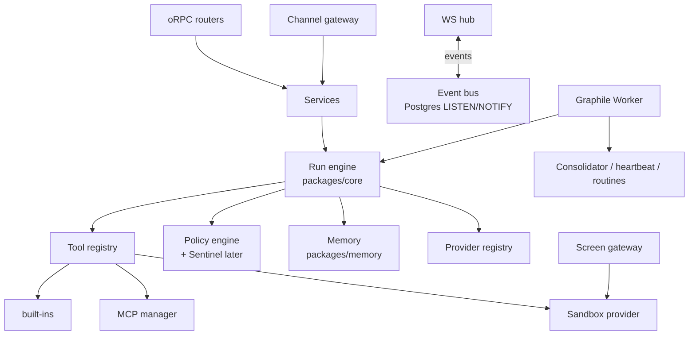
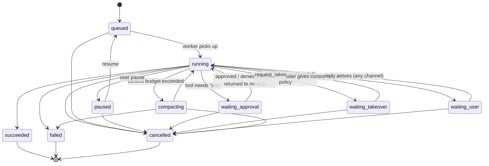

# Mawl — Architecture

Read alongside [SPEC.md](SPEC.md), [MEMORY.md](MEMORY.md) and [PLAN.md](PLAN.md). Library versions are targets; pin exact versions when scaffolding and check that each is current.

## 1. System overview


**Principle: one brain, many faces.** All state and all agent execution live in `mawl-server` plus Postgres. Every client is a thin view over the same typed API and event stream, so agents keep running when every client is closed.

## 2. Monorepo layout

pnpm workspaces + Turborepo. TypeScript (strict) everywhere except the sandbox image's shell scripts.

```
mawl/
├─ apps/
│  ├─ server/        Hono HTTP + oRPC + WebSocket; boots runtime, worker, gateways
│  ├─ web/           React 19 + Vite + Tailwind v4 + Motion; the main UI
│  ├─ desktop/       Tauri 2 shell (Rust minimal): window, tray, notifications, deep links, "manage stack"
│  └─ mobile/        Expo (React Native, New Arch) + Reanimated + expo-router
├─ packages/
│  ├─ contracts/     zod schemas + oRPC router contract + event types (shared by all)
│  ├─ core/          agent runtime: run loop, tool registry, policy engine, providers, MCP manager
│  ├─ memory/        tiers, recall, compaction, consolidator (see MEMORY.md)
│  ├─ db/            Drizzle schema + migrations (Postgres + pgvector)
│  ├─ sandbox/       SandboxProvider interface + DockerProvider + screen gateway
│  ├─ channels/      ChannelAdapter interface + telegram (grammY) + discord (discord.js)
│  ├─ ui/            design tokens (CSS vars + TS), shared React components (web/desktop)
│  ├─ ui-native/     RN components using the same tokens (mobile)
│  ├─ mascot/        beaver assets: Rive file + SVG fallbacks + state hook
│  ├─ client/        typed API client + WS event store (TanStack Query), used by web & mobile
│  └─ testkit/       fake LLM provider (scripted), fixtures, test containers helpers
├─ infra/
│  ├─ compose/       docker-compose.yml, .env.example
│  ├─ sandbox/       Dockerfile + supervisord for the computer image
│  └─ install/       install.sh / install.ps1
├─ design/           mockup + assets
└─ docs/
```

## 3. Technology choices

| Concern | Choice | Why |
|---|---|---|
| Monorepo | pnpm + Turborepo | Fast and cached |
| Lint/format | Biome | One fast tool |
| Tests | Vitest (unit/integration), Testcontainers (Postgres), Playwright (web e2e + visual), Maestro (mobile e2e, later) | TDD everywhere |
| HTTP/API | Hono + oRPC (end-to-end types, OpenAPI out) + native WS | Small and fast; typed clients for web and mobile |
| Auth | Single owner + paired devices. Device tokens (Ed25519 keypair per device, JWT session) | No accounts to create; per-device revocation |
| DB | Postgres 17 + pgvector + built-in FTS (`tsvector`) via Drizzle | One service for relational, vector and BM25 |
| Jobs | Graphile Worker (Postgres-backed queue + cron) | No Redis; durable, transactional |
| Agent loop | Vercel AI SDK v7 (`ai@7`, spec LanguageModelV4; `ToolLoopAgent` / `streamText` with `stopWhen`, `tool({ needsApproval })`) wrapped by our `Run` engine; MCP via `@ai-sdk/mcp@2` | Multi-provider, tool approval hooks, stable MCP client. Tests use `@mawl/testkit` `fakeModel` (wraps `MockLanguageModelV4`) |
| Providers | `@ai-sdk/anthropic`, `@ai-sdk/openai`, `@openrouter/ai-sdk-provider`, `ollama-ai-provider-v2`, `@ai-sdk/openai-compatible` | Bring your own key, a local model, a ChatGPT plan (Sign in with ChatGPT), or a Claude plan through the unmodified Claude Code binary (own adapter over `@anthropic-ai/claude-agent-sdk`, see Provider registry) |
| MCP | `@ai-sdk/mcp` `createMCPClient` (HTTP/SSE + stdio) | Stdio servers run *inside* the sandbox via exec |
| Sandbox | Docker containers via `dockerode`, through `tecnativa/docker-socket-proxy` | The server never mounts the raw socket |
| Desktop stream | x11vnc → websockify → **screen gateway** in server → `@novnc/novnc` RFB client | Simple and proven; upgrade path to neko/Selkies WebRTC |
| Browser automation | `@playwright/mcp` running headed on the sandbox `DISPLAY` | You see what the agent does |
| Channels | grammY (Telegram), discord.js (Discord) | Mature and typed |
| Desktop shell | Tauri 2 (+ plugins: notification, deep-link, single-instance, autostart, updater, shell) | Small and fast |
| Mobile | Expo SDK (latest), expo-router, Reanimated, expo-notifications, expo-camera (QR), react-native-webview (noVNC) | Proven mobile path |
| UI | React 19, Tailwind v4, Radix primitives (via shadcn-style local components), Motion, Lucide icons, Sonner (toasts), cmdk (command palette) | Use existing libraries; don't reinvent |
| Mascot animation | Rive (`@rive-app/react-canvas`, `rive-react-native`) with an SVG + Motion fallback | One state machine for both platforms |
| Data fetching | TanStack Query + a WS event bus that updates the cache | Live UI without polling |
| Crypto | libsodium-wrappers (secret encryption at rest) | Audited |
| Observability | pino logs + OpenTelemetry traces (optional exporter) | |

## 4. Server internals (`apps/server`)



- A single Node process runs everything for v1: API, WS, worker, gateways. Its entrypoint can start them as separate roles later (`--role=api|worker|gateway`) for scaling or crash isolation. In compose, `restart: unless-stopped` plus a healthcheck supervises it.
- **Runtime and config.**
  - Dev runs `tsx watch src/main.ts`. Production is one esbuild bundle, `apps/server/dist/server.mjs` (`pnpm --filter @mawl/server build`), with `@mawl/*` sources and npm deps inlined (only `pg-native` and `@anthropic-ai/claude-agent-sdk` are external) and the SQL migrations copied to `dist/drizzle`. Native Node type stripping is not used because workspace packages use extensionless imports. Start with `pnpm --filter @mawl/server start`.
  - Boot order: parse env, open logger, load or create the master key and the ChatGPT host id, open Postgres, run migrations (advisory-locked), run Graphile Worker's own migrations and start its worker, re-enqueue runs left `queued` or `running`, listen, log `listening`. SIGINT and SIGTERM stop the listener, abort running jobs (their runs stay `running` and resume on the next boot), stop the worker, close the database and exit 0. Any boot failure logs one `boot failed` line (error name, code, message; never the connection string) and exits 1.
  - Env is validated with zod at boot; errors list variable names only, never values.

    | Variable | Default | Meaning |
    |---|---|---|
    | `DATABASE_URL` | required | `postgres://` or `postgresql://` URL |
    | `MAWL_HOST` | `127.0.0.1` | bind address (compose sets `0.0.0.0`) |
    | `MAWL_PORT` | `7420` | HTTP port |
    | `MAWL_SECRETS_DIR` | `.mawl/secrets` | holds `master.key` and `siwc-host-id` (compose: `/secrets`) |
    | `MAWL_SIWC_PORT` | `1455` | loopback port of the Sign in with ChatGPT callback |
    | `MAWL_SIWC_BIND_HOST` | `127.0.0.1` | bind address of that callback listener |
    | `MAWL_CLAUDE_CONFIG_DIR` | unset | optional, must be an absolute path; passed to the Claude Code binary as `CLAUDE_CONFIG_DIR`, where the owner's own `claude auth login` keeps its login (compose: a named volume) |
    | `MAWL_CLAUDE_CODE_PATH` | unset | optional, must be an absolute path; path of a Claude Code binary to use instead of the one the SDK bundles |
    | `MAWL_WEB_DIR` | unset | optional, must be an absolute path; the built web app (`apps/web/dist`) to serve at `/`. Unset: a `web` directory beside the bundle (`dist/web`, which the image ships) when it holds `index.html`, otherwise none, and dev uses the Vite server |
    | `MAWL_ALLOWED_ORIGINS` | none | comma-separated extra origins that may open the WebSocket and pass the Host check (compose passes it through from `infra/compose/.env`) |
    | `LOG_LEVEL` | `info` | pino level |

  - HTTP surface: `GET /healthz` returns 200 `{ok:true}`, or 503 `{ok:false}` (no detail) if `select 1` fails or takes over 2 s; it is the compose healthcheck target. oRPC (`RPCHandler`, fetch adapter) is mounted at `/rpc`. Procedures not built yet answer 501 `NOT_IMPLEMENTED` (still stubs: approvals, devices, settings). `events.subscribe` is served only on `/ws`; HTTP `/rpc` answers it with 501.
  - Profiles (as built): `profiles.list/get/create/update/archive` run through `profiles/service.ts`. `create` needs only `name` (trimmed, 1-80 chars) and `modelMain` (`<credentialId>:<modelId>`, checked by the contract). Persona is capped at 8000 characters and an explicit slug at 40. The slug is derived from the name (lowercase ascii, dashes, 40 chars, fallback `teammate`) and deduped `-2`, `-3`; an explicit slug that is taken answers typed `SLUG_TAKEN` (409), and a model naming a missing credential answers `UNKNOWN_CREDENTIAL` (422). The color defaults to the DESIGN.md accent presets in rotation by profile count. `list` hides archived profiles unless `includeArchived`; `archive` is idempotent and keeps the slug reserved. An archived profile is not found for `update` and `runs.start`. No profile events on the bus yet.
  - Web app: when a web directory exists (`MAWL_WEB_DIR`, else `dist/web`), `apps/server/src/web-static.ts` serves it after the API routes, so `/rpc`, `/ws` and `/healthz` are never shadowed. GET and HEAD only, behind the same Host check as `/rpc`. A file that exists is sent as it is; `/assets/*` (hashed by Vite) gets `Cache-Control: public, max-age=31536000, immutable` and everything else `no-cache`. A path with no file falls back to `index.html` only when the request accepts `text/html`, is not under `/assets/` and has no file extension (client-side routes such as `/t` or `/settings`); anything else is a 404. Paths with percent escapes, backslashes, empty segments or a segment starting with `.` are never mapped to a file (no traversal, no dotfiles). Every static response carries `X-Content-Type-Options: nosniff`, `Referrer-Policy: no-referrer` and `Content-Security-Policy: frame-ancestors 'none'`.
  - Logging: pino JSON with redaction of secret-like fields and auth headers. Each request logs method, path without query, status, duration and a request id (also returned as `x-request-id`). The RPC error hook logs procedure path and error code only, never inputs or outputs.
- **Event bus.** Every state change becomes an `Event` row and a `NOTIFY`, which the WS hub fans out to subscribed clients. Clients resume from `lastEventId`.

## 5. Agent run engine (`packages/core`)

### Run lifecycle



A user can cancel a run from any non-terminal state (SPEC F6). Waiting states don't time out into `failed`. An expired approval is returned to the model as a denial, and the run continues.

- **Durable steps.** Each model step and tool result is persisted before the next step starts. A crash resumes from the last persisted step. Runs execute as Graphile jobs, and **waiting states release the worker**: the job ends, and a new job continues the run when the condition resolves.
- **Context assembly per step:**
  `system(persona + rules + tool docs)` → `core blocks (frozen per segment)` → `segment summary/handoff` → `recalled memories (as data)` → `recent turns` → `current input`.
  The stable prefix comes first so prompt caching works (Anthropic `cache_control` breakpoints are set automatically).
- **Budget.** Each run has a token budget, a step cap (`stopWhen: stepCountIs(N)`), a wall-clock cap and a cost cap. These are configurable per profile and routine.
- **Provider adapters** expose capabilities (`supportsTools`, `supportsContextEditing`, `supportsCompaction`, `supportsCaching`). The memory layer uses native Anthropic context editing and compaction when they are available and falls back to its own ladder otherwise. `contextWindow` is a property of the model, not the provider, so it is not part of the descriptor; the run engine (P1.4) resolves it per model id.

  **Run engine (as built, P1.4).** Pure engine in `packages/core/src/runs/` behind a `RunStore` port; persistence, Graphile Worker and RPC in `apps/server/src/runs/`.
  - *Model ref.* `profiles.model_main` is `<credentialId>:<modelId>`, split at the first colon (`parseModelRef` in contracts), so model ids may hold `:` and `/`. An unparseable ref or an unknown credential fails the run as `model_not_configured`; a credential that cannot be decrypted fails it as `config_error`. A provider failure while building the model (ChatGPT plan needing re-auth) passes through with its own reason. Any other error while building the model is infrastructure: it is rethrown so the job retries, and the run is not failed. `runs.start` trims the prompt and rejects one that is empty after trimming. The provider's `supportsTools` capability decides whether tools reach the model.
  - *Error codes.* `Run.error` and the `run.status` event's `error` are a closed `RunErrorCode`: every `ProviderFailureReason` plus `model_not_configured`, `budget_steps`, `budget_tokens`, `budget_wall_clock`, `internal_error`. The engine never stores provider or exception text. `ProviderFailureError.reason` maps 1:1, anything else is `internal_error`, and the host logs the exception name with the run id only.
  - *Execution.* `executeRun(deps)` does one `streamText` call per model step (`stopWhen: stepCountIs(1)`, `maxRetries: 2`, `streamText` only, never `generateText`). Messages for step N are the thread history (text of user and assistant messages, last 200) plus the replayed response messages of every persisted step. Stream and call errors arrive through `onError`, not as throws. The step loop continues while the finish reason is `tool-calls` and the step produced tool results; otherwise the run finishes. Text deltas go to `onDelta` only (ephemeral, P1.5 fans them out); there is never a row per token.
  - *Step persistence.* A model step writes one `model` row (`input_json = {messages: [assistant message]}`, usage) and, if tools ran, one `tool` row (`{messages: [tool message]}`) in ONE transaction, with one `run.step` event per row and the run's running usage total. `idx` counts rows (model then tool), so it is contiguous and `UNIQUE(run_id, idx)` dedupes: a duplicate execution finds its row taken and ends quietly without touching the run. The write also locks the run row (`SELECT ... FOR UPDATE`) and only happens while the status is `running`: if cancel or pause committed first, nothing is written (no rows, no events) and the engine stops quietly. Each step also adds its elapsed time to `runs.active_ms` in the same transaction. All `run_steps` and `events` writes go through `apps/server/src/runs/repo.ts`, which always applies `jsonValue()` (a raw JS `null` is stored as JSON null, tested on PGlite and Postgres).
  - *State machine.* Every status change is `UPDATE runs SET status=$to WHERE id=$id AND status=$from`, checked with `canTransition`, plus a `run.status` event in the same transaction. A lost CAS means cancel or pause won: the engine stops and writes nothing. Job start moves `queued` to `running` and stamps `started_at`; a run already `running` is a crash resume and continues from its persisted steps (a last persisted model step without tool results means only the finish was missed, so it finishes without calling the model). Terminal, paused and waiting runs are a no-op. A failure before the first step still goes `queued` to `running` to `failed`. On success, one transaction inserts the assistant message (text of every model step, joined by a blank line), moves `running` to `succeeded` with the summed usage and bumps `threads.last_event_at`.
  - *Budget.* Defaults: 20 model steps, 200 000 tokens (input plus output over all steps), 15 minutes of active time; `runs.budget_json` overrides each. Active time (`runs.active_ms`, exposed as `Run.activeMs`, migration 0005) is what earlier executions persisted plus this execution so far, so time spent paused, queued again after a resume, or down after a crash is not counted. `started_at` is stamped once and a resume keeps it. Steps, tokens and wall clock are checked before every step, so the step that crosses the token cap is persisted and the run then fails `budget_tokens`; a final answer that crosses the cap still succeeds. The wall clock also aborts an in-flight step through a timer-linked signal and fails `budget_wall_clock`. The cost cap (`maxCostUsd`) is accepted but not enforced: there is no pricing table yet.
  - *Cancel, pause, resume, shutdown.* The server keeps a `RunRegistry` (`Map<RunId, AbortController>`) of executing runs; it is also the "already executing in this process" guard. `runs.cancel` is a CAS from any non-terminal state to `cancelled` (CONFLICT `{from, to}` if terminal) and then aborts the controller; `runs.pause` is `running` to `paused` plus abort; `runs.resume` is `paused` to `queued` plus a new job. The engine re-reads the status before each step. An abort with reason `shutdown` leaves the run `running` with its steps intact; any other reason means the state is already set. A partial in-flight step is discarded and redone on resume. A job whose run is still registered (pause, then a quick resume, while the old execution unwinds) is not dropped: it re-queues itself about 1 s later, at most 30 times (counter in the job payload), then leaves the run to boot recovery. A shutdown abort that fired before the listener attached is applied right after attaching.
  - *Graphile Worker.* graphile-worker 0.18.0 shares `DbHandle.pool`, `noHandleSignals: true`, concurrency 4, logs routed into pino (`graphile` scope). One task, `run.execute`, payload `{ runId }` (zod-parsed; a malformed payload is logged and dropped). The handler throws only on infrastructure errors (database down), so Graphile retries (`maxAttempts` 5); model and provider errors fail the run, not the job. `runs.start` writes the thread (new `app` thread titled with the first 60 characters of the prompt, or an existing one of the same profile), the user message and the queued run with its `run.status` event in one transaction, then enqueues; if enqueueing fails the run stays `queued` and is logged. The bundle includes graphile-worker (its migrations are embedded in JS), proved by `build.pg.test.ts`.
  - *Boot recovery.* After Graphile's own migrations and `run()`, the server enqueues a job for every run in `queued` or `running`, because a crashed process leaves its job locked for hours. This is idempotent: the CAS, `UNIQUE(run_id, idx)` and the registry guard make a second job a no-op.
  - *RPC.* `runs.start/get/cancel/pause/resume`, `threads.list` (by last activity, newest first) and `threads.messages` (latest `limit` messages, default 50, in chronological order; `before` is an opaque cursor, the id of the oldest message the client already has, and the server pages by `(created_at, id)` so microsecond timestamps and ties never drop rows; a cursor that is not a message of that thread is NOT_FOUND) are implemented; unknown profile, thread or run is typed NOT_FOUND, and a thread must belong to the profile. There is no auth until P6.1, and `events.subscribe` stays a stub until P1.5.
  - *Not yet.* Mawl tools and the policy gate (P2: the engine takes an optional `ToolSet`, and tool calls must go through the policy engine once it exists), the Claude Code tool bridge, context assembly beyond persona and history and `contextWindow` (P3.5), approvals, the cost cap, and tool idempotency on resume (a step interrupted during tool execution runs its tools again).

  **Provider registry (as built, `packages/core/src/providers/`).**
  - `PROVIDER_DESCRIPTORS[kind]` holds label, `keyRequired`, `baseUrlRequired`, `defaultBaseUrl` and the capability flags. The app reads it through `providers.catalog` to render the add form.
  - `createLanguageModel({ kind, baseUrl, secret }, modelId, { fetch? })` returns a `LanguageModelV4`. OpenAI uses the Responses API; `openai_compatible` and OpenRouter use chat completions; Ollama uses `<base>/api`. A kind that needs a key refuses to build without one, so the SDKs never fall back to an environment variable. Every SDK gets a fetch wrapper that forces `redirect: 'error'`, so a run-time request never forwards a key to another host.
  - `testCredential(conn, { fetch?, timeoutMs = 10 000 })` makes one free GET and returns `{ ok, latencyMs }` or `{ ok: false, reason }`. The reason is one of `invalid_key`, `unreachable`, `rate_limited`, `unexpected_response`, or, for the Claude plan only, `not_signed_in` and `wrong_auth_method`. No provider text is ever returned and the response body is not read, because either can echo the key. Redirects are refused (`redirect: 'error'`) so a key is never sent to another host. A hard deadline races the fetch, so a fetch that ignores the abort signal still ends as `unreachable`.
  - A base url is http(s) only, with no credentials, query or fragment; trailing slashes are stripped on input, as `resolveBaseUrl` does. `providers.test` on a stored row whose secret no longer decrypts (master key changed) fails with the typed `CREDENTIAL_UNREADABLE` (409) error.

  | Kind | Default base url | Caching | Context editing / compaction | Key test request |
  |---|---|---|---|---|
  | `anthropic` | `https://api.anthropic.com/v1` | yes | yes / yes | `GET {base}/models` with `x-api-key` and `anthropic-version: 2023-06-01` |
  | `openai` | `https://api.openai.com/v1` | yes | no / no | `GET {base}/models` with `Authorization: Bearer` |
  | `openrouter` | `https://openrouter.ai/api/v1` | yes | no / no | `GET {base}/key` with `Authorization: Bearer` |
  | `ollama` | `http://localhost:11434` (in Docker use `host.docker.internal`) | no | no / no | `GET {base}/api/tags` (Bearer only if a key is set) |
  | `openai_compatible` | none, required | no | no / no | `GET {base}/models` (Bearer only if a key is set) |
  | `openai_chatgpt` | `https://api.openai.com/v1` (fixed) | no | no / no | `GET {base}/models` with the OAuth access token |
  | `anthropic_claude_code` | none (no HTTP from Mawl) | no | no / no | `claude auth status` run through the binary |

  Status mapping: 2xx ok; 401/403 `invalid_key`; 429 `rate_limited`; network error, timeout or refused redirect `unreachable`; anything else `unexpected_response`.

  **Sign in with ChatGPT (`openai_chatgpt`, as built).** The owner signs in with a ChatGPT plan instead of an API key. Facts come from developers.openai.com/siwc/token-sharing-open-source (checked 2026-10-18).
  - *Where the code lives.* Pure OAuth logic is in `packages/core/src/providers/chatgpt/`: PKCE, authorize url, code exchange, refresh, revoke, ID token checks, error mapper, fetch wrapper, token manager. Persistence and the listener are in `apps/server/src/providers/` (`chatgpt/auth.ts`, `chatgpt/listener.ts`).
  - *Sign-in flow.* `providers.chatgpt.start` returns `{ attemptId, authorizeUrl }`; the app opens the url in a browser on the server host. The server opens a one-shot `node:http` listener on `MAWL_SIWC_BIND_HOST:MAWL_SIWC_PORT` for `GET /auth/callback`. The redirect uri is always `http://127.0.0.1:<port>/auth/callback` (never `localhost`; only the port may vary). One attempt is in flight at a time: a second `start` cancels the first. An attempt expires after 10 minutes. `providers.chatgpt.status({ attemptId })` answers `pending`, `succeeded {credentialId}` or `failed {reason}`, with a closed `ChatGptSignInFailure` reason; an unknown id is NOT_FOUND. If the port cannot be bound, `start` answers 503 `SIGN_IN_UNAVAILABLE`. The listener refuses a foreign `Host` header, other paths, other methods and any callback whose `state` is missing or wrong (constant-time check, answered 400) without using up the attempt, so a web page that probes the port cannot cancel a sign-in. A valid state with `error=access_denied` does end it. It keeps an error handler after it starts. Starting a new attempt waits for one whose code exchange is already running instead of cancelling it, and answers a static "You can close this window" page that echoes no code, state or error. In Docker, bind `0.0.0.0` inside the container and publish `127.0.0.1:1455:1455` on the host only.
  - *OAuth details.* Authorize `https://auth.openai.com/api/accounts/authorize`, token `.../api/accounts/oauth/token`, revoke `.../api/accounts/oauth/revoke` (the `revocation_endpoint` of the issuer's openid-configuration, hard-coded). First sign-in sends `client_id=dynamic_agent_client` and `agent_name_hint=Mawl`; OpenAI returns the issued `oaiapp_...` id as `client_id` in the callback. The server saves it in `oauth_clients` before the code exchange and reuses it on every later sign-in; the placeholder is never stored. A new registration whose callback lacks an `oaiapp_` id is rejected as incomplete, and a callback that supplies a different id than the saved one is rejected. Scopes are `openid profile email offline_access resource.invoke chatgpt.tokens.use.direct`, the resource is `https://api.openai.com/v1`, PKCE is S256, and `state` and `nonce` are fresh per attempt. The ID token is verified with `jose` (6.2.12, MIT): RS256 only (the one algorithm the issuer advertises), signature against the JWKS at `https://auth.openai.com/.well-known/jwks.json` (the issuer's `jwks_uri`, fetched lazily with a 5 s timeout and cached), then issuer, audience (the client id), expiry and nonce. Anything wrong, including an unreachable JWKS, fails the attempt as `invalid_id_token`.
  - *Host id.* `ext_agent_host_id` is a random `urn:uuid:<v4>` created on first boot as `siwc-host-id` in `MAWL_SECRETS_DIR` (same race-safe create as `master.key`) and sent on every sign-in. It is never derived from the owner or the machine.
  - *Storage.* The credential row holds the secret `{clientId, accessToken, refreshToken, idToken, expiresAt, scope}` encrypted with AAD `provider_credentials:<id>`. Public columns: `account_email` (the owner's own), `plan_usage` (false when the grant lacks `chatgpt.tokens.use.direct`: signed in, but no inference) and `reauth_required`. `account_email` is stored in plaintext on purpose: it is the owner's own address, shown in the app, and it is never logged. Signing in again with the same client updates the same row. `oauth_clients` outlives the credential, so logout keeps the registration.
  - *Refresh.* Refresh when under 5 minutes remain. Refreshes are serialised per credential id in process, and a caller rejected with a stale token reuses a token another caller already rotated. The rotated refresh token is persisted before the new access token is handed out. If the save fails it is retried 3 times at once; if it still fails, the rotated credential is kept in memory and is saved (and used) before anything else on the next call. A hard crash in that window loses the rotation and the owner signs in again. Sign-in writes use the same per-credential queue, and clearing tokens after a terminal error only happens if the stored refresh token is still the one that failed, so a late failure cannot wipe a newer sign-in. Terminal errors (`invalid_grant`, `invalid_refresh_token`, `token_expired`, `refresh_token_expired`, `refresh_token_invalidated`, `refresh_token_reused`) clear the tokens, keep the client id, set `reauth_required` and fail with `reauth_required`. `invalid_client` is `config_error`. Network and 5xx failures are `temporarily_unavailable` and never erase credentials.
  - *Inference.* `ProviderService.createModel(id, modelId)` builds the OpenAI SDK's `.responses(modelId)` over `createChatGptFetch`. That wrapper injects a fresh bearer on every call (the SDK key is a placeholder), forces `redirect: 'error'`, and rewrites Responses bodies: `store: false`, system items become developer items, and `previous_response_id` plus the fields the endpoint rejects (`background`, `conversation`, `max_output_tokens`, `max_tool_calls`, `metadata`, `moderation`, `multi_agent`, `prompt`, `prompt_cache_retention`, `safety_identifier`, `temperature`, `top_logprobs`, `top_p`, `truncation`, `user`) are dropped. Non-streaming calls are refused with `unsupported_capability` before any request, so use `streamText`, not `generateText`. A 401 refreshes once and retries once; a second 401 is `config_error`. The base url is fixed: a stored one is ignored, and the wrapper itself refuses (`config_error`, no request, no bearer) any url that is not `https://api.openai.com`. Error bodies are read up to 64 KiB.
  - *Errors.* `ProviderFailureReason` (in `@mawl/contracts`; P1.4 stores it on a failed run) is `plan_limit_reached`, `not_eligible`, `temporarily_unavailable`, `unsupported_capability`, `reauth_required`, `config_error`, `plan_usage_disabled` or `provider_error`. `ProviderFailureError` (core) carries the reason and an optional `retryAfter` in seconds, never provider text. The mapping from `error.code` also applies to streamed `response.failed` and `error` events, which end the stream with the typed error: `subscription_sharing_usage_limit_exceeded` to `plan_limit_reached`; `subscription_sharing_user_not_eligible` to `not_eligible`; `subscription_sharing_usage_unavailable` and `subscription_sharing_user_unavailable` to `temporarily_unavailable`; `subscription_sharing_unsupported_capability` to `unsupported_capability`; `subscription_sharing_route_not_supported`, `chatpass_v2_scope_not_authorized` and `chatpass_v2_invalid_authorization_context` to `config_error`. With no known code the http status decides.
  - *Key test and logout.* `providers.test` on a ChatGPT credential refreshes if needed, then does `GET https://api.openai.com/v1/models` with the bearer; token problems map to `invalid_key` or `unreachable`. `providers.delete` is logout: a form POST to the revoke endpoint (`token`, `token_type_hint=refresh_token`, `client_id`; an empty 200 is success) with up to 3 attempts and doubling backoff on 5xx or network errors, then the row is deleted regardless (a failed revoke is logged as not confirmed). `providers.delete` returns the removed credential plus `revoked`: false means revocation was not confirmed, and the app should tell the owner to revoke access in ChatGPT settings. Other kinds always answer true. `ProviderCredentialInput` rejects `openai_chatgpt`: credentials come only from this flow.
  - *Logging.* Tokens, codes, state, nonce, verifier and the email are never logged; the log carries the attempt id and the outcome only.
  - *Not yet.* Desktop handoff (P1.8), the sign-in button and plan and model pickers (P1.6, P8.1), `id_token_hint` and `login_hint` for returning sign-ins, and model listing in the app.

  **Claude plan via Claude Code (`anthropic_claude_code`, as built).** The owner uses a Claude subscription by signing in to Claude Code itself; Mawl runs the unmodified binary that `@anthropic-ai/claude-agent-sdk` bundles. This is the only subscription path Anthropic's terms allow (code.claude.com/docs/en/legal-and-compliance: sign-in to a Claude account must complete through Anthropic's own flow). Owner decision 2026-10-18: Mawl is a personal, self-hosted project. If Mawl is ever distributed or multi-user, remove this provider (check before P8.5).
  - *Hard rules, tested.* Mawl never reads, copies, parses or logs `.credentials.json` or any keychain entry; implements no claude.ai OAuth flow; accepts no Claude token in any input (no setup-token storage, no OAuth-token handling); and does not remove or disable any of the binary's auth methods. `scripts/claude-terms.test.ts` fails the build if those file names or token variable names appear outside docs and the negative tests. `ProviderCredentialInput` accepts `anthropic_claude_code` with a label only and rejects a `secret` or a `baseUrl`. The row stores the label; its secret column holds an empty encrypted string and the credential has no public account fields (Mawl does not surface the Claude email).
  - *Sign in.* The owner runs `claude auth login` in a terminal on the server host or in the container, with `CLAUDE_CONFIG_DIR` set to the same directory as `MAWL_CLAUDE_CONFIG_DIR` (when set). Mawl only documents the command. Docker: `docker compose -f infra/compose/docker-compose.yml exec server claude auth login` (it needs a terminal, so no `-T`). The image sets both `MAWL_CLAUDE_CONFIG_DIR` and `CLAUDE_CONFIG_DIR` to `/claude`, a named volume, so the login the shell writes is the one the server's spawned binary reads. The server bundle keeps the SDK external (`apps/server/src/build.ts`), because the SDK finds its native binary (about 290 MB per platform, an optional `@anthropic-ai/claude-agent-sdk-<platform>` package) beside itself in `node_modules`. The image (`infra/docker/server.Dockerfile`, Debian glibc) therefore runs `npm install --omit=dev` of exactly `@anthropic-ai/claude-agent-sdk@0.3.302` in `/app`, which pulls the matching `linux-x64` or `linux-arm64` package, and links its `claude` file to `/usr/local/bin/claude`. The SDK is self-contained at runtime: its peers `@anthropic-ai/sdk` and `@modelcontextprotocol/sdk` are not installed in the image and `import('@anthropic-ai/claude-agent-sdk')` still resolves (checked in the container). Headless login, checked 2026-10-18 in the container: `claude auth login` prints `Opening browser to sign in...`, then a `https://claude.com/cai/oauth/authorize?...` URL whose redirect is `https://platform.claude.com/oauth/code/callback`, then `Paste code here if prompted >`. No local callback port is needed: the owner opens the URL in any browser, signs in, copies the code Anthropic's page shows and pastes it into the terminal. Mawl never sees the code.
  - *Model.* `createClaudeCodeModel` (`packages/core/src/providers/claude-code/`) is an own thin `LanguageModelV4` over the SDK's `query()`, loaded by dynamic import on first use. Text only in v1: system messages become the system prompt, a lone user message is the prompt, and earlier turns become a labelled `User:`/`Assistant:` transcript. Files, images and function tools fail with `UnsupportedFunctionalityError` before anything is spawned (descriptor `supportsTools: false`; P1.4 may bridge tools through an in-process MCP server). `doStream` maps the SDK's partial stream events to text and reasoning parts and the result message to `finish` (usage from the result: input, output, cache read and write; `stop_reason` to the unified finish reason). `doGenerate` collects the stream. Sampling settings are ignored with `unsupported` warnings.
  - *Options, always.* `tools: []`, `settingSources: []`, `strictMcpConfig: true`, `persistSession: false`, `maxTurns: 1`, `includePartialMessages: true`, `permissionMode: 'dontAsk'` (never `bypassPermissions`, never `allowedTools`), `cwd` a dedicated empty directory, one private `mkdtemp` directory (`mawl-claude-code-XXXXXX`, owner-only) under the OS temp dir created per process on first use and made again if a tmp cleaner removes it (a creation failure is `provider_error` without the path), and the AI SDK abort signal wired to the query's `AbortController` (a cancelled stream also aborts). Not `--bare`.
  - *Clean environment.* The SDK's `env` replaces the subprocess environment, so Mawl builds it from an allowlist (`PATH`, `HOME`, `USERPROFILE`, `APPDATA`, `LOCALAPPDATA`, `TMPDIR`/`TEMP`/`TMP`, `LANG`, `LC_ALL`, `SystemRoot` and a few Windows basics, `NODE_EXTRA_CA_CERTS`, the proxy variables, `CLAUDE_CONFIG_DIR`; matched case-insensitively) and never passes `ANTHROPIC_*`, `CLAUDE_CODE_OAUTH_TOKEN`, `CLAUDE_CODE_USE_*` or anything else. Otherwise a stray variable would outrank the subscription login in Claude Code's auth order (cloud vars, `ANTHROPIC_AUTH_TOKEN`, `ANTHROPIC_API_KEY`, `apiKeyHelper`, `CLAUDE_CODE_OAUTH_TOKEN`, then the `/login` subscription) and bill someone else's key. `MAWL_CLAUDE_CONFIG_DIR` overrides an inherited `CLAUDE_CONFIG_DIR`.
  - *Errors.* Mapped to `ProviderFailureReason`, never passing SDK text: a `rate_limit_event` with status `rejected` or assistant error `rate_limit` is `plan_limit_reached` (a rejected event carries `retryAfter` from `resetsAt`, read as epoch seconds, or milliseconds when over 1e11); `authentication_failed`, `oauth_org_not_allowed`, `verification_required` is `reauth_required`; `account_on_hold`, `billing_error` is `not_eligible`; `overloaded`, `server_error` is `temporarily_unavailable`; `model_not_found`, `invalid_request` is `config_error`; everything else (including error results, a crashed or unspawnable binary, a `query()` call that throws synchronously, and codes added later) is `provider_error`. `doGenerate` throws the `ProviderFailureError`; `doStream` emits it as an `error` part followed by `finish` with reason `error`. An abort passes through as the abort.
  - *Key test.* `providers.test` runs `claude auth status` (JSON on stdout, exit 1 when logged out) with the same clean env and a 10 s deadline, resolving the binary from `MAWL_CLAUDE_CODE_PATH` or the SDK's platform package. Only `authMethod` is read: `claude.ai` is `ok` with the measured latency; `none` (or `loggedIn: false`) is `not_signed_in`; any other method (`api_key`, `oauth_token`, `api_key_helper`, `third_party`) is `wrong_auth_method`, because something in the environment or config would bill another key or token and Mawl refuses; a spawn failure or timeout is `unreachable`; output that is not that JSON is `unexpected_response`. Stdout and the owner's email are never returned or logged.
  - *Login check before every run.* The same check runs inside the model, after the input is validated and before any `query()` spawn, so a binary that is signed out or uses another auth method never reaches a billable call. Mapping: `not_signed_in` is `reauth_required`, `wrong_auth_method` is `config_error`, anything else (`unreachable`, `unexpected_response`) is `provider_error`. A check that throws counts as `unreachable`. Only an `ok` result is cached, for 5 minutes (a clock that steps backwards forces a re-check) per (binary path, effective config dir, including an inherited `CLAUDE_CONFIG_DIR`) in a process-wide map shared by every model; failures are never cached and concurrent calls share one in-flight check. A call whose signal is already aborted rejects with the abort before any check or spawn. A caller that aborts while the check is pending stops waiting and rejects with the abort; the check keeps running for the others. `doStream` reports a failed check like any other failure (`stream-start`, `error`, `finish` with reason `error`); `doGenerate` throws it. The check is injectable (`checkLogin`) for tests.
  - *Dependencies.* `@anthropic-ai/claude-agent-sdk` 0.3.302 and its peers `@anthropic-ai/sdk` 0.135.0 and `@modelcontextprotocol/sdk` 1.32.1 are pinned in `@mawl/core`. The SDK's license is Anthropic's Commercial Terms ("SEE LICENSE IN README.md"), not an OSS license; the owner accepted this for a personal project.
  - *Not yet.* Tools (P1.4), the add-provider UI and a "run `claude auth login`" hint on `not_signed_in` (P1.6), model listing (`supportedModels()`), and plan-usage display from `rate_limit_event`.
  The server (`apps/server/src/providers/`) owns persistence. `create` encrypts the secret (or an empty string when none) with AAD `provider_credentials:<id>`; reads select only `providerCredentialPublicColumns`; `resolveCredential(id)` decrypts for the run engine and is not exposed over RPC.

### Tools

| Group | Tools |
|---|---|
| Computer | `shell`, `read_file`, `write_file`, `list_files`, `computer_screenshot`, `computer_act` (batched xdotool actions), `open_url`, browser via Playwright MCP |
| Web | `web_search` (provider-native or SearXNG/Brave key), `web_fetch` (to markdown) |
| Memory | `memory_block_edit`, `remember`, `recall`, `session_search`, `skill_load`, `skill_propose` |
| Human | `ask_user`, `request_takeover`, `notify` |
| Agency | `schedule_create/list/cancel`, `message_teammate` (S1) |
| MCP | Any connected server's tools, namespaced `mcp__<server>__<tool>` |

Large tool outputs (over ~4k tokens) are stored as **artifacts**. The model gets a preview plus `artifact_id` and can page through the rest with `read_artifact`.

### Policy engine

```ts
type Level = 'auto' | 'ask' | 'handoff' | 'block'
interface PolicyRule { match: { tool?: string; mcpServer?: string; actionClass?: ActionClass; argPattern?: string }; level: Level }
type ActionClass = 'read' | 'write_local' | 'send_message' | 'purchase' | 'delete' | 'credential' | 'external_post' | 'shell_exec'
```

- Tools declare an action class. MCP tools default to `ask` until the user classifies them; read-only hints from MCP annotations lower this to `auto`.
- The user's rules come first, then profile defaults, then global defaults. `credential` and payments are always `handoff`, and the user cannot lower them.
- **Sentinel (S2).** An optional second model reviews `send_message`/`external_post`/`purchase` calls against the user's intent and can escalate them to `ask`.

## 6. Sandbox and screen gateway (`packages/sandbox`, `infra/sandbox`)

```ts
interface SandboxProvider {
  ensure(profileId: string, spec: SandboxSpec): Promise<SandboxHandle>   // create or start
  suspend(profileId: string): Promise<void>                               // stop when idle (home volume persists)
  exec(h: SandboxHandle, cmd: string[], opts?: ExecOpts): AsyncIterable<ExecChunk>
  vncEndpoint(h: SandboxHandle): Promise<{ host: string; port: number }>
  status(h: SandboxHandle): Promise<SandboxStatus>
}
```

- **Image `mawl/computer`.** Ubuntu 24.04 with:
  - Xvfb `:1` (1280×800), XFCE (minimal), Chromium, xdotool, scrot
  - x11vnc + websockify, Node 22 with `@playwright/mcp` running headed on `:1`
  - a small `computer-agent` HTTP helper (screenshot/act/exec)
  - supervisord to run everything, and a non-root user `mawl` with home on a named volume `mawl-home-<profile>`
- **Network.** Sandboxes join an internal network `mawl-sbx`. Only the server can reach their VNC and helper ports, and nothing is published to the host. Egress is allowed, with an optional per-profile allowlist later.
- **One sandbox per profile.** It starts on demand, auto-suspends after N idle minutes (default 20), and its home is checkpointed through the volume.
- **Screen gateway.** `GET /screen/:profileId?ticket=` upgrades to WS and proxies the VNC bytes.
  - Tickets are short-lived (60 s, single use), issued over oRPC to an authenticated device, and arrive in the WS subprotocol header, never in a logged URL.
  - A ticket carries a capability: `view` or `control`. Only the holder of the **control lease** gets input forwarded. Everyone else is view-only, with input dropped server-side.
- **Takeover protocol.**
  - `takeover.request` → if a run is active and not in `waiting_takeover`, the user gets a "pause the agent?" prompt, and confirming pauses the run.
  - The lease is granted with an expiry, renewed by heartbeats.
  - `takeover.release` → the run resumes, and the agent gets a note: "User had control for 2m14s; re-observe the screen."
- **Credential form.** The user types into a Mawl form. The server sends the text to the sandbox with `xdotool type`, without adding it to the transcript or the model context, and logs `credential_entered (redacted)` in the audit log.

## 7. Channels (`packages/channels`)

```ts
interface ChannelAdapter {
  kind: 'telegram' | 'discord'
  start(ctx: ChannelContext): Promise<void>; stop(): Promise<void>
  send(to: ChannelPeer, msg: OutboundMessage): Promise<void>        // text, markdown, buttons, images
}
// Inbound is normalised to { profileId, channel, peer, text, attachments, replyTo, actionId? }
```

- **Ownership and isolation.** Each profile has its own bot tokens, with a DB lock so one token belongs to one profile. Only allowlisted user IDs can talk to a bot; the owner is claimed with a pairing code during setup.
- **Sessions.** Each channel+peer gets a conversation thread. Memory is shared across a profile's threads.
- **Interactive elements.** Approvals render as inline buttons (Approve / Deny / Open in app), and takeover requests include a deep link to the app.
- **Commands.** `/status`, `/runs`, `/pause`, `/resume`, `/routines`, `/new`, `/memory <query>`.

## 8. Clients

- **Web UI (`apps/web`).** The UI itself; desktop and mobile get layouts suited to them.
  - Routes: `/onboarding`, `/t/:profile` (chat), `/t/:profile/computer`, `/activity`, `/approvals`, `/memory`, `/routines`, `/connections`, `/settings`.
  - Command palette (⌘K).
  - Layout: three panes. A teammate list, the conversation, and a context panel (computer / memory / run details) that you can collapse.
  - Transport: one `@mawl/client` WebSocket to `/ws` on the page's own host (`wss://` on https pages), shared by every query and mutation. The browser never calls HTTP `/rpc`. In development Vite proxies `/rpc` and `/ws` to `127.0.0.1:7420` and keeps the `localhost:5173` Host, which the server's loopback allowlist accepts.
  - Views read through TanStack Query; views and components never fetch ad hoc. Heavy pages load on first visit through route code splitting (Settings today); Teammates, the landing page, stays in the main chunk.
- **Desktop (`apps/desktop`).** Tauri loads the web build bundled with it and points it at the configured server URL (default `http://localhost:7420`).
  - Native features: tray icon with the mascot state, native notifications, a global shortcut to a quick-ask popover, autostart, and deep links `mawl://`.
  - A "Start my stack" helper runs `docker compose up -d` when Docker exists locally.
- **Mobile (`apps/mobile`).**
  - Tabs: Teammates · Activity · Approvals · Settings.
  - Chat screen, and a Computer screen (noVNC in a WebView with touch→mouse mapping and a keyboard bar).
  - Push notifications go through Expo Push, which is the only external call and can be turned off. Without it, foreground WS events still work.

### Pairing (v1: LAN/Tailscale)
1. Desktop or web Settings → "Pair phone" shows a QR code containing `{ serverUrls: [lan, tailscale?], pairingCode (one-time, 5 min), serverPubKey }`.
2. The phone scans it, generates an Ed25519 device key and calls `devices.pair(code, devicePubKey, name)` on the first URL it can reach.
3. The server stores the device and returns a session. Each later request is a signed challenge followed by a short-lived JWT.
4. Settings lists the devices, and you can revoke any of them. Docs recommend Tailscale for access from outside the home network. An E2E relay (S6) can later replace the transport without changing the auth.

## 9. Data model (core tables, Drizzle)

```
profiles(id, name, slug, color, persona_md, model_main, model_helper, policy_json, heartbeat_cron, created_at, archived_at)
provider_credentials(id, provider, label, secret_enc, base_url, account_email, plan_usage, reauth_required, oauth_client_id, created_at)
oauth_clients(client_id, provider, created_at)
-- anthropic_claude_code rows store only a label: empty secret_enc, no base_url, no oauth_client_id
threads(id, profile_id, channel, peer, title, created_at, last_event_at)
messages(id, thread_id, run_id, role, parts_json, token_count, created_at)
runs(id, profile_id, thread_id, trigger{user|routine|heartbeat|teammate}, status, budget_json, usage_json, segment_no, created_at, started_at, ended_at, error)
run_steps(id, run_id, idx, kind{model|tool}, input_json, output_ref, usage_json, created_at)
artifacts(id, profile_id, run_id, mime, size_bytes, content bytea|path (exactly one), preview, token_count, created_at)
approvals(id, run_id, tool, args_redacted_json, action_class, status, decided_by_device, decided_via_channel, created_at, decided_at)
routines(id, profile_id, name, schedule{cron|rrule|nl_source}, prompt, delivery_channel, enabled, last_run_id)
mcp_servers(id, profile_id|null, name, transport, config_enc, enabled, tool_policy_json)
channels(id, profile_id, kind, token_enc, allowlist_json, status)
devices(id, name, pubkey, platform, last_seen_at, revoked_at)
events(id bigserial, profile_id|null, run_id|null, type, payload_json, created_at)    -- feed + WS resume + audit
-- memory tables: see MEMORY.md
```

## 10. Event protocol (WS)

`client → server`: `{ type: 'subscribe', topics: ['profile:*'|'run:<id>'|...], since?: eventId }`
`server → client`: `{ id, type, profileId, runId?, payload, ts }`

Event types:
- `run.status`
- `run.delta` (text tokens)
- `run.tool_call` / `run.tool_result`
- `run.step`
- `approval.created` / `approval.resolved`
- `takeover.requested` / `takeover.lease`
- `memory.updated`
- `routine.fired`
- `sandbox.status`
- `notify`

All event types are defined as zod schemas in `packages/contracts`.

**Server.**
- The WS hub serves the oRPC router at `/ws` only (client frames capped at 64 KiB). Two checks guard it, until device auth lands in P6.1:
  - **Host allowlist** (DNS rebinding), on the `/ws` upgrade and on HTTP `/rpc`: the `Host` header must be a loopback name (`localhost`, `*.localhost`, `127.0.0.1`, `[::1]`), the configured bind host (`MAWL_HOST`, unless it is a wildcard such as `0.0.0.0`), or the host of an entry in `MAWL_ALLOWED_ORIGINS`. The port is not compared, so a host listed in `MAWL_ALLOWED_ORIGINS` is allowed on any port, and every `*.localhost` name is allowed. Lookalikes (`localhost.`, `127.0.0.2`, `[::ffff:127.0.0.1]`, userinfo such as `user@localhost`) and `0.0.0.0` are denied. Anything else, or a missing `Host` header (the request url is never used instead), gets 403. To reach the server by a LAN name or address, list its origin in `MAWL_ALLOWED_ORIGINS`.
  - **Origin check**, browsers only: same host as the request, loopback on any port, the Tauri webview, or an allowed origin. A request without `Origin` (a non-browser client) passes.
  - Known gap until P6.1: a page served from loopback on any port passes both checks, so any local web page can talk to the server. Device pairing closes it. The client's `{ type: 'subscribe', ... }` above is the `events.subscribe` procedure.
- Stored events are rows in `events`. `insertEvent` sends a `NOTIFY`, and one LISTEN connection per process wakes the bus, which reads the table `id > lastSeen` in pages. A hole in the id sequence holds later events back for a short grace period, so delivery stays in id order.
- Liveness and limits: the hub pings every socket every 30 s and terminates one that did not answer the previous ping (half-open connections). At most 64 sockets are open at once; further upgrades get 503 and a log line.
- A subscriber is replayed from `since` up to the bus's high-water mark, then gets live events. Each subscriber has a bounded queue; on overflow its stream fails with `RESYNC_REQUIRED`. Each connection may hold a limited number of subscriptions (`TOO_MANY_SUBSCRIPTIONS`).
- `run.delta` is never stored or replayed. The run job feeds model tokens to a coalescer that emits at most one delta per run per 50 ms. A run's pending text is flushed (1) when a model step's stream ends (`onStepEnd` in the engine), (2) just before the bus delivers any stored event of that run, so text never arrives after the `run.step` or `run.status` that follows it, and (3) in a `finally` when the job ends, however it ends. A delta's envelope id is the bus's `lastSeen`, so a client's `since` never passes a stored event it has not received.
- Boot starts the bus before the worker. Shutdown closes the sockets and the listener, stops the worker, flushes and closes the coalescer, then stops the bus.

**Client (`packages/client`).**
- `createMawlClient({ url, WebSocket? })` returns the typed contract client and TanStack Query utils. A socket cannot be reopened, so the link opens a new socket for the first call after the old one closed.
- The event store keeps one `events.subscribe` stream open. Every item goes through `parseEnvelope`: unknown types and versions are skipped, but the `since` cursor still moves past them. After a dropped stream it reconnects with exponential backoff (1 s doubling to 30 s, jittered, reset by the first event of a stream, not by opening it) and resumes from the cursor.
- On `RESYNC_REQUIRED` it drops the run text buffers and subscribes again without a cursor (live only); once that stream is attached it invalidates every query, so no event can fall between the refetch and the stream. The first resync retries at once, and repeats without any event in between back off.
- Stored events invalidate the queries they change (run status, threads, approvals). `run.delta` text is appended to a per-run buffer that a UI reads with `getRunText` and `subscribeRunText`. A new `stepIdx` starts the buffer over, and a terminal `run.status` drops it once the invalidated queries have refetched the stored reply.
## 11. Security model

- **Trust boundaries:**
  - client ↔ server: device auth
  - server ↔ sandbox: internal network; the sandbox is treated as untrusted
  - server ↔ providers/MCP: TLS
- The sandbox can never reach Postgres or the Docker proxy. These networks are kept separate.
- Secrets are encrypted at rest with a key from the `mawl-secrets` volume, generated on first boot. Secrets are never logged and never sent to the model.
  - `master.key` is 32 random bytes, mode 0600 in a 0700 directory. It is created atomically (temp file then hard link, so concurrent first boots end with one key and readers never see a partial file). An existing file is never overwritten or repaired: a wrong-sized file aborts boot, because a new key would orphan every stored secret. On POSIX the directory is forced to 0700 and a key file with group or other permission bits logs a warning (boot continues). On Windows there is no mode check: protection relies on the ACL inherited from the user profile directory, so keep `MAWL_SECRETS_DIR` there.
  - Blob format: `0x01` (version) ‖ 24-byte random nonce ‖ XChaCha20-Poly1305 (IETF AEAD, libsodium) ciphertext+tag. The AAD is not stored; callers pass the owning row as `<table>:<id>` (for example `provider_credentials:<id>`), so a ciphertext copied to another row fails to decrypt. Every decrypt failure (tamper, wrong AAD, wrong key, unknown version, short blob) raises one `SecretDecryptError` with a fixed message and no detail.
- Tool output and web content are treated as **data**. They are wrapped in `<untrusted>` tags in context, scanned for injection before a memory write, and their instructions are never followed blindly (mirrored in the system prompt).
- Rate limits and caps per run; global kill switch "Pause all teammates".
- Supply chain: pinned image digests, lockfile, Renovate.

## 12. Deployment

### Compose v1 (as built, P1.9)

`infra/compose/docker-compose.yml`, project `mawl`. Run it with `docker compose -f infra/compose/docker-compose.yml up -d --build` after copying `infra/compose/.env.example` to `.env` and setting `MAWL_DB_PASSWORD` (docs/RUNNING.md has the full steps).

| Service | Image | Notes |
|---|---|---|
| `db` | `pgvector/pgvector:0.8.7-pg17` | `POSTGRES_USER` and `POSTGRES_DB` `mawl`, `POSTGRES_PASSWORD` from `MAWL_DB_PASSWORD` (compose refuses to start without it), volume `mawl-db`, `pg_isready` healthcheck, no published port |
| `server` | built from `infra/docker/server.Dockerfile` as `mawl-server:local` | waits for `db` to be healthy; `restart: unless-stopped`; volumes `mawl-secrets:/secrets` (master key, ChatGPT host id) and `mawl-claude:/claude` (the Claude Code login); `DATABASE_URL` points at `db`; `MAWL_ALLOWED_ORIGINS` is passed through from `.env` |

- **Ports are host-loopback only.** `127.0.0.1:7420` is the app and API; `127.0.0.1:1455` is the Sign in with ChatGPT callback, which OpenAI redirects the owner's browser to. There is no device sign-in until P6.1, so nothing else may reach the server. Exposing it on a LAN or the internet waits for device auth and a TLS proxy.
- **Image.** Build context is the repo root (`.dockerignore` keeps `.git`, `.env*`, `node_modules`, `dist`, `docs`, `design` out). Two stages on `node:24-bookworm-slim`, pinned by digest (a test enforces it): `build` runs `pnpm install --frozen-lockfile` for the server and web, then builds both; `runtime` installs the Claude SDK for its architecture, copies `dist/server.mjs`, `dist/drizzle` and the web build to `/app/dist/web`, and runs as the non-root `node` user. `/secrets` and `/claude` are created owned by `node`, so fresh named volumes get the right owner. Environment: `MAWL_HOST=0.0.0.0`, `MAWL_SECRETS_DIR=/secrets`, `MAWL_SIWC_BIND_HOST=0.0.0.0`, `MAWL_CLAUDE_CONFIG_DIR=/claude`, `CLAUDE_CONFIG_DIR=/claude`, `NODE_ENV=production`. A `HEALTHCHECK` fetches `http://127.0.0.1:7420/healthz`. A cold build takes about a minute.
- **Tests.** `scripts/compose.test.ts` checks the compose file and Dockerfile statically (loopback ports, named volumes, required password, healthcheck gate, digest pins). `apps/server/src/compose.smoke.test.ts` builds and boots the real stack under a throwaway project name, random host port and its own image tag, then checks `/healthz`, `/`, `/t`, an immutable asset, `health.get` over `/rpc` and `claude auth status` (logged out, config dir `/claude`). It skips without Docker locally and fails under `CI` or `MAWL_REQUIRE_DOCKER`.

### Later (P4 and P8)

The sandbox arrives with `dockerproxy` (`tecnativa/docker-socket-proxy`, containers/exec/images/networks/volumes only), separate `core` and `sbx` networks, an artifacts volume and a `computer-image` service under a `build` profile; the server image moves to GHCR. Sketch of the additions:

```yaml
services:
  dockerproxy:
    image: tecnativa/docker-socket-proxy
    environment: [CONTAINERS=1, POST=1, EXEC=1, IMAGES=1, NETWORKS=1, VOLUMES=1]
    volumes: [/var/run/docker.sock:/var/run/docker.sock:ro]
    networks: [core]
  computer-image:          # build/pull only; containers are created per profile by the server
    image: ghcr.io/<owner>/mawl-computer:latest
    profiles: [build]
networks: { core: {}, sbx: { internal: false } }
```

`install.sh` / `install.ps1`:
1. Check Docker.
2. Download the compose file.
3. Run `docker compose pull && up -d`.
4. Open `http://localhost:7420`.

The desktop app can run the same flow from its "Start my stack" button.
## 13. Key decisions (ADR summary)

| # | Decision | Alternatives considered |
|---|---|---|
| 1 | Server-side brain in Docker; clients are thin | Embedded runtime in the desktop app (agents would stop when it quits) |
| 2 | Tauri 2 desktop + Expo mobile, sharing `contracts`/`client`/tokens | Electron (heavier); Tauri mobile (less mature) |
| 3 | Postgres + pgvector + FTS, with Graphile Worker | SQLite + sqlite-vec (simpler but weaker under concurrency); Redis queues |
| 4 | Vercel AI SDK v7 core loop, our own Run engine | Claude Agent SDK (Anthropic-only); Mastra (heavier, opinionated memory) |
| 5 | noVNC through an authenticated gateway first | neko/Selkies WebRTC (later), Guacamole (heavy) |
| 6 | One sandbox per profile | One shared computer (anti-pattern) |
| 7 | Our own memory layer inspired by Letta/mem0/Graphiti | Embedding mem0/Letta as a service (an extra stack, less control) |
