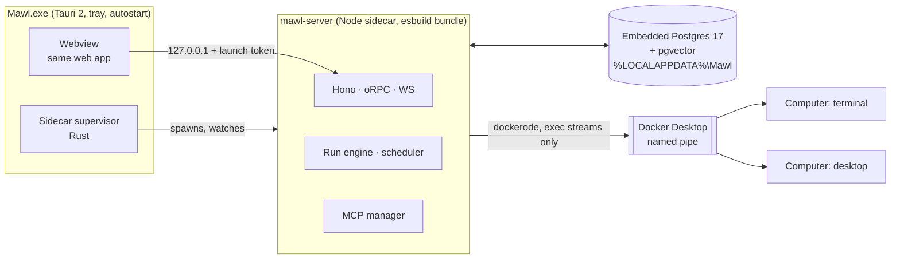

# Mawl — Redesign 2026-10 (desktop-first)

Status: **proposed**, 2026-10-21. Once accepted, SPEC, ARCHITECTURE and PLAN are rewritten to match and this file stays as the decision record (ADR R1–R14). Where this file and the older docs disagree, this file wins.

## 1. Why

Mawl v0 was "a Docker stack first": the user runs `docker compose`, and the apps are thin clients. That is fine for a self-hoster and wrong for a consumer. The new promise:

> Download the installer, open Mawl, chat with a teammate. Install Docker only when you want your teammate to have its own computer.

Owner decisions (2026-10-21): portfolio project, consumer-grade UX; Windows first; the app lives in the tray and starts at login; Docker is the user's install, used only for computers; one agent loop for every provider; schedules are central; remote access and mobile are not v1.

## 2. Target shape

- **Desktop mode (primary).** The Tauri app spawns the server as a sidecar (`externalBin`), and the server spawns Postgres as a child. Closing the window hides it to the tray. "Quit Mawl" stops everything. Autostart at login is on by default (a toggle).
- **Headless mode (alternative).** The same server bundle in Docker (today's compose) or run directly with `mawl-server --headless`, serving the web app. Same code, same tests.
- **Docker is only for computers.** Chat, MCP, web tools, memory and schedules work without Docker. Without Docker, the UI shows a "Give your teammate a computer → install Docker Desktop" card with detection and a retry. It never fails as an error.

## 3. Decisions (ADR)

| # | Decision | Alternatives considered | Supersedes |
|---|---|---|---|
| R1 | The desktop app hosts the server as a sidecar; headless/Docker is the alternative | Server in Docker only (ADR 1: too hard for consumers); in-webview runtime (dies with the window) | ADR 1 |
| R2 | Embedded real Postgres 17 + pgvector, a child process of the server, data under `%LOCALAPPDATA%\Mawl\pg` | PGlite (single-threaded WASM, no real `pg` pool for graphile-worker, forces a job and bus rewrite); SQLite + sqlite-vec (rewrites every P1 query, FTS and vectors); Postgres in Docker (chat would need Docker) | — (keeps ADR 3) |
| R3 | Local auth now: a per-launch random token, handed to the webview by the supervisor, required on every `/rpc` and `/ws` call. Device auth (P6.1 in the old plan) builds on it later | No auth on loopback (any local process could drive agents and read keys) | — |
| R4 | `Computer` is its own entity. A profile has an optional `computerId`; several profiles may share one | Computer = profile (ADR 6, too rigid) | ADR 6 |
| R5 | Two Mawl images on GHCR, pulled, never built on the user's machine: `mawl-computer-terminal` and `mawl-computer-desktop` (builds on terminal). Only Mawl computers are supported, never arbitrary user containers | One heavy image for all; attach any container | — |
| R6 | All server↔computer traffic goes over Docker exec/attach streams: stdio MCP, the helper RPC and the VNC tunnel. No published ports, no container IPs | Published loopback ports (port juggling, a wider surface); container IPs (unreachable from the Windows host) | §6 networking |
| R7 | One agent loop for every provider: our durable step engine (P1.4) drives a minimal ReAct loop | Per-provider loops; adopting the Claude Agent SDK as the loop | — |
| R8 | The system prompt is code: versioned Markdown blocks assembled stable → volatile for caching, with snapshot tests and an eval set | One big prompt string | — |
| R9 | Approvals are engine-level, never prompt-level: a gated call parks the run, and the approved call replays with the exact stored arguments | Asking the model to wait or re-issue the call | — |
| R10 | The Claude plan (`anthropic_claude_code`) stays as a **limited** provider: our tools, policy and prompt through an in-process MCP bridge; documented gaps (§5.6) | Dropping it (loses the subscription path); a second loop | — |
| R11 | Skills follow the Agent Skills `SKILL.md` standard with progressive disclosure; MCP tools are deferred behind a tool search once a profile has many | All tool schemas in every prompt | — |
| R12 | Schedules are first-class: cron/RRULE, intervals, one-shots, natural language with confirmation, a missed-run policy for sleep and shutdown, and receipts | Cron only | — |
| R13 | The trace compiler turns a routine run that passed its receipt into a script with model "holes", and self-heals one broken step at a time. Its own late phase | Re-running the model every time | — |
| R14 | Remote control order: Telegram/Discord (long polling, no inbound networking) → Tailscale for the full app and mobile → own E2E relay as a stretch. A Mawl marketplace comes late | Building our own gateway first | S6 timing |

## 4. Desktop host details

- **Sidecar.** Tauri `externalBin` ships `node.exe` (Node 24) plus `server.mjs`, or a Node SEA single executable (decide in the slice; SEA is preferred if the Claude Agent SDK's external native package still resolves). The supervisor:
  - picks a free loopback port and generates the launch token
  - passes both to the server through env or stdin (never argv, which shows up in process lists)
  - waits for `/healthz`, then points the webview at it
  - restarts the server with backoff (max 5 in 5 min, then an error screen with a "copy diagnostics" button)
- **Watchdog.** The server exits when its parent dies (stdin EOF), so there are no orphaned servers or Postgres.
- **Data.** `%LOCALAPPDATA%\Mawl\{pg,secrets,claude,logs,artifacts}`. The master key moves into Windows Credential Manager via Tauri (a file in `secrets/` stays the headless fallback).
- **Embedded Postgres.** Start on boot with a random port bound to 127.0.0.1, a generated superuser password, `initdb` on first run, and clean shutdown on quit. Upgrades between PG majors are a later problem (pin 17). Binaries, lifecycle and the pgvector build as proven in D0.1 (§10.1).
- **Installer.** Tauri bundler, NSIS per-user install (no admin). Auto-update via the Tauri updater against GitHub Releases. Code signing is optional for a portfolio project (SmartScreen warns without it).
- **First run.** Splash → provider (Continue with ChatGPT first, then an API key, Ollama detection, Claude plan) → name your teammate → done. Docker is offered later, from the teammate's computer card.

## 5. The agent loop

### 5.1 Loop

ReAct on top of the existing durable step engine. Per step: assemble the context → stream the model → persist the step → run tool calls through policy → persist the results → repeat until a step has no tool calls.

Additions:
- **Steering queue.** Messages the user sends during a run go to `run_inbox`. They are injected at the next step boundary as user turns, not into a new run.
- **Follow-up queue.** Background events (a background shell exited, a subagent finished, an approval resolved) enter the same inbox, typed and marked as system notes.
- **Truncated tool calls** (finish reason `length` mid-call) are failed with an explanation, never executed.
- **`finishTurn` hook.** It runs when the model stops calling tools. It can accept, or continue with a note (a receipt failed, a todo is still open). Capped, so it can't loop forever.
- **Fallback models.** A per-profile ordered list. On `temporarily_unavailable` or `plan_limit_reached`, the next step uses the next model, and the run records the switch.
- **Tool idempotency keys** (`run_id`, `step_idx`, `toolCallId`), so crash-resume never repeats a side effect blindly.

### 5.2 Prompt blocks (`packages/core/prompts/`)

Order (stable → volatile; cache breakpoints after 3 and after 6):

1. `identity`: who Mawl teammates are and the voice
2. `rules`: honesty, tool-result-is-data, never kill display or browser processes, ask before irreversible actions, stop conditions
3. `tools`: how to use tools well; the computer block, conditional on the computer kind
4. `persona`: the profile's SOUL
5. `skills-index`: name + one line per skill
6. `memory-core`: pinned memory blocks, frozen per segment
7. `environment`: date and time, timezone, the computer's state, the channel
8. recalled memories (as data), the segment summary, recent turns, input

Each block is a `.md` file with a version header. Snapshot tests check the assembled prompt per configuration (no computer, terminal, desktop; with and without skills). A small eval set (P2) scores real runs on fixed tasks. Mawl writes its own prompts; there is no imported prompt text.

### 5.3 Subagents

`delegate(task, tools?)` runs a child loop inside the parent's turn, with a tiny prompt. It can't talk to the user, can't delegate again, and returns one report. Its budget is carved out of the parent's.

### 5.4 Skills, MCP, plugins

- **Skills.** A `SKILL.md` (frontmatter `name`, `description`) plus optional files. Stored per profile, editable in the UI. The index is in the prompt, `skill_load(name)` returns the body, and scripts run on the profile's computer. Proposed skills go to an approval queue (old S4).
- **MCP.** Remote HTTP/SSE with OAuth (`@ai-sdk/mcp`), and stdio servers inside the computer over exec (R6). Above a threshold (default 30 tools), MCP tools are deferred: the prompt lists server names, and `tool_search(query)` loads matching schemas into the next step.
- **Plugins.** A Mawl plugin bundles skills, MCP server configs, prompt blocks and routine templates. Local import comes first (folder or zip); the Mawl marketplace is a late phase.

### 5.5 Policy and approvals

Unchanged from ARCHITECTURE §5 (levels auto/ask/handoff/block, non-lowerable classes), plus R9: the parked call is stored with its arguments hash, the approval card shows exactly those arguments, and approve replays them byte for byte. Edits create a new call that is approved separately.

### 5.6 Claude plan via Claude Code (limited provider)

Do as much as the unmodified binary allows:
- **Tools.** Our registry is exposed through `createSdkMcpServer`. Every handler goes through policy and records a step, so the audit and the UI look the same as on other providers.
- **Steering.** Use the SDK's streaming-input mode (an async iterable of user messages) to inject inbox messages mid-query (to verify).
- **Approvals.** The MCP handler waits for the decision. Here, unlike elsewhere, the worker stays held while it waits, with a timeout that becomes a denial.
- **Resume.** A crash mid-query restarts the current segment from the last persisted step. Session resume via the SDK may be added if it works with a private config dir (to verify).
- **Shown in the UI** as "Claude plan (limited): no mid-run crash resume; approvals hold a worker".

## 6. Computers

- **Entity.** `computers { id, name, kind: terminal|desktop, image_ref, status, home_volume, created_at }`. `profiles.computer_id` is nullable. Teammate settings offer: no computer, use an existing Mawl computer, or create a new one (terminal or desktop).
- **Terminal image.** Debian slim, bash, git, curl, python3, node, ripgrep, jq, headless Chromium + Playwright MCP, and the `computer-agent` helper. Target under 500 MB.
- **Desktop image.** Terminal + Xvfb, XFCE (minimal), Chromium headed, xdotool, x11vnc. Target under 1.6 GB.
- **Transport (R6).** The helper speaks JSON-RPC over `docker exec -i` stdio. Stdio MCP servers run with `docker exec -i`. VNC is tunnelled by an exec running a tiny TCP-to-stdio bridge inside the container to `localhost:5900`.
- **Sharing.** Shell and files are concurrent. Desktop input (mouse and keyboard) needs a per-computer input lease: the agent takes it per `computer_act` batch, and the user's takeover outranks it.
- **Lifecycle.** Start on demand, suspend after 20 idle minutes, home on a named volume. "Reset computer" recreates the container and keeps the home volume, unless the user chooses "wipe".
- **Docker detection.** Named pipe present? Engine answering? Image pulled? Each state has its own UI copy and action (install link, "start Docker Desktop", pull progress).

## 7. Schedules

- **Triggers.** cron or RRULE with a timezone; interval; one-shot at a time ("remind me in 1h"); natural language → schedule via the helper model, always shown back for confirmation.
- **Missed runs** (laptop asleep or Mawl closed): per-routine `catch_up_once` (default), `skip` or `run_all` (capped at 10), evaluated on boot and on resume-from-sleep (a Tauri power event plus a clock-jump check).
- **Receipts.** A routine can declare its definition of done: a check script on its computer, a helper-model rubric, or "a delivered message exists". A failed receipt marks the run "needs attention" instead of succeeded.
- **Delivery.** In-app plus a Windows notification; Telegram and Discord when connected.
- **Heartbeat.** Kept from SPEC F8, as a special routine.

## 8. Trace compiler (late phase)

1. A routine run that passed its receipt is eligible.
2. Its recorded steps are compiled into a script:
   - browser actions as Playwright locator code (Playwright MCP reports the code it ran; to verify)
   - shell steps as commands
   - judgment steps as **holes**: a typed model call with a narrow prompt, called only when needed (e.g. only when the page diff is non-empty)
3. Later runs execute the script on the computer. The receipt still checks the result.
4. **Self-heal.** On a step failure, the model gets the failing step, its context and the DOM snapshot, proposes a replacement for that step only, the run continues, and the patched script is saved as a new version (with an audit entry and a diff in the UI).
5. After N failed heals, the routine falls back to a full model run and the user is told.

## 9. Impact on P1 (as built)

| Slice | Verdict |
|---|---|
| P1.1 schema, P1.5 bus, P1.6 shell, P1.7 chat | Keep as is |
| P1.2 server | Keep. Add desktop config: data dir, random port, launch token, parent watchdog, embedded PG bootstrap |
| P1.3 providers | Keep. SIWC callback is now on the real host (the Docker `0.0.0.0` bind only matters in headless mode). Ollama default `http://localhost:11434` works directly |
| P1.3b Claude plan | Keep. Rework per §5.6 in the loop phase. Login: the app opens a terminal running `claude auth login` with Mawl's config dir (still Anthropic's own flow) |
| P1.4 run engine | Keep. Extend per §5.1 |
| P1.8 desktop shell | **Re-scope** to the desktop host (§4). The deep-link parser and the Rust scaffold carry over; "server URL setting" becomes an advanced "connect to a remote Mawl" option |
| P1.9 compose | Becomes headless mode. Move the image smoke test out of the default gate into its own task |
| CI | Add a GitHub Actions Windows job: pgvector DLL build, embedded PG test, Tauri NSIS bundle |

## 10. Risks and spikes (do first)

1. **pgvector on Windows. Done (D0.1, 2026-10-21): it works, and R2 holds.**
   - **Binaries.** PostgreSQL 17.10 (MSVC 19.44). The npm `embedded-postgres` / `@embedded-postgres/windows-x64` 17.10.0-beta.17 ship a `postgres.exe` byte-identical to EDB `postgresql-17.10-1-windows-x64-binaries.zip` (SHA256 `F9AAFCA58E7026A1EF2CAEEE711ACF761671E57904D430ADC85F468374F5A821`).
     - The npm package is beta-only with a single maintainer, and has no `include/`, `pg_config` or `postgres.lib`.
     - **Decision:** take the EDB zip directly, pinned by hash. Prune the pgAdmin wxWidgets DLLs (about 13 MB).
   - **Lifecycle: our own thin wrapper (~60 lines), not the library's.**
     - Steps: `initdb --auth=scram-sha-256 --username=mawl --pwfile` (a generated 256-bit password, stored under the data root, never in `%TEMP%`), then spawn `postgres -D … -p <free port> -c listen_addresses=127.0.0.1`, poll with `pg` until it's ready, and stop with `pg_ctl stop -m fast -w`.
     - The library's `stop()` on Windows is `taskkill /f /t`, so every next start runs crash recovery.
     - `pg_ctl start` from Node hangs on inherited handles.
     - Never spawn with `detached: true`: libuv's kill-on-close job object takes Postgres down with a killed server, and WAL recovers on the next start (tested).
     - `pg_ctl` output is localized, so read exit codes only.
   - **pgvector v0.8.7** (`f37c13f6`) from the official tag, against the EDB 17.10-1 headers and `postgres.lib`.
     - Production: MSVC `nmake /F Makefile.win` in a GitHub Actions `windows-2025` job (download + hash the EDB zip, assert the `postgres.exe` hash, build, `installcheck`, upload the artifact and hash it, since the PE timestamp makes it non-reproducible).
     - Local fallback (no MSVC on the dev machine): MinGW gcc with `-DHAVE_X86_64_POPCNTQ -Dpg_strtof=strtof -Wl,--disable-auto-import`. Without these flags the backend crashes on `CREATE EXTENSION`, because the headers branch on `_MSC_VER`. Recipe: [infra/desktop/pgvector/build-vector-mingw.ps1](../infra/desktop/pgvector/build-vector-mingw.ps1). pgvector's own `installcheck`: 14/14 pass.
   - **Checks.**
     - The repo's 6 migrations apply.
     - HNSW `vector_cosine_ops` on 2000 × 384-d: the plan uses the index, top-5 takes about 1 ms, recall@10 is 0.93–0.995 at the default `ef_search`.
     - `halfvec`, `sparsevec` and `bit` work. Bad input errors cleanly and the backend survives.
     - The stop is clean, with no recovery on restart.
     - No firewall or Defender prompt (loopback only).
   - **Numbers.**
     - Cold `initdb`: 17–34 s with fsync, about 4 s with `--no-sync`. **Decision:** `initdb --no-sync` into a staging dir, then rename it into place behind the first-run splash.
     - Warm start 0.3–0.9 s, stop about 0.5 s, migrations about 1.1 s.
     - Binaries 97 MB (37 MB zipped), `vector.dll` 277 KB, a fresh data dir 39 MB.
   - **Risk.** MinGW against MSVC headers is unsupported, so any PG or pgvector bump can add an ABI mismatch. That's why CI uses MSVC, and `--disable-auto-import` turns most mismatches into link errors.
2. **Sidecar packaging.** Node SEA vs a shipped `node.exe`, and whether the Claude Agent SDK's native package resolves from the install dir. Installer size target: under 200 MB without the Claude binary, which is downloaded on first use if the owner picks the Claude plan.
3. **Exec-stream VNC tunnel** latency on Docker Desktop (WSL2 backend).
4. **Sleep and wake detection** reliability on Windows.

## 11. New phase order (to become PLAN.md)

| Phase | Goal |
|---|---|
| D0 Spikes | §10.1 and §10.2 proven, with results written here |
| D1 Desktop host | Installer → tray app → embedded PG → local auth → first-run → chat works with no Docker |
| D2 Agent loop | Prompt blocks, tool registry + built-ins, policy, approvals (R9), queues, `finishTurn`, fallback, subagents, skills, MCP + tool search, Claude plan bridge, eval set |
| D3 Computers | Images, the Computer entity + UI, Docker detection, exec transport, shell/files/browser tools, live view, takeover, credential form |
| D4 Memory | MEMORY.md, unchanged |
| D5 Schedules | Routines, NL parsing, missed runs, receipts, heartbeat, schedule tools, notifications |
| D6 Trace compiler | §8 |
| D7 Telegram & Discord | Long polling, approvals, routines from chat |
| D8 Remote + mobile | Tailscale serve, device pairing, the Expo app |
| D9 Polish & ship | Onboarding polish, mascot, a11y, local plugin import, docs site, release; marketplace after |
